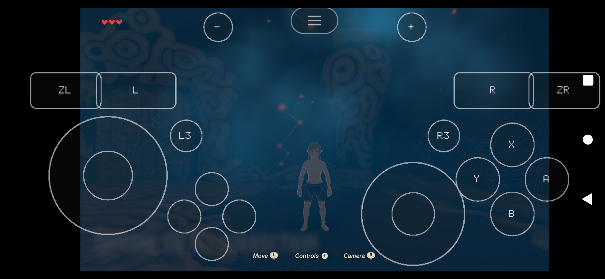
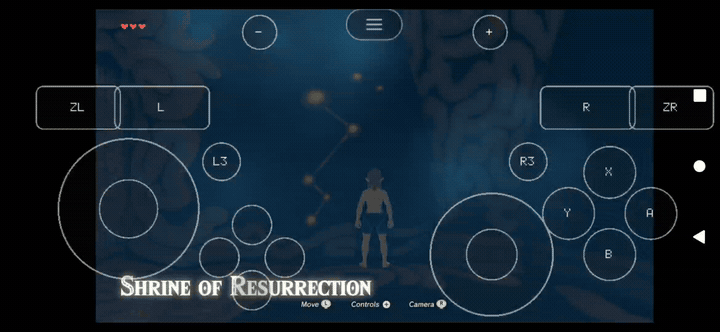
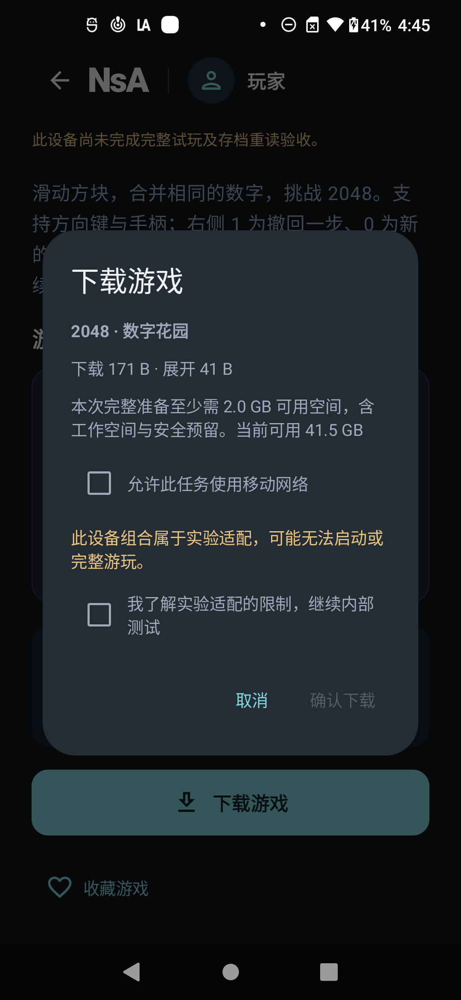
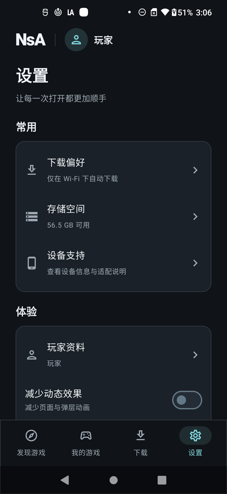
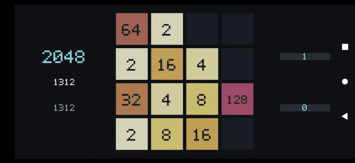
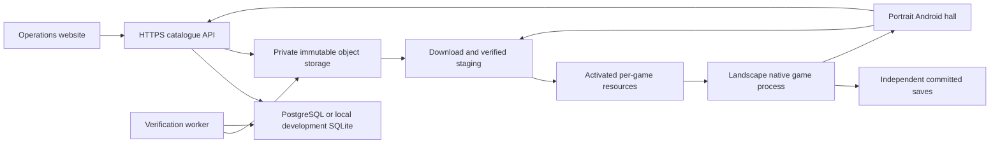

# NsA Core

[简体中文](README.zh-CN.md) · [Documentation](docs/README.md) · [v0.4.0 release notes](docs/releases/v0.4.0.md) · [Releases](https://github.com/wikigsroom/NsA-core/releases)

**One Android app: discover a supported game, download its resources, and play locally.** NsA adds a portrait game hall, content delivery, installation, saves and operations services to the native nx2android/nxnative runtime.

The interface follows the finalized **Obsidian** design: dark surfaces, restrained accents and portrait navigation. A game switches to landscape only when its runtime takes over; leaving it restores the portrait hall.

## Actual gameplay on a physical phone





[Gameplay MP4](docs/media/botw-input.mp4) · [Capture provenance](docs/media/botw-input.json) · [Full screenshot and recording index](docs/media/README.md)

These are real USB captures from a Motorola edge plus, Android 12, Snapdragon 865 / Adreno 650. BotW is an **experimental local integration**: actual scene loading, touch movement, a new manual save and fresh-process reload have been observed. The short shrine measurements were approximately 7–13 FPS; this is not sustained playability acceptance. Exact APK identities and the boundaries of each observation are recorded beside the media. Clips are silent.

<table>
<tr><td></td><td></td><td></td></tr>
<tr><td>Portrait library</td><td>Download confirmation</td><td>Settings</td></tr>
</table>



[2048 MP4](docs/media/session-play.mp4) · [Reloaded board](docs/media/session-reloaded.png) · [Media identities and historical captures](docs/media/README.md)

## What this release contains

**v0.4.0 is a formal GitHub release of the source and desktop authoring tools.** Download the Windows or macOS archive, or check out the tagged source. The archives include both README languages, the full documentation and reviewed screenshots/GIFs. `SHA256SUMS.txt` and `release-manifest.json` identify the actual assets and source commit.

| Deliverable | Purpose | Prerequisites |
|---|---|---|
| Tagged source | Build and operate the unified Android hall and services | Native Android toolchain, Python and a configured catalogue |
| Windows x64 bundle | Desktop GUI/CLI for preparing supported native ports | Windows, tool downloads, your own required game inputs |
| macOS bundle | Desktop GUI/CLI; architecture is in the asset name | Matching macOS architecture and tool downloads |
| Reviewed media | See the actual hall and phone gameplay | Any image/video viewer |
| Internal two-game APK | Retained locally for USB integration tests | Local credentials and private game modules; **not a public release attachment** |

There is no hosted public game catalogue or ready-to-install public hall APK in this release. The documented local setup builds the open-source 2048 profile without commercial game inputs. An operator must deploy a real service, configure signing/trust and prepare approved content before offering the target player flow to general users. Source publication does not include game programs, keys, personal saves or the internal APK.

## Player experience

1. **Install and open the configured app.** Complete the welcome page. The hall remains portrait.
2. **Find a game.** Browse Discovery, search, filter by genre or inspect the local library. Compatibility is evaluated for this device and APK, including its compiled slots.
3. **Read the detail page.** Check the download size, preparation space, language, controls and compatibility. Experimental access requires an appropriate entitlement and explicit confirmation.
4. **Download.** Confirm the task. The download centre shows progress, speed, estimated time and its actual state. Pause/resume/retry/cancel affect the persisted task.
5. **Prepare resources.** The client checks signatures, blocks, archive hashes and every indexed file before activating the installation.
6. **Play.** Tap Play/Continue after preparation. A fresh native game process opens in landscape; no second app is launched.
7. **Save and return.** Save inside the game, press Back, then confirm return to the hall. Reopening starts a fresh process and reads the game's committed save.
8. **Manage the library.** Export/import backups, repair resources, change per-game options or remove resources while retaining saves by default.

The current app UI is Simplified Chinese. This repository's entry points and operating guides are bilingual; English documentation does not imply a fully localized English app.

## Functional scope

| Area | Implementation |
|---|---|
| Hall | Welcome, discovery/search/filtering, details, library, download centre, settings, device/storage/help and game management |
| Transfers | Single active queue, persistent intent, verified 8 MiB checkpoints, Range/ETag checks, scoped URL renewal and shared failure budget |
| Installation | Signed manifests, ZIP64 streaming, file indexes, path/link/collision rejection, staging and journal-backed activation/recovery |
| Runtime | Compiled native slots, exact ELF/registry identity checks, distinct SONAMEs, authenticated session/generation/nonce handshake, fresh `:game` process |
| Lifecycle | Application-owned coordinator, pause/exit, Surface/input restoration, protected recovery and conservative stopped-session reconciliation |
| Saves | Per-game committed directories, versioned hashed exports, import validation, pre-swap backup and recoverable swap journals |
| Updates | Separate app/content updates, compatible save rules, previous-install retention and healthy-version rollback rules |
| Services | Catalogue, installation credentials, compatibility, immutable objects, publication, worker verification, policies and feedback |
| Staff website | Metadata, rights/build/release records, uploads, independent review, evidence, feedback, roles and audit |
| Engineering | Native Windows tooling, USB verification, structured contracts, requirement tracing and capture provenance |

Implementation and formal acceptance are tracked separately in the [verification record](docs/hall/implementation-status.md) and [90-requirement map](docs/hall/requirement-coverage.md).

## Architecture and execution model



The main process owns Compose, Room, transfers, installation and save management. Each session uses a fresh `:game` process. A compiled slot identifies its game modules, profile, shader chain, permitted drivers and native-library digest. The catalogue delivers resources; adding a new native slot requires an APK update.

This is local native execution. Switch system services and graphics are adapted by the host; a phone does not decrypt or compile arbitrary new games when the user taps Download. Every offered game must be prepared, integrated and checked beforehand.

The API and worker run as separate services. Local development uses SQLite and filesystem object storage. Production providers use PostgreSQL, private S3-compatible storage and OIDC. The staff website is separate from the player app.

## Build the open-source local demo

Use native Windows and a USB-connected physical Android device. All new tools, caches and outputs stay inside this checkout under `游戏移植/`. No Docker, WSL, virtual machine or emulator is used.

Prerequisites: Git, Python 3.13, Java 21, Android SDK 36 / build-tools 36.0.0, NDK r27c (`27.2.12479018`), and an arm64 Android 12+ device. Set `NSA_SDK_SOURCE` / `NSA_NDK_SOURCE` when these are installed elsewhere. The setup copies required components into the project tool directory.

```powershell
git clone git@github.com:wikigsroom/NsA-core.git
Set-Location NsA-core
./devtools/hall_bootstrap.ps1
./devtools/hall.ps1 native
./devtools/hall.ps1 build
```

Run the catalogue and verification worker in separate terminals:

```powershell
./devtools/hall.ps1 serve
```

```powershell
./devtools/hall.ps1 worker
```

Then prepare, publish and install the original open-source 2048 demo:

```powershell
./devtools/hall.ps1 content
./devtools/hall.ps1 publish-2048
./devtools/hall.ps1 install
```

Unlock the phone and authorize USB debugging. The installer connects the phone's localhost port to the computer with ADB reverse. Keep API/worker running while fetching content. Select the experimental filter when using the invited internal development catalogue. Development credentials stay under ignored `services/local/` and must not be shared.

Do not regenerate runtime identities for an already published immutable release. Source/profile changes require newly compiled identities and a new content release ID. See the [development guide](docs/development.md) for prerequisites, repeat builds, private BotW integration and complete checks.

## Storage and device support

| Item | Measured or required scope |
|---|---|
| Open-source 2048 | Tiny separate content package; no Switch files or keys required |
| Internal two-game APK | About 78.4 MiB; contains private compiled game code, so retained locally |
| BotW archive | 14.300 GiB, with 14.292 GiB indexed expanded content |
| Initial BotW phone preparation | About **30.592 GiB additional free space**, including a 2 GiB reserve; installed resources about 14.39 GiB |
| Development material | Source inputs, extracted data, compiled output, service copies and toolchains consume separate space |

General additional space: `max(archive − downloaded, 0) + max(expanded − installed, 0) + working + max(2 GiB, ceil(expanded × 5%))`. Updates also retain the previous version and required backups. See [measured storage](docs/hall/storage.md).

The hall targets Android API 31+, arm64-v8a. The tested phone has 4096-byte pages. Individual Switch integrations additionally depend on graphics features, driver and game profile; upstream results on another device do not verify this phone. Mali/PowerVR and 16 KiB-page devices are not accepted by this local record.

## Verification and known limits

| Evidence | Actual scope |
|---|---|
| Recovery candidate | Android source `5c1bff0`; APK `3bd6c8…3451d`; native libraries reused exactly from `d427f08` |
| Computer checks | Build/package guard passed; 26 JVM cases freshly passed; lint 0 errors / 16 warnings |
| USB instrumentation | All 22 cases passed, including nine Room/kernel-lock recovery cases; all 22 preexisting player files unchanged after overlay/tests |
| Original 2048 | Actual input, changed save, normal portrait return and byte/16-tile-identical fresh-process reload |
| BotW | Experimental actual input, new manual save and reload; exact per-candidate details in the execution record |
| Previous switching batch | Five A → B → A rounds on the preceding `5808f5…6d06` APK; evidence is not relabeled as a newer build |
| Open gates | Full G0, controlled live-main-loss recovery, representative 30-minute performance/game speed/temperature, subjective/BotW sound, physical power-loss/ENOSPC and broader device coverage |

A GitHub release records a software version; the open gameplay and production gates remain visible. The source regression cases do not prove every physical recovery timing. Do not describe BotW as verified/playable or infer audio quality from silent GIFs.

## Documentation by role

| Start here | Details |
|---|---|
| [Documentation index](docs/README.md) | Complete bilingual reading paths |
| [Player/operating guide](docs/hall/README.md) | All player actions, states, saves, failures and recovery |
| [Development guide](docs/development.md) | Build, service startup, content preparation, testing and adding games |
| [Deployment guide](docs/deployment.md) | Production configuration, signing/trust, identity, storage and maintenance |
| [Media index](docs/media/README.md) | Real phone screenshots, game GIF/MP4, desktop captures and provenance |
| [v0.4.0 release notes](docs/releases/v0.4.0.md) | Contents, changes, upgrade path, validation and limits |
| [Product baseline](docs/product/README.md) | 90 requirements, 360 detailed rules and page/acceptance definitions |
| [Engineering constraints](docs/engineering/README.md) | Architecture, contracts, runtime/install/save/release rules |
| [Finalized design](docs/design/obsidian-portrait/README.md) | Portrait Obsidian design, screens, components and prototype |
| [Implementation evidence](docs/hall/implementation-status.md) | Results pinned to actual source/APK snapshots |

## Troubleshooting

| Symptom | Action |
|---|---|
| Empty development catalogue | Check API/worker, device entitlement, filter and published release; cached empty results are not proof of support |
| Cannot reach localhost | Keep USB connected; check authorization and `adb reverse tcp:8443 tcp:8443`; use the matching local debug CA |
| App update required | The APK lacks the matching compiled slot/profile; downloading more resources cannot repair it |
| Download waits | Inspect network consent, explicit pause, active game and remaining storage; resume deliberately when required |
| Resource verification fails | Keep the error, repair or redownload the matching immutable release; preserve saves |
| Session protection remains | Use retry/confirmed process exit as offered; unknown ownership must keep player data protected |
| APK signature differs | Use the same application identity and signing key; uninstalling can delete private progress |
| Black screen/low speed | Record exact APK/content/driver/device and filtered diagnostics; do not promote the title to verified |

## Repository and attribution

Updates are published to [wikigsroom/NsA-core](https://github.com/wikigsroom/NsA-core), branch `main`. The root README files now describe NsA; the old upstream game list and standalone README text have been removed. The original standalone workflow remains available through the desktop tool and [upstream documentation](https://github.com/shirai91/nx2android).

The native runtime comes from [nx2android](https://github.com/shirai91/nx2android) and [nxnative](https://github.com/seedds/nxnative). Preserve their [MIT license](nxnative/LICENSE) and third-party notices. The original native 2048 has its own [MIT license](android/native-games/2048/LICENSE). Game names and captured game imagery belong to their respective owners; the public source and tool archives contain no commercial game programs, private keys or player saves.
