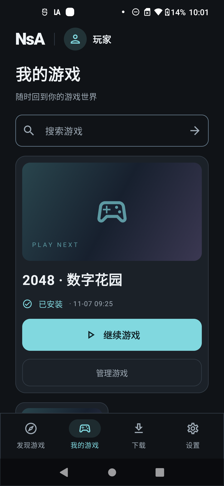
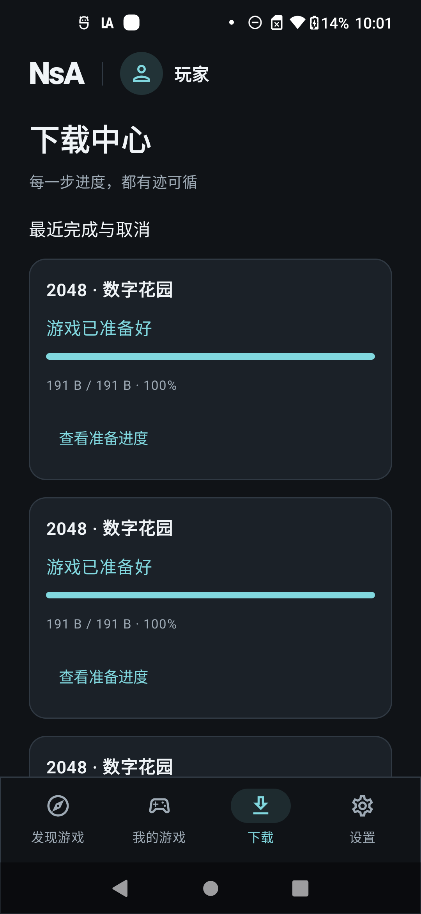
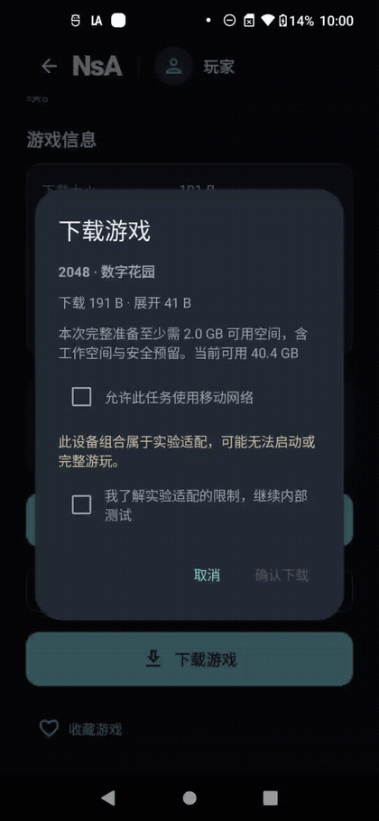
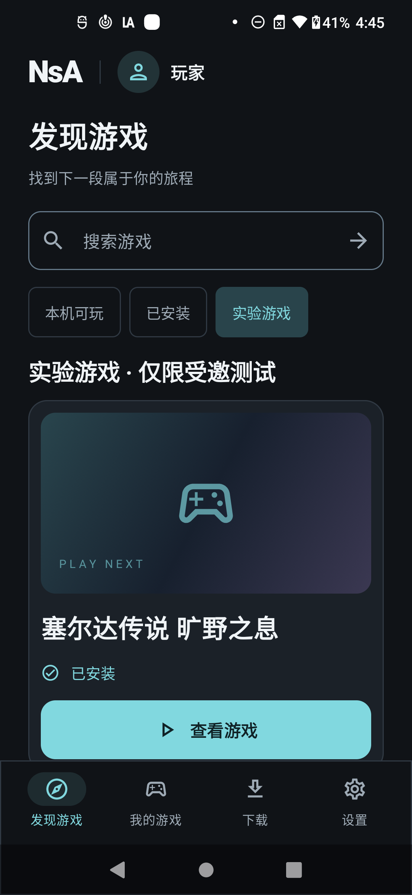
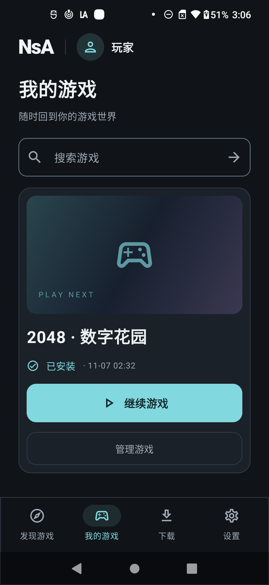
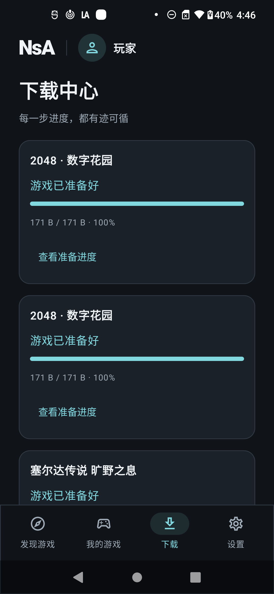
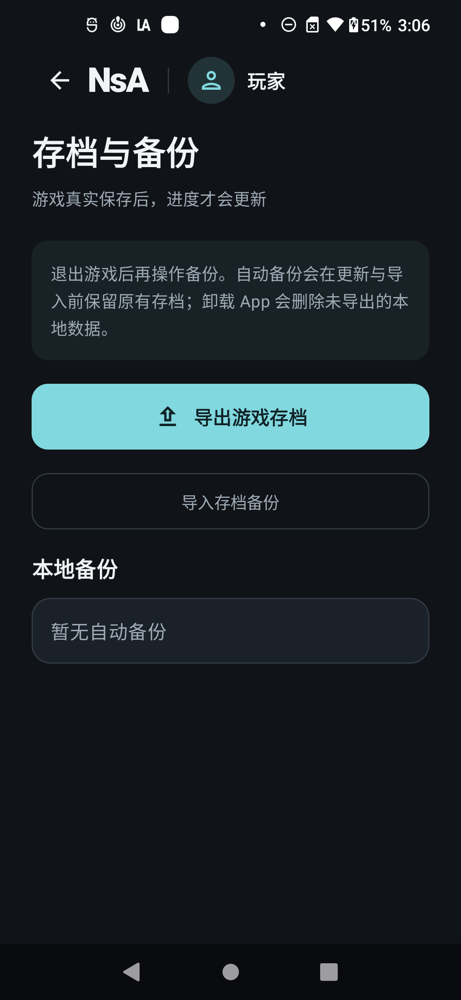
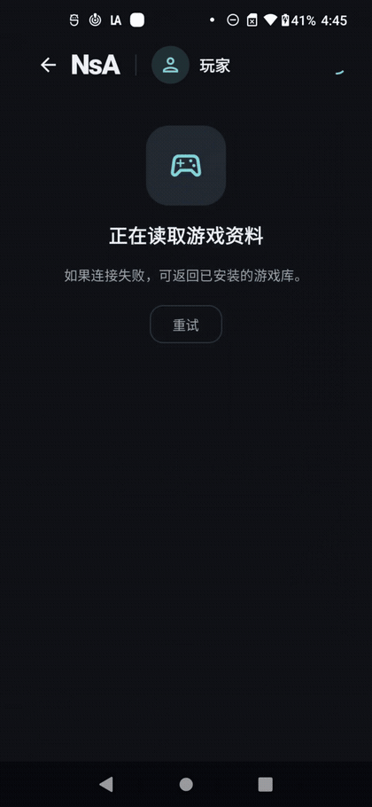
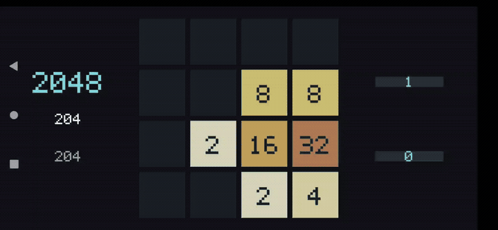

# NsA · Unified Android game hall

The [USB runtime correction round](docs/hall/runtime-round-2026-11-07.md) is installed on the physical phone: source `f1c68f7`, APK `d8c51a…79af`. Thirteen Android tests passed. 2048 v3 completes real download, input, normal Back exit and fresh-process reload; the corrected two-capture 440 Hz audio test also passed. **BotW is blocked before gameplay by a stale compiled core (`MODULE_MISMATCH`).** The [native-build correction](docs/hall/native-build-round-2026-11-07.md) adds Unicode dependency and compiled-identity checks before rebuilding. Five cross-game rounds, full G0, sustained performance and production release remain open.

Current USB captures; clips are silent. Historical captures retain their original identities.

<table><tr><td></td><td></td></tr></table>



[Hall MP4](docs/media/runtime-hall.mp4) · [2048 GIF](docs/media/runtime-2048.gif) · [2048 MP4](docs/media/runtime-2048.mp4) · [Reloaded board](docs/media/runtime-reloaded.png) · [Provenance](docs/media/README.md)

The earlier [transfer round](docs/hall/transfer-round-2026-11-07.md) and [recovery round](docs/hall/recovery-round-2026-11-07.md) retain their original evidence. BotW new-save/reload results on the earlier APK do not transfer to this candidate.

[简体中文](README.zh-CN.md) · [Detailed setup and usage](docs/hall/README.md) · [Implementation status](docs/hall/implementation-status.md) · [Product requirements](docs/product/README.md) · [Engineering baseline](docs/engineering/README.md)

**One installed app: discover → download → verify and install → play in landscape → save and return to the portrait hall.**

This fork builds a unified Kotlin/Compose Android hall on [nx2android](https://github.com/shirai91/nx2android) and [nxnative](https://github.com/seedds/nxnative). The finalized D Obsidian design uses a dark portrait interface with Discovery, Library, Downloads and Settings. A separate operations site handles content rights, builds, uploads, independent review, publication, compatibility evidence and audit.

**Current state: runtime candidate `d8c51a…79af` is installed.** See the [current execution record](docs/hall/runtime-round-2026-11-07.md) for results and pending checks. Earlier gallery artifacts retain their original APK identities.

The [historical targeted source review](docs/hall/source-review.md) records the policy, reconstruction and save-exchange defects that led to this correction batch. Its pinned evidence remains unchanged; source changes and host passes do not close the physical-device acceptance gates. It covers three requirements; the broader source map and existing media are not full acceptance.

| Layer | Concrete behavior |
|---|---|
| Android hall | Cached catalogue, search/filter/detail, installed library, queue, storage, saves, settings, feedback and app updates |
| Transfer/install | Persisted per-game ownership, FIFO, checked 8 MiB ranges, ZIP64 extraction and journal-backed publication/cleanup; isolated fault tests passed, physical power-loss cases remain open. |
| Runtime | Explicit compiled slots, unique SONAMEs, ABI identity binding, one fresh `:game` process per session, actual save events |
| Services | FastAPI, verification worker, PostgreSQL/private S3 production providers, explicit SQLite/private-directory development providers |
| Operations | OIDC/PKCE, server roles, idempotency, revision checks, independent reviewers and audit |
| Tooling | Native Windows setup/build/publication, USB-only install/capture, bilingual documentation |

Historical Android gallery (the app interface currently uses Simplified Chinese; exact source APKs are in the neighboring provenance records):

<table>
<tr><td>Discovery</td><td>Library</td><td>Downloads</td></tr>
<tr><td></td><td></td><td></td></tr>
<tr><td>Settings</td><td>Saves and backups</td><td>Download confirmation</td></tr>
<tr><td></td><td></td><td></td></tr>
</table>

<details>
<summary>Actual download walkthrough, native game input, recordings and provenance</summary>





[Hall MP4](docs/media/hall-walkthrough.mp4) · [2048 MP4](docs/media/native-2048.mp4) · [16 Android screenshots, 3 desktop screenshots and provenance](docs/media/README.md). These silent captures show the 171-byte open-source demo download and short real game input. Each artifact records its own APK identity; the gallery includes a preceding build with identical Android/service source. See the [verification record](docs/hall/implementation-status.md) and [next device-validation procedure](docs/hall/device-validation.md).

</details>

```powershell
./devtools/hall_bootstrap.ps1
./devtools/hall.ps1 native
./devtools/hall.ps1 build
```

The default bootstrap prepares the original open-source 2048 slot without private game inputs. Git, Python 3.13, Java 21, SDK 36 and NDK r27c are prerequisites. See the [full guide](docs/hall/README.md) for service startup, TLS, content publication, device installation, recovery, production configuration and checks. Existing local BotW inputs are an explicit `-WithBotw` profile. No game files, keys, private APKs or saves are included; 2048 is not Switch compatibility evidence.

New tools, caches, credentials, outputs and game material remain under `游戏移植/`. No Docker, WSL, virtual machine or Android emulator is used. Capture screenshots/video from the physical device; review provenance and private content before publishing README media. Design-prototype screenshots are not app runtime evidence.

The update destination is [wikigsroom/NsA-core, main branch](https://github.com/wikigsroom/NsA-core/tree/main). Subsequent code, documentation and reviewed media are synchronized to `main`, preserving existing remote changes. Upstream attribution and the original standalone port instructions are retained below.

For the complete solution, follow the [architecture and usage guide](docs/hall/README.md), [Chinese guide](docs/hall/README.zh-CN.md), [requirements](docs/product/README.md), [90-item source and acceptance map](docs/hall/requirement-coverage.md), [engineering constraints](docs/engineering/README.md), [design baseline](docs/design/obsidian-portrait/README.md) and [implementation decisions](docs/engineering/decisions/0005-client-guardrails-and-cache.md). Production service deployment, distribution signing and accepted game/device combinations are separate release gates.

---

## Retained upstream standalone porter documentation

The game list and porting instructions in this section describe the original
per-game APK workflow. The unified hall has its own published catalogue and
[device verification record](docs/hall/implementation-status.md).

<h1 align="center">
  <picture>
    <source media="(prefers-color-scheme: dark)" srcset="docs/images/logo-dark.svg">
    
  </picture>
</h1>

Port your own Nintendo Switch games to Android, natively: the game's own arm64 code runs on the device, with the Switch's system services stood in for by a host and NVN graphics replayed on Vulkan. Pick the game's folder, click **Port**, and get an APK plus the game's data, installed on your device if you like. Bring your own game files and keys; nothing from any game is in this repository.

This is the Android port of [nxnative](https://github.com/seedds/nxnative), which does the same on iPhone and iPad. Supported games: [Games](#games).

## Games

These games play on Android. Tested on a Lenovo Legion Y700 (Snapdragon 8 Elite, Adreno 830), unless a game names another device. The device's GPU must read BC-compressed textures (Adreno, Xclipse; not Mali or PowerVR).

| | |
|:---:|:---:|
| <br>13 Sentinels: Aegis Rim<br><sub>`v0.1.3` · update 1.10 · 60 fps</sub> | <br>Advance Wars 1+2: Re-Boot Camp<br><sub>`v0.1.3` · base game 1.0.0 · 60 fps (30 in battle on Switch)</sub> |
| <br>Blasphemous 2<br><sub>`v0.1.3` · update 1.0.8 · 60 fps</sub> | <br>Captain Toad: Treasure Tracker<br><sub>`v0.1.3` · update 1.4.2 · 60 fps</sub> |
| <br>Castlevania: Belmont's Curse<br><sub>`v0.2.0` · update 1.1.0 · 60 fps</sub> | <br>Celeste<br><sub>`v0.1.3` · update 1.4.1.1 · 60 fps</sub> |
| <br>Dark Souls: Remastered<br><sub>`v0.4.0` · update 1.0.3 · 30 fps</sub> | <br>Donkey Kong Country Returns HD<br><sub>`v0.1.3` · update 1.1.0 · 60 fps</sub> |
| <br>Final Fantasy Resonance<br><sub>`v0.4.0` · update 1.0.1 · 60 fps</sub> | <br>Football Manager 26 Touch<br><sub>`v0.4.0` · update 1.0.2 · 30 fps (as on Switch) · played by touch · **match view not tested yet**</sub> |
| <br>Graveyard Keeper 2<br><sub>`v0.1.2` · update 1.0.4 · 60 fps (30 on Switch)</sub> | <br>Hades II<br><sub>`v0.1.2` · update 1.0 · 60 fps</sub> |
| <br>Hollow Knight: Silksong<br><sub>`v0.1.3` · update 1.0.30000 · 60 fps</sub> | <br>Lonely Mountains: Downhill<br><sub>`v0.3.0` · base game 1.0.5 · 60 fps on Retroid Pocket 6 with PurpleVK · **work in progress**: brief transition glitch and occasional black/white flashes</sub> |
| <br>Mario vs. Donkey Kong<br><sub>`v0.1.3` · update 1.0.1 · 60 fps</sub> | <br>Metroid Dread<br><sub>`v0.3.0` · update 2.1.0 · 60 fps</sub> |
| <br>NEO: The World Ends with You<br><sub>`v0.1.2` · update 1.03</sub> | <br>Paper Mario: The Origami King<br><sub>`v0.2.0` · update 1.0.1 · 60 fps (30 on Switch)</sub> |
| <br>Paper Mario: The Thousand-Year Door<br><sub>`v0.2.0` · update 1.0.1 · 60 fps (30 on Switch) · **work in progress**: playable, but lighting flickers (walls go black for single frames after a fall)</sub> | <br>Pokémon Legends: Arceus<br><sub>`v0.2.0` · update 1.1.1 · 60 fps (30 on Switch)</sub> |
| <br>Pokémon Legends: Z-A<br><sub>`v0.3.0` · update 2.0.2 · 30 fps (as on Switch) · **tested to Lumiose station**: the city and battles not checked yet</sub> | <br>South Park: The Stick of Truth<br><sub>`v0.3.1` · base game 1.0.0 · 30 fps · a Vulkan 1.3 driver is needed (Turnip packed on the Adreno 640)</sub> |
| <br>Super Mario Bros. Wonder<br><sub>`v0.1.3` · update 1.2.1 · 60 fps, dips to 40</sub> | <br>Super Mario Odyssey<br><sub>`v0.2.0` · update 1.4.1 · 60 fps · shake the device to throw Cappy</sub> |
| <br>Tales of Eternia Remastered<br><sub>`v0.1.2` · update 2.0.0 · 60 fps</sub> | <br>The Legend of Zelda: Tears of the Kingdom<br><sub>`v0.3.0` · update 1.4.3 · 30 fps, 60 in caves and shrines · smoothest with a Turnip Vulkan driver · **work in progress**: 60 fps in the open world</sub> |
| <br>The World Ends with You -Final Remix-<br><sub>`v0.4.0` · base game 1.0.0 · 60 fps · played by touch</sub> | ![UNDER NIGHT IN-BIRTH Exe:Late[cl-r]](docs/images/under-night-in-birth-exe-late-cl-r.jpg)<br>UNDER NIGHT IN-BIRTH Exe:Late[cl-r]<br><sub>`v0.2.0` · update 1.0.3 · 60 fps</sub> |
| <br>UNDER NIGHT IN-BIRTH II Sys:Celes<br><sub>`v0.2.0` · update 1.42 · 60 fps</sub> | <br>Unicorn Overlord<br><sub>`v0.1.3` · update 1.05 · 60 fps · **boots**: saving and a full battle not tested yet</sub> |
| <br>Unpacking<br><sub>`v0.1.2` · update 2.01 · 60 fps · played by touch</sub> | <br>Untitled Goose Game<br><sub>`v0.4.0` · update 1.1.2 · 60 fps</sub> |
| <br>Viractal: Will You Trust Your Party?<br><sub>`v0.1.0` · update 1.4.5</sub> | <br>Xenoblade Chronicles 3<br><sub>`v0.1.0` · update 2.2.0 · 30 fps · **work in progress**: some effects and models don't draw yet</sub> |

The tag (`v0.1.3`) is the latest nx2android version the game was tested on. Older games are not tested again for each release: if a later version breaks one, a patch release fixes it. A tag newer than the [latest release](https://github.com/shirai91/nx2android/releases/latest) is the next release, and the game needs the development checkout until it ships.

A game that is not in this table is not supported yet. The games we look at next, and the ones done: [docs/PORT_CHECKLIST.md](docs/PORT_CHECKLIST.md).

## For players: port a game without programming

1. Download `nx2android-<version>-windows-x64.zip` (Windows) or `nx2android-<version>-macos-arm64.zip` (Mac with Apple silicon) from [Releases](https://github.com/shirai91/nx2android/releases/latest), unzip it and start **nx2android** (on a Mac, see [packaging/INSTALL.md](packaging/INSTALL.md#1-start-the-app) first).
2. **Setup** tab: click **Download missing tools** (the Android NDK, the .NET SDK and platform-tools, about 1 GB, from Google and Microsoft), then set your **prod.keys**. Every line turns green.
3. **Port** tab: choose the folder with the game's NSP, XCI, NSZ or XCZ files (base game, update, DLC) and click **Port**.
4. Tick **Install on the device when done** with the device plugged in and USB debugging on, or copy the APK and the data folder yourself.

Pokémon Legends: Arceus and Pokémon Legends: Z-A need the device during the port, even without **Install on the device when done**: their shaders are in Oodle-compressed archives, which the port decodes with the game's own decoder on the device. Have platform-tools (adb) from step 2, and plug in the device with USB debugging on before you click **Port**.

A game played by touch: tick **Touch game** on the Port tab (`--touch`). The on-screen gamepad then starts hidden and every touch but one on the menu button goes to the game; the pause menu shows the gamepad again.

Chinese or Korean text drawn as `???`: choose a TrueType font with those characters as **System font** on the Port tab (`--shared-font`, a single `.ttf`, not a `.ttc`). It goes in the data pack; the tool ships none. The tool's own text entry panel still shows only ASCII, so its title stays `???` and names are typed in ASCII.

A game slowed by its draw calls in busy scenes: tick **Multithread replay** on the Port tab (`--mt-replay`). The game's Vulkan commands are then recorded on a thread of their own. It stays on until you port the game again without it.

To arrange the on-screen controls, open the pause menu's **Gamepad** tab and choose **Edit layout**: drag a control to move it, pinch or use **− / +** to resize it. **Save** keeps the layout for the next launch and **Cancel** discards your edits. **Snap to grid** (off at first, and remembered) shows a square grid and snaps each control's center to it as you drag.

For the experimental external-screen controller, port from the command line with `--external-display`. The game moves to a connected display and the phone shows the gamepad; the sound menu selects the phone or an external output. This option requires `javac` and an Android SDK with a platform and build-tools (`ANDROID_HOME`). Android 12 or newer uses the saved native layout; Android 10–11 use the fallback controller. Support varies by device and game.

Already have the game on the device for an emulator? The app can read the game's files (its RomFS, most of its size) from that dump's folder instead of a second copy: type the dump's RomFS folder in the app's **RomFS on the device** field (or give it to `--romfs-at`) before you install, which must be the same game version as the port. [packaging/INSTALL.md](packaging/INSTALL.md#the-game-is-already-on-the-device) says how.

A game that crashes with "AllocateAddressRegion … refused (0x1803)" in its log needs more address space: port it again with a larger **Extra address space** on the Port tab (`--alias-headroom` on the command line). [packaging/INSTALL.md](packaging/INSTALL.md#when-something-goes-wrong) says more.

The step-by-step guide is [packaging/INSTALL.md](packaging/INSTALL.md). You need your own game files and `prod.keys`, dumped from your own Switch; the tool never ships or downloads either. NSZ and XCZ files are decompressed during the port (into the build folder's `tmp/`, deleted once extracted).

## Saves

The game's pause menu (Game tab) has **Export save** and **Import save**: an export is a folder in `Android/data/<package>/files/saves/` on the device, the save's files as a console's save tools copy them, so a save from a console imports the same way. The app's **Saves** tab moves them between the device and the PC.

An import replaces the save the game has; the app exports that one first on the device (a folder ending `-before-import`). Uninstalling the app deletes its saves and its exports: copy them to the PC first.

## For developers

Running from the repository, the command line, the repository layout, building the bundle, tests and commit messages: [docs/DEVELOPMENT_GUIDE.md](docs/DEVELOPMENT_GUIDE.md). How it is put together: [docs/ARCHITECTURE.md](docs/ARCHITECTURE.md).

## Keys and game files

nx2android decrypts your game files with your `prod.keys` while it ports them, as Switch emulators do. This repository and its releases contain no keys, no game files and nothing extracted from them, and the tool never downloads either. Dump both from your own Switch, and don't share them or the APKs and data packs built from them.

Nintendo's takedown notices so far have gone to whoever hosts a project (13 Switch emulator repositories on GitHub in February 2026), not to players. Whether decrypting your own games for your own use is allowed depends on where you live.

## License

MIT, as nxnative (see `nxnative/LICENSE`). Third-party code keeps its own license.
