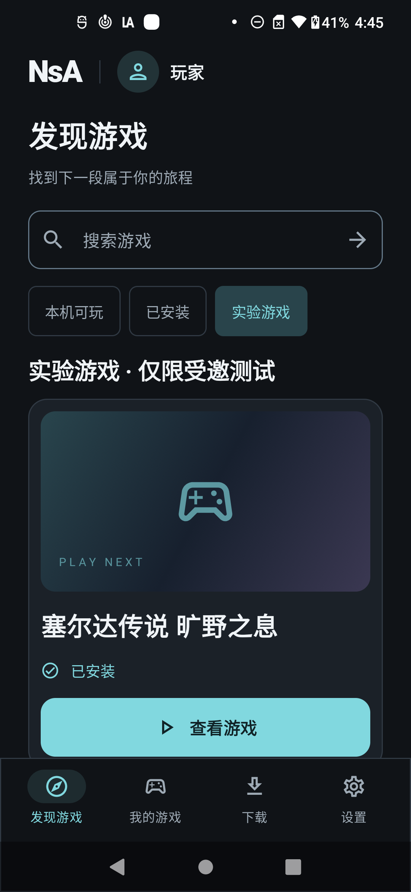
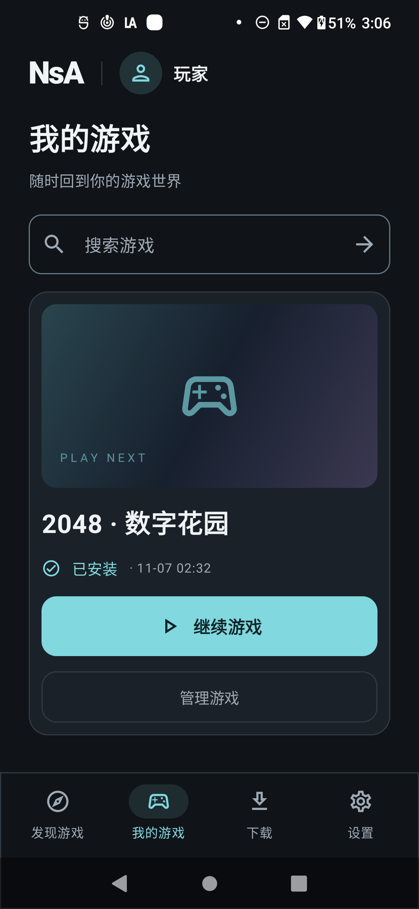
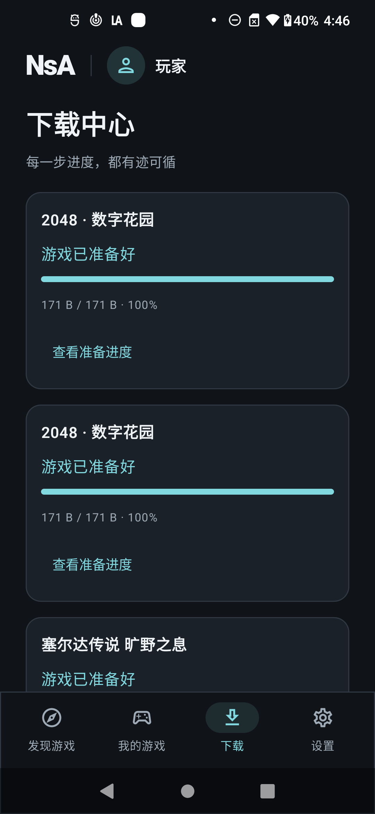
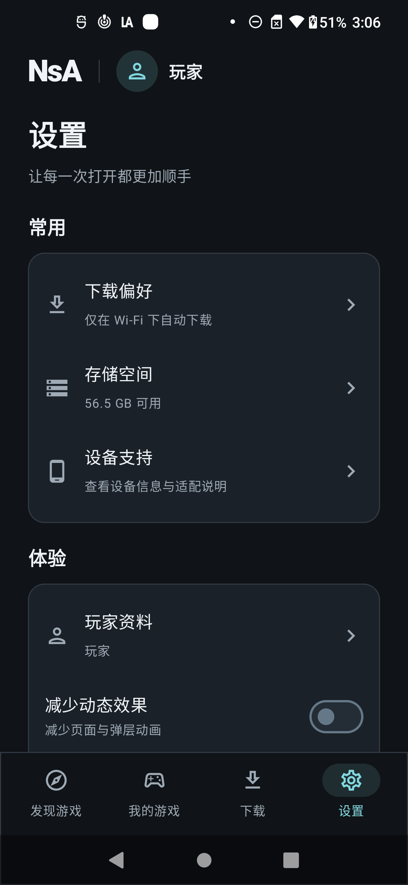
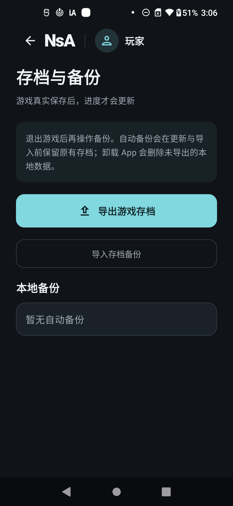
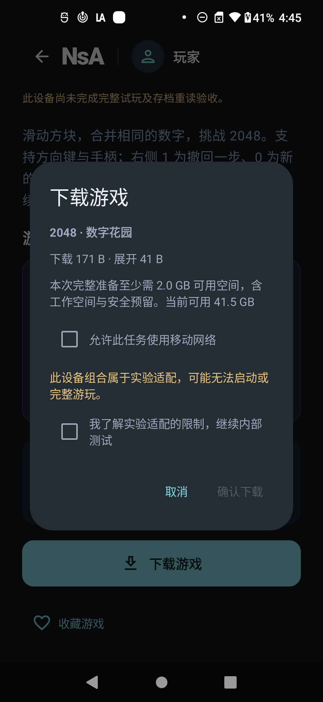
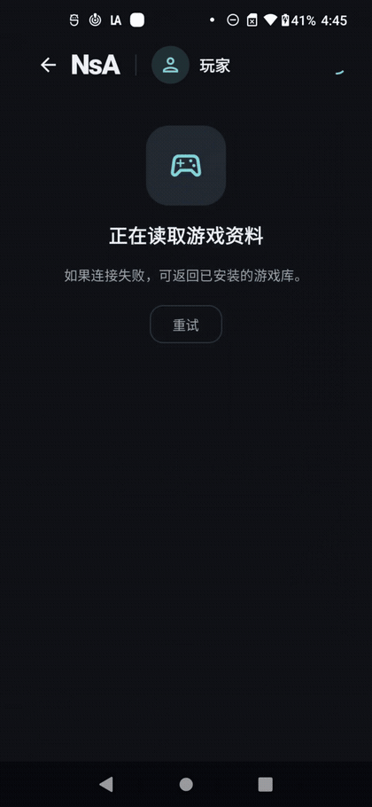
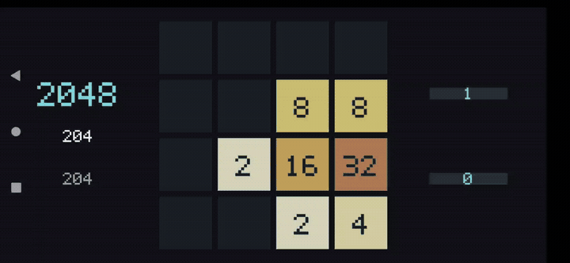

# NsA · Android 统一游戏大厅

新增[恢复与存档修正轮次](docs/hall/recovery-round-2026-11-07.md)，整批落实策略防回退、进程归属恢复与存档交换保护。新源码的构建、测试和安装状态单独记录，不沿用下方历史 APK 和素材的验收结果；继续保留其他项目的手机测试。

后续代码、文档及已审核素材统一更新到 [wikigsroom/NsA-core 的 main 分支](https://github.com/wikigsroom/NsA-core/tree/main)，保留远端已有更新，不强制覆盖历史。

[English](README.md) · [完整方案与使用说明](docs/hall/README.zh-CN.md) · [产品需求](docs/product/README.md) · [技术约束](docs/engineering/README.md)

一个 App：发现游戏 → 查看适配与空间 → 下载 → 校验与安装 → 横屏游玩 → 保存并退出 → 回到竖屏大厅。

基于 [nx2android](https://github.com/shirai91/nx2android) 与 [nxnative](https://github.com/seedds/nxnative) 开发。新增 Kotlin/Compose 大厅、独立游戏进程、内容目录与发布服务，沿用已定稿的 D「曜黑极简」设计。源码更新目标是 [wikigsroom/NsA-core](https://github.com/wikigsroom/NsA-core)。

**当前已构建新的恢复修正候选，尚未安装到手机。** 手机保留源码 `3c096c8` 对应的内部版；该版两项真机测试和《旷野之息》导入存档后的复苏神庙场景，继续作为历史证据。更早的 APK 完成过大厅及 2048 短程操作、写档和重读。新候选的恢复行为、游戏新进度保存重读及持续游玩仍待真机验收。[修正轮次记录](docs/hall/recovery-round-2026-11-07.md)列明新构建、资源更新与集中检查；[实现与验证记录](docs/hall/implementation-status.md)保留此前结果。

[历史定向源码核对](docs/hall/source-review.md)保留了本轮策略、进程重建与存档交换修正的原始问题和证据。其固定记录不改写；已修改源码、电脑端测试通过仍不等于真机验收。本次定向检查覆盖三个需求，原有代码映射、截图与录像均不代表全部验收通过。

| 入口 | 使用逻辑 |
|---|---|
| 发现游戏 | 名称搜索、类型筛选、详情、版本与适配信息、下载确认 |
| 我的游戏 | 继续游戏、收藏、游戏管理、独立操作偏好、存档与更新 |
| 下载 | 单任务队列、暂停/继续/重试、网络条件、分块校验与安装进度 |
| 设置 | 下载偏好、存储、设备支持、权限、反馈、隐私、App 更新 |
| 独立后台 | 构建与授权登记、真实文件上传、独立审核、发布/阻断、证据与审计 |

大厅默认竖屏，只有进入游戏后横屏。游戏按 App 内已编译槽位运行，不从目录安装任意原生运行库。每次切换游戏使用新进程；存档按游戏与本地玩家隔离。资源删除默认保留存档，卸载 App 前请导出重要进度。

以下为 USB 真机上的实际页面，当前 App 界面使用简体中文：

<table>
<tr><td>发现游戏</td><td>我的游戏</td><td>下载中心</td></tr>
<tr><td></td><td></td><td></td></tr>
<tr><td>设置</td><td>存档与备份</td><td>下载确认</td></tr>
<tr><td></td><td></td><td></td></tr>
</table>

<details>
<summary>查看真实下载流程、游戏操作 GIF、录屏与来源</summary>





[大厅 MP4 录屏](docs/media/hall-walkthrough.mp4) · [2048 MP4 录屏](docs/media/native-2048.mp4) · [16 张手机截图、3 张后台截图及来源记录](docs/media/README.md)。录屏展示 171 字节开源示例包下载与短时实际操作，不含音轨。每份素材分别记录 APK 身份；部分来自 Android/服务源码与 main 相同的前一构建。完整可玩结论见[验证记录](docs/hall/implementation-status.md)，后续操作按[真机验收步骤](docs/hall/device-validation.md)执行。

</details>

本地开发使用 Windows 原生工具与 USB 真机，不调用 Docker、WSL、虚拟机或模拟器。所有新工具、缓存、下载、构建和诊断均位于 `游戏移植/`。源码仓库不包含游戏本体、密钥、私有构建或存档。

```powershell
./devtools/hall_bootstrap.ps1
./devtools/hall.ps1 native
./devtools/hall.ps1 build
```

默认只准备原创开源 2048，无需私有游戏文件。前置工具是 Git、Python 3.13、Java 21、SDK 36 和 NDK r27c。已有本地《旷野之息》材料时，使用显式的 `-WithBotw` 配置；完整步骤见下方手册。

服务启动、内容打包/发布、USB 安装、测试、存档与更新、正式部署的完整步骤见 [中文手册](docs/hall/README.zh-CN.md)。本机快捷配置读取已有的游戏工作目录；其他机器必须提供自己的对应输入，不能仅克隆源码即获得商业游戏内容。

截图、GIF 与录屏来自实际安装的程序，均有来源与摘要记录。设计定稿位于[设计目录](docs/design/obsidian-portrait/README.md)，与[程序实录](docs/media/README.md)分别保存。[完整手册](docs/hall/README.zh-CN.md)说明方案、运行边界、发布链、使用步骤和恢复方法；[90 项需求实现对照](docs/hall/requirement-coverage.md)关联代码入口与待验收边界；[技术开发约束](docs/engineering/README.md)及[实施决策](docs/engineering/decisions/0005-client-guardrails-and-cache.md)约束后续修改。

上游核心与第三方组件保留原许可，参见 `nxnative/LICENSE` 和各组件说明。原生 2048 为本项目新增的独立开源游戏，其验证不替代 Switch 游戏兼容性结论。
