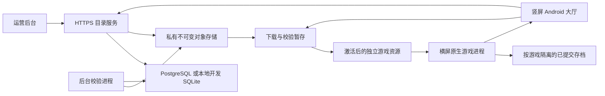

# NsA Core

[English](README.md) · [完整文档](docs/README.zh-CN.md) · [v0.4.0 版本说明](docs/releases/v0.4.0.md) · [正式版本下载](https://github.com/wikigsroom/NsA-core/releases)

**一个 Android App：找到支持的游戏，下载资源，然后直接在本机游玩。** NsA 基于 nx2android/nxnative 原生运行能力，补齐竖屏大厅、内容交付、安装、存档与运营后台。

界面采用已定稿的 **Obsidian · 曜黑极简**：暗色背景、克制的强调色、默认竖屏导航。仅在具体游戏接管运行窗口后切换横屏；退出游戏后恢复竖屏大厅。

## 实机游戏画面


[游戏录屏 MP4](docs/media/botw-input.mp4) · [来源记录](docs/media/botw-input.json) · [完整截图与录屏索引](docs/media/README.md)

以上为 Motorola edge plus 真机经 USB 采集的画面：Android 12、骁龙 865、Adreno 650。《旷野之息》目前为**本地实验适配**，已观察到真实场景加载、触控移动、新手动存档与新进程重读。此前神庙短测约 7～13 FPS，尚未达到持续可玩性验收。每份素材均保留实际安装包身份和观察范围；视频没有音轨。

<table>
<tr><td></td><td></td><td></td></tr>
<tr><td>竖屏游戏库</td><td>下载确认</td><td>设置</td></tr>
</table>


[2048 录屏 MP4](docs/media/session-play.mp4) · [新进程重读棋盘](docs/media/session-reloaded.png) · [素材身份及历史记录](docs/media/README.md)

## 本次正式发布的范围

**v0.4.0 是源码及桌面制作工具的正式 GitHub Release。** 可下载 Windows/macOS 压缩包，或检出对应标签源码。压缩包包含中英 README、完整文档和经过检查的实机截图/GIF；`SHA256SUMS.txt` 与 `release-manifest.json` 记录实际附件摘要及源码提交。

| 交付内容 | 用途 | 使用前提 |
|---|---|---|
| 标签源码 | 构建并运营统一 Android 大厅与服务 | 原生 Android 工具链、Python、已配置目录服务 |
| Windows x64 制作工具 | 通过桌面界面或命令行准备支持的原生移植 | Windows、工具下载、本人需要的游戏输入 |
| macOS 制作工具 | 桌面界面与命令行，架构以附件名称为准 | 对应架构的 macOS 与工具依赖 |
| 实拍媒体 | 查看大厅与手机实际游戏效果 | 图片或视频查看器 |
| 内部双游戏 APK | 保留在本机进行 USB 集成测试 | 包含本地凭据与商业游戏模块，**不作为公开附件** |

本版没有已部署的公共游戏目录服务，也没有可直接安装的公开大厅 APK。按下方本地流程，可以在不使用商业游戏材料的情况下构建开源 2048 演示。面向普通玩家提供完整服务前，运营方仍须部署真实服务、配置签名与信任、准备获准交付的内容。源码发布不包含商业游戏程序、密钥、个人存档或内部安装包。

## 玩家使用流程

1. **安装并打开已配置的 App。** 完成欢迎页，大厅保持竖屏。
2. **找到游戏。** 在发现页浏览、搜索、按类型筛选，或进入我的游戏。兼容性按当前手机与 APK 实际内置运行模块判断。
3. **查看详情。** 阅读下载量、准备空间、语言、操作与适配情况；实验内容需要对应资格并单独确认。
4. **确认下载。** 下载中心展示进度、速度、预计时间和真实状态；暂停、继续、重试、取消均操作持久化任务。
5. **准备资源。** 校验签名、分块、完整归档及逐文件索引，通过后才激活安装。
6. **开始游戏。** 资源准备好后点开始/继续游戏，以新的原生游戏进程进入横屏，不跳转另一款 App。
7. **保存并返回。** 在游戏内保存，按系统返回，确认返回大厅。再次启动使用新进程读取实际已写入的游戏存档。
8. **管理游戏。** 从游戏库进入备份导入导出、资源修复、独立设置与资源删除；默认保留存档。

当前 App 界面使用简体中文。仓库入口与操作文档提供中英双语；英文 README 不表示 App 已完成英文界面本地化。

## 功能范围

| 领域 | 当前实现 |
|---|---|
| 大厅 | 欢迎、发现/搜索/筛选、详情、游戏库、下载中心、设置、设备/空间/帮助及游戏管理 |
| 下载 | 单活动队列、意图持久化、8 MiB 校验检查点、Range/ETag 校验、授权续签与共享失败预算 |
| 安装 | 签名清单、ZIP64 流式展开、文件索引、路径/链接/冲突拒绝、暂存及日志驱动的激活恢复 |
| 运行 | 内置原生模块、实际 ELF 与注册表身份核对、独立 SONAME、会话/代次/nonce 握手、新 `:game` 进程 |
| 生命周期 | Application 级协调、暂停退出、Surface/输入恢复、未知状态保护与无主会话保守对账 |
| 存档 | 按游戏隔离已提交目录、带版本与摘要的导出、导入校验、替换前备份及可恢复交换日志 |
| 更新 | App 与内容分别更新、存档兼容规则、保留前版及健康版本回退约束 |
| 服务 | 目录、安装凭据、兼容评估、不可变对象、发布、后台回读校验、策略及反馈 |
| 运营后台 | 元数据、权利/构建/发布记录、上传、独立审核、设备证据、反馈、角色及审计 |
| 工程 | Windows 原生工具、USB 实测、机器契约、需求追踪与素材来源记录 |

实现与验收分别记录，详见[实际验证状态](docs/hall/implementation-status.md)和[90 项需求对照](docs/hall/requirement-coverage.md)。

## 技术方案与运行方式



主进程负责 Compose、Room、下载、安装和存档管理。每次游戏会话使用新的 `:game` 进程。每个内置模块绑定游戏模块、适配配置、着色器链、允许的驱动及运行库摘要。目录服务交付资源；新增运行模块需要更新 APK。

游戏在手机本机原生运行，由宿主适配 Switch 系统服务与图形接口。点击下载不会让手机自行解密、编译或适配任意新游戏；运营方必须事先完成准备、接入与验证。

API 与校验 worker 分开运行。本地开发使用 SQLite 和文件对象存储；生产配置使用 PostgreSQL、私有 S3 兼容存储与 OIDC。运营后台是独立的工作人员网页。

## 构建开源本地演示

采用 Windows 原生环境与 USB 安卓真机。新增工具、缓存和产物全部位于 `游戏移植/` 下的本仓库内；不使用 Docker、WSL、虚拟机或安卓模拟器。

准备 Git、Python 3.13、Java 21、Android SDK 36 / build-tools 36.0.0、NDK r27c（`27.2.12479018`），以及 Android 12+ 的 arm64 手机。工具已安装在其他位置时，设置 `NSA_SDK_SOURCE` / `NSA_NDK_SOURCE`；初始化会将所需组件复制到项目工具目录。

```powershell
git clone git@github.com:wikigsroom/NsA-core.git
Set-Location NsA-core
./devtools/hall_bootstrap.ps1
./devtools/hall.ps1 native
./devtools/hall.ps1 build
```

分别在两个终端运行目录服务与校验进程：

```powershell
./devtools/hall.ps1 serve
```

```powershell
./devtools/hall.ps1 worker
```

随后准备、发布并安装本项目原创的开源 2048：

```powershell
./devtools/hall.ps1 content
./devtools/hall.ps1 publish-2048
./devtools/hall.ps1 install
```

解锁手机并授权 USB 调试。安装工具通过 ADB reverse 将手机 localhost 端口连接到电脑；获取内容期间保持 API/worker 运行。内测开发目录需选择实验游戏筛选。开发凭据保存在被 Git 忽略的 `services/local/`，不要分享。

已发布的不可变版本不能直接重生成运行身份。源码或配置变化后，应实际重新编译并使用新的内容发布编号。前置工具、重复构建、私有 BotW 接入与完整检查见[开发手册](docs/development.zh-CN.md)。

## 空间与设备要求

| 项目 | 实测或要求范围 |
|---|---|
| 开源 2048 | 独立的小型内容包，不需要 Switch 游戏或密钥 |
| 内部双游戏 APK | 约 78.4 MiB，包含私有游戏编译代码，保留本机 |
| BotW 归档 | 14.300 GiB，索引中展开内容 14.292 GiB |
| BotW 首次手机准备 | 约需 **30.592 GiB 新增空闲空间**，含 2 GiB 安全余量；安装后资源约 14.39 GiB |
| 开发材料 | 原始输入、解包数据、编译输出、服务副本和工具链分别占用空间 |

新增空间公式：`max(归档 − 已下载, 0) + max(展开量 − 已安装, 0) + 工作空间 + max(2 GiB, ceil(展开量 × 5%))`。更新还需保留前版与必要备份。详见[空间实测](docs/hall/storage.md)。

大厅面向 Android API 31+、arm64-v8a。当前测试手机使用 4096 字节内存页；具体 Switch 游戏还依赖图形特性、驱动与适配配置。上游在其他设备的结果不能代替本机验证；本地记录未验收 Mali/PowerVR 或 16 KiB 页设备。

## 验证结果与已知限制

| 证据 | 实际范围 |
|---|---|
| 恢复候选 | Android 源码 `5c1bff0`、APK `3bd6c8…3451d`；原生库逐字节复用 `d427f08` |
| 电脑检查 | 构建与打包身份核对通过；26 项 JVM 用例本轮重新执行通过；lint 0 错误、16 警告 |
| USB 仪器测试 | 22 项全部通过，含 9 项 Room/内核锁恢复用例；覆盖安装及测试后原有 22 份玩家文件均未改变 |
| 原创 2048 | 实际输入、进度变化、正常竖屏返回，新进程重读字节与 16 个棋格一致 |
| BotW | 实验性实际输入、新手动存档与重读；不同候选的具体证据见执行记录 |
| 前一轮反复切换 | `5808f5…6d06` 安装包完成 5 轮 A → B → A；该证据不改写为新安装包结果 |
| 开放门槛 | 完整 G0、受控大厅进程死亡恢复、代表性 30 分钟性能/游戏速度/温度、主观与 BotW 声音、物理断电/空间耗尽及更多设备 |

GitHub Release 用于固定软件版本，开放的游戏与生产门槛继续保留。源码回归不能证明所有真实进程恢复时序。不得将 BotW 标成已验证可玩，也不能根据无声 GIF 判断声音质量。

## 文档导航

| 入口 | 内容 |
|---|---|
| [完整文档索引](docs/README.zh-CN.md) | 按玩家、开发者、运营方组织的双语阅读路径 |
| [玩家与操作手册](docs/hall/README.zh-CN.md) | 所有玩家操作、任务状态、存档、错误与恢复 |
| [开发手册](docs/development.zh-CN.md) | 构建、服务启动、内容准备、测试与新增游戏 |
| [部署手册](docs/deployment.zh-CN.md) | 生产配置、签名信任、应用身份、存储及维护 |
| [截图与录屏索引](docs/media/README.md) | 实机页面、游戏 GIF/MP4、后台截图及来源 |
| [v0.4.0 版本说明](docs/releases/v0.4.0.md) | 交付物、变更、升级、验证与限制 |
| [产品需求基线](docs/product/README.md) | 90 项需求、360 条细则、页面与验收定义 |
| [技术开发约束](docs/engineering/README.md) | 架构、契约、运行/安装/存档/发行规则 |
| [完整设计定稿](docs/design/obsidian-portrait/README.md) | 曜黑竖屏设计、页面、组件和原型 |
| [实施证据](docs/hall/implementation-status.md) | 绑定真实源码与 APK 的各轮结果 |

## 常见问题

| 现象 | 处理方式 |
|---|---|
| 开发目录为空 | 检查 API/worker、设备资格、筛选与发布记录；缓存空列表不代表已支持 |
| localhost 无法连接 | 保持 USB、检查调试授权与 `adb reverse tcp:8443 tcp:8443`，使用配套开发 CA |
| 提示更新 App | 当前 APK 缺少匹配模块或配置，继续下载资源无法补齐 |
| 下载等待 | 查看网络授权、主动暂停、游戏运行与剩余空间，按提示手动恢复 |
| 资源校验失败 | 保留错误，修复或重下对应不可变版本，保留存档 |
| 持续保护游戏会话 | 按提示重试或明确确认结束进程；归属未知时继续保护玩家数据 |
| 安装签名不一致 | 使用相同包名和签名密钥的更新；卸载可能删除私有进度 |
| 黑屏或低速 | 记录准确安装包、内容、驱动与设备，选择提交过滤诊断；不升级为已验证状态 |

## 仓库与来源

后续更新位于 [wikigsroom/NsA-core](https://github.com/wikigsroom/NsA-core) 的 `main` 分支。根目录 README 已全面替换为 NsA 文档，删除旧上游游戏列表与单游戏 README 正文；原制作方式继续通过桌面工具和[上游文档](https://github.com/shirai91/nx2android)查询。

原生基础来自 [nx2android](https://github.com/shirai91/nx2android) 与 [nxnative](https://github.com/seedds/nxnative)，保留其 [MIT 许可](nxnative/LICENSE)及各第三方说明。原创原生 2048 另有 [MIT 许可](android/native-games/2048/LICENSE)。游戏名称与实拍游戏画面归各自权利方所有；公开源码与工具压缩包不包含商业游戏程序、私钥或玩家存档。
