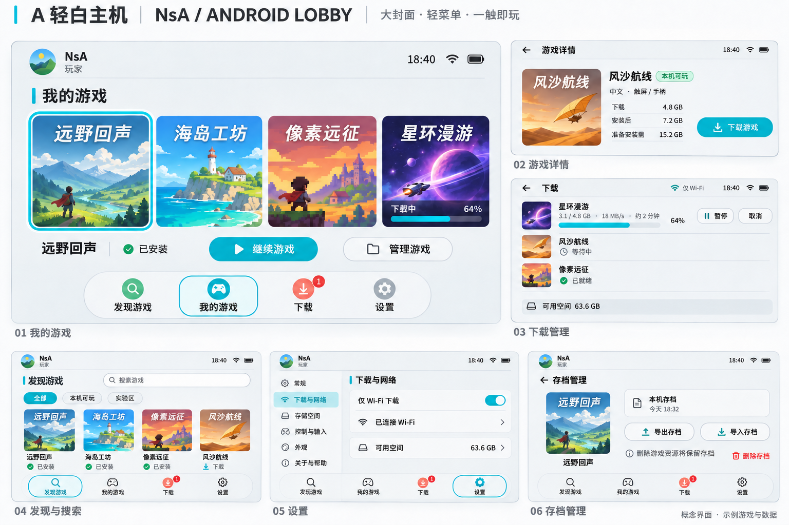
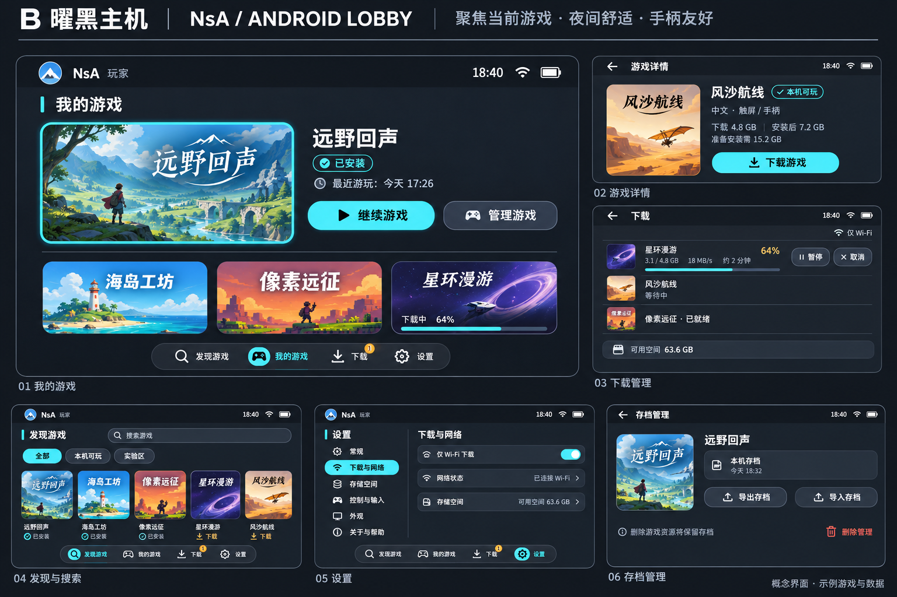
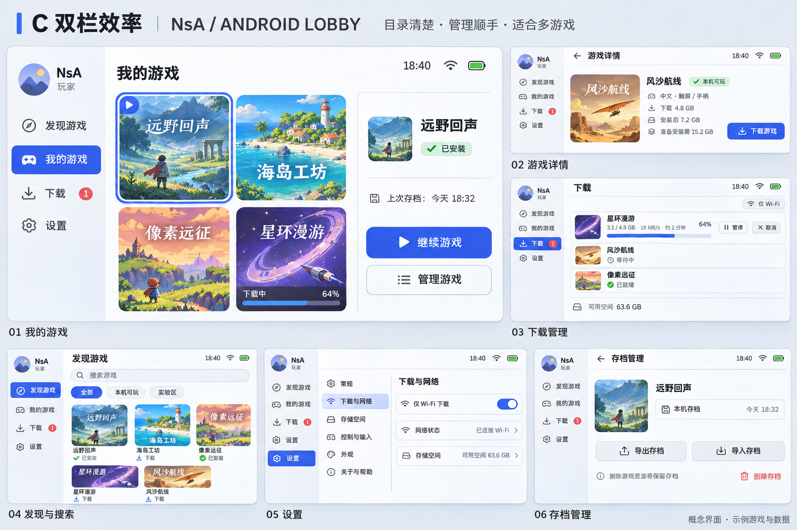

# NsA 非游戏大厅设计选型

日期：2026-11-06。状态：视觉选型；第一轮 A–C 为多页方案，第二轮 D–H 按用户最新要求全部重做为暗色竖屏单页方案。尚未进入 Android 界面实现。

最新选型：[第二轮五种暗色竖屏单页风格 D–H](single-home-round-2/README.md)。每种只展示一张完整竖屏首页；此前的浅色及横屏草案由本轮替代。

已确定：所有非游戏页面默认竖屏，只有启动具体游戏并进入运行界面后才横屏；返回大厅恢复竖屏。下文 A–C 为历史横屏视觉探索，保留用于风格参考，不能作为当前默认方向。

设计对象是“一个 Android App 内找游戏、下载、准备、开始、管理和再次进入”的全部外围界面；游戏引擎画面、游戏内 HUD、角色和战斗系统不在本次范围。封面只作为界面内容示例，不代表平台已经提供这些游戏或获得对应发行范围。

关联需求：[产品需求说明书](../../product/游戏大厅二次开发需求说明书.md)、[技术方案](../../product/技术方案与接口约定.md)。三套方案使用相同的功能与主要页面，只改变布局、配色和选择方式，方便横向选型。

## 1. 参考依据与转化

参照 Nintendo Switch 2 的 HOME、软件选项与系统设置，提取以下设计原则：

| 参考原则 | NsA 的转化 |
| --- | --- |
| 软件封面是首页主要内容 | 我的游戏直接呈现封面和当前选择，不用广告大图占据首屏 |
| 玩家和系统状态退居边缘 | 左上头像/工作名，右上时间/网络/电量；不以设备参数卡占满大厅 |
| 下方集中常用系统入口 | 发现游戏、我的游戏、下载、设置；存档/控制在相关管理页访问 |
| 当前选择和确认操作清楚 | 封面焦点框、标题、一个主要按钮形成一致关系；触屏直接点击，手柄可逐项导航 |
| 设置按类别和内容分区 | 保留左分类、右设置行的思路；使用 Android 实际具备的能力 |
| 软件选项集中更新/管理 | 将更新、资源管理、存档和反馈集中在游戏管理页，避免散落很多互不相关入口 |

参考来源：[Nintendo Switch 2 HOME Menu Overview](https://en-americas-support.nintendo.com/app/answers/detail/a_id/68181/p/1095/c/286)、[System Settings](https://en-americas-support.nintendo.com/app/answers/detail/a_id/68186/p/1095/c/188)、[Software Menu Options](https://en-americas-support.nintendo.com/app/answers/detail/a_id/68291/p/1095/c/950)。官方 HOME 图片另参考 [任天堂主机转移说明](https://support.nintendo.com/jp/switch2/mastery/transfer/switch-to-switch2/index.html)。

NsA 使用自己的工作名、图标与示例封面。不把 Nintendo Online、eShop、GameChat、主机休眠、系统驱动切换或主机独有服务直接复制为本 App 功能。参考的是菜单的信息组织和视觉节奏。

## 2. 三套方向

| 维度 | A 轻白主机 | B 曜黑主机 | C 双栏效率 |
| --- | --- | --- | --- |
| 主要气质 | 最接近 NS2 浅色 HOME，简洁、轻松 | 深色、安静、突出当前游戏 | 白灰、清楚、适合较大游戏库 |
| 首页结构 | 大封面横向排列 + 底部圆形功能入口 | 左侧当前封面 + 右侧操作区，下面最近游戏 | 左侧导航 + 中部封面网格 + 右侧所选游戏操作 |
| 主要记忆点 | 封面周围清楚的青色焦点框 | 选中游戏与“继续游戏”形成一个中心区域 | 选中卡片与右侧信息一一对应 |
| 导航 | 底部轻胶囊栏 | 底部紧凑胶囊栏 | 横屏左侧导航；竖屏改底部栏 |
| 适合人群 | 首次使用、触屏操作、小型首发目录 | 夜间使用、长时间浏览、手柄操作 | 多游戏管理、平板、频繁下载安装 |
| 优点 | 学习成本低、接近参考风格 | 当前操作突出、暗光观看舒适 | 更容易同时看到游戏与操作，不必频繁进入详情 |
| 需要控制 | 游戏过多时增加网格入口，不无限横滑 | 文字与灰色层级不能过暗；黑色不等于省电保证 | 窄屏不能强塞三栏；避免变成桌面管理软件 |
| 建议 | 作为首版优先方向 | 可作为另一方向，或将来暗色主题的参考 | 适合明确要求多游戏效率时选择 |

三套是设计选项；不表示本次同时实现三种大厅。确定方向后再统一组件、细化每个状态并实现。

选型图：

- [A 轻白主机](images/A-light.png)
- [B 曜黑主机](images/B-dark.png)
- [C 双栏效率](images/C-split.png)

每张实际为 1536 × 1024，包含六组页面。原始生成与编辑输出保留在本地；仓库保存以上三张最终选型图。请求模型、实际像素、文件摘要与 A 图的标题排版补正见 [生成记录](generation-record.json)。

### 2.1 颜色、字体与组件令牌

| 令牌 | A | B | C |
| --- | --- | --- | --- |
| 背景 | `#ECEFF1` | `#181C22` | `#E9EDF2` |
| 表面 | `#FFFFFF` | `#252C35` | `#FFFFFF` |
| 主文字 | `#252A30` | `#F0F3F6` | `#26303A` |
| 焦点/主要动作 | `#16B9D4` | `#53D8E5` | `#4268E8` |
| 次要文字 | 主文字降级但保持可读对比 | `#9AA6B5` | `#7D8B9C` |
| 辅助状态 | `#EF5A60` / `#36A98D`，限制为小图标和标记 | `#DFA64F`，主要用于等待/实验提示 | `#EB626B`，用于需注意的删除动作 |

字体建议：中文标题采用 Noto Sans SC 中等字重，正文使用 Android 系统中文无衬线；容量/速度用等宽数字，必要时 Roboto Mono。生成图只提供视觉目标，不是字体安装或最终排版的验收结果。前景与背景对比、触控区域和放大字体需在真实界面实现时检查，不能仅用上述十六进制色值证明无障碍达标。

布局以 8dp 间距节奏为基础，主要按钮建议 48–56dp 高；封面轻圆角，内容面板与按钮圆角形成统一层级。焦点框清楚但不闪烁；选择切换建议 120–180ms，缩放不超过约 1.025；支持减少动效。无背景粒子、全屏视频或依赖高成本实时模糊的界面。

### 2.2 首页结构草图

```text
A：头像 / NsA                                   时间 / 网络 / 电量
   我的游戏
   [选中封面] [封面] [封面] [下载中的封面] ...
   游戏名称                 [管理游戏] [继续游戏]
                 (发现) (我的游戏) (下载) (设置)

B：头像 / NsA                                   时间 / 网络 / 电量
          [当前大封面]     游戏名称 / 已安装
                           [继续游戏] [管理游戏]
          [最近封面] [最近封面] [下载中的封面]
                 (发现) (我的游戏) (下载) (设置)

C：头像 | 我的游戏 / 搜索                           系统状态
   发现 | [选中封面] [封面] | 游戏名称 / 当前版本
   我的 | [封面]     [封面] | 最近存档 / 安装状态
   下载 |                   | [继续游戏] [管理游戏]
   设置 |                   |
```

## 3. 页面与入口全景

默认无需注册；玩家可直接进入大厅。先让用户找到内容与操作，再按动作申请权限。底层运行模块、Build ID、环境变量、工具链和 ADB 只在高级诊断中出现。

| 页面 | 入口与主要任务 | 信息层级与动作 | 必须具备的状态 |
| --- | --- | --- | --- |
| UI-01 首次打开 | 安装后进入；说明用途并开始使用 | 简短欢迎、进入大厅；权限不集中轰炸 | 首次离线、必要说明、能力探测稍后完成 |
| UI-02 我的游戏 / HOME | 默认入口；继续最近游戏 | 最近/已安装封面、选中游戏、继续/开始、管理、下载状态 | 空库、已安装、下载中、更新、需修复、离线 |
| UI-03 发现游戏 | 常驻导航；找到可在本机使用的内容 | 搜索、类型/兼容筛选、封面、名称、下载/已安装状态 | 加载、缓存、无结果、服务失败、内容下架 |
| UI-04 搜索与筛选 | 发现页搜索框 | 中文/英文名/别名；筛选可见且可清除，回退保留上下文 | 无结果、无网络、有缓存、分页失败 |
| UI-05 游戏详情 | 点击发现卡或游戏信息 | 名称/封面、本机状态、输入/语言、大小/安装峰值、限制；唯一主按钮 | 下载、继续下载、准备中、开始、更新 App、实验、不支持 |
| UI-06 下载管理 | 导航或下载提示 | 当前任务优先、阶段/速度/字节、暂停/继续/取消、队列与空间 | 下载、等待网络、系统停止、低空间、校验、失败、完成 |
| UI-07 准备与启动 | 下载后安装或点击开始 | 安装/校验/图形准备/加载分别说明；取消/返回/重试 | 尚未就绪、系统回收后恢复、启动超时、首帧但未可操作 |
| UI-08 设置 | 常驻导航 | 类别列表、对应设置行、帮助与关于 | 当前值、禁用原因、系统权限入口、需重启后生效 |
| UI-09 下载与网络 | 设置或下载页偏好 | 仅非计费网络、当前网络、下载行为；首版不放未实现限速开关 | 默认 Wi-Fi、移动数据确认、断网、通知受限 |
| UI-10 空间与资源 | 设置/游戏管理/低空间提示 | 资源、缓存、临时文件、存档分开；显示可释放空间与保留内容 | 运行锁、清理进行、失败恢复、资源删除但存档保留 |
| UI-11 存档管理 | 游戏管理或空间管理 | 本机已提交档、时间、导入/导出、备份、独立删除入口 | 无档、正在提交、格式不匹配、导出取消、导入恢复 |
| UI-12 控制与输入 | 设置/游戏管理 | 触控布局预览、尺寸/透明度、已支持手柄、恢复默认 | 未连接、断开释放按键、按游戏独立设置；不画实际游戏 HUD |
| UI-13 本机支持与实验区 | 详情状态/发现实验筛选/设置 | 解释支持范围、设备组合与已知限制，实验需主动进入 | 正式、实验、未验证、不支持、需更新 App |
| UI-14 关于、帮助与反馈 | 设置与错误入口 | App 更新、版本说明、许可、问题分类；可选附加脱敏诊断 | 无更新、下载失败、用户取消诊断、工单提交失败 |

三张选型图重点展示 UI-02、UI-05、UI-06、UI-03/UI-04、UI-08/UI-09、UI-11 共六组页面；其余由上述页面规范和下文状态规则覆盖。选型图不是所有系统对话框的穷举，也不代表已有可交互 App。

## 4. 核心操作与主按钮

卡片上的焦点框表示“当前选择”，兼容标签表示“本机支持情况”，下载进度表示“资源状态”，三者不复用同一种视觉语义。选中不等于可以玩，文件到 100% 也不等于准备完成。

| 实际状态 | 主按钮/状态文案 | 同屏必要信息 | 点击后的结果 |
| --- | --- | --- | --- |
| 可下载，依赖/本机预检通过 | 下载游戏 | 下载量、展开后大小、还需空间、网络偏好 | 创建唯一任务并进入真实进度 |
| 缺运行模块 | 更新 App 后可下载 | 所需版本和更新入口 | 先更新 App，不先下载整个游戏 |
| 实验内容 | 查看实验说明 | 已知限制、设备和测试范围 | 主动确认进入实验范围后才允许继续 |
| 硬性不支持 | 暂不支持本机 | 简短具体原因、帮助 | 不给伪装成可点的开始按钮 |
| 正在下载 | 下载中 + 进度 | 字节、速度/约剩余时间、暂停 | 进入任务页；此时不启动半包 |
| 用户暂停 | 继续下载 | 已保留进度 | 按网络条件续传 |
| 等待网络/空间/系统允许 | 等待 Wi-Fi / 空间不足 / 已停止 | 可执行恢复动作 | 改网络、清资源或用户主动继续 |
| 校验/安装/首次准备 | 正在校验 / 正在准备 | 阶段和可取消范围 | 不假造网络速度，不先显示开始 |
| 完整安装并通过检查 | 开始游戏 / 继续游戏 | 游戏和必要限制 | 在同 App 内启动对应会话 |
| 文件缺失/损坏 | 修复游戏 | 发现问题、保留存档说明 | 校验/补齐资源，不清存档 |
| 已有会话 | 返回游戏 | 当前运行游戏 | 返回该会话，不重复启动 |
| 可更新 | 更新；旧版可用时另有开始入口 | 内容与 App 更新明确区分 | 准备新版本，运行时不覆盖旧版 |

搜索返回保留关键词和筛选，详情返回保留滚动位置。开始游戏前可暂停后台重任务；回大厅后恢复原来选中的游戏与列表位置，不无故跳回首屏。

触屏可以直接点击焦点卡片/主要按钮；手柄方向键和摇杆在实际可见项间移动，A 确认、B 返回等按当前输入方式显示。手柄提示只是辅助，不能成为触屏完成流程的前提；键盘焦点也应可见。

## 5. 关键状态、反馈和确认

| 场景 | 呈现方式 | 文案和动作 |
| --- | --- | --- |
| 首次没有游戏 | 我的游戏轻量空状态，保留主导航 | “还没有安装游戏” + “发现游戏” |
| 离线且有安装 | 低干扰页内提示，不整页封锁 | “当前离线，已安装游戏仍可使用”；只对特殊联网内容解释限制 |
| 离线且无目录缓存 | 明确空状态 | “连接网络后浏览游戏” + “重试” / “我的游戏” |
| 搜索无结果 | 保留搜索与筛选 | “没有找到相关游戏” + “清除筛选”；不展示虚构推荐 |
| 从 Wi-Fi 切移动网络 | 任务暂停行 + 可见选择 | “当前网络可能产生流量费用” + “等待 Wi-Fi” / “继续使用” |
| URL 续签/短暂重连 | 任务内短状态，不弹全局错误 | “正在恢复连接”；已校验进度保持 |
| 下载文件到 100% | 切换为准备状态 | “下载完成，正在校验”；不显示虚假的 100% 可玩 |
| 空间不足 | 任务错误卡/详情内说明 | “还需释放 X GB” + “管理空间”；已确认进度保留 |
| 取消下载 | 就地确认或模态，范围明确 | “取消后将删除未完成下载，已安装游戏和存档不受影响” |
| 游戏资源删除 | 游戏管理内确认 | 显示游戏名/可释放空间，“保留存档”默认不作为可误关的隐蔽开关 |
| 清缓存 | 低风险说明 | “下次启动会重新准备画面缓存”；与资源卸载、删档分开 |
| 删除存档 | 独立危险动作，二次确认 | 显示游戏名与不可继续该进度的影响；默认焦点为取消 |
| 导入存档 | 系统文件选择器 + 校验结果 | 先确认游戏/版本，保留旧档备份；运行时不允许替换 |
| 游戏启动失败/进程退出 | 回到可恢复大厅，保留会话信息 | “游戏未能启动”或准确原因 + “返回大厅” / “重试” / “反馈问题” |
| 正常返回大厅 | 非游戏退出提示 | “游戏内尚未保存的进度可能丢失”；不宣称强制自动存档 |
| 更新失败 | 当前游戏信息和旧版状态仍可见 | 允许时继续旧版，提供重试；不把所有更新失败都变成删档重装 |

进行中的任务使用原位进度；短暂成功提示不抢焦点；阻断操作的错误才使用显著卡片或模态。不要每次轮询弹窗。模态支持系统返回关闭，并在关闭后把焦点还给触发控件。

状态使用图标 + 文本 + 适当颜色。成功/已安装、实验/等待、阻断/错误各有明确标签；下载与安装的阶段词保持全 App 一致。“未验证”不自动被画成绿色“本机可玩”。实际《旷野之息》在当前设备应放实验范围，不能把生成图中虚构游戏的示例标签当作真机结论。

## 6. 响应式与 Android 实现约束

| 条件 | 设计行为 |
| --- | --- |
| 手机非游戏页面 | 默认竖屏：发现、搜索、详情、我的游戏、下载、准备、设置与管理均纵向组织；四入口底部导航，按安全区留白 |
| 进入游戏运行界面 | 仅用户点击开始/继续游戏并通过启动检查后切横屏；游戏内暂停菜单保持横屏，不在浏览封面、下载或安装时切换 |
| 返回大厅或启动失败 | 恢复竖屏及原页面、滚动位置、下载状态；正常退出、崩溃和取消均有恢复路径 |
| 平板与系统窗口限制 | 产品仍以竖屏非游戏流程为基准；若系统窗口不允许锁定方向，保持内容可操作，不将其解释为默认横屏 |
| 窄屏设置 | 左分类改为上一级列表，点入独立页面；不强行保留左右列 |
| 历史 C 的三列首页 | 只保留视觉参考；当前手机采用纵向卡片或两列网格，所选游戏操作纵向展开，不作为默认三列首页 |
| 字体放大/读屏 | 行高增长、标签可换行，保留按钮可见文字；进度可读出阶段与数值，焦点顺序按视觉逻辑 |
| 手柄断开 | 显示触屏操作，不保留按住状态；焦点不跳到不可见项 |
| App/游戏前后台 | 恢复实际任务和页面，避免界面重建创建重复任务；游戏运行时减少大厅封面缓存与后台重 I/O |

普通页面只展示与决策有关的信息。手机具体 GPU/驱动、运行模块摘要、详细错误和测试记录放“本机支持/高级诊断”，不把工程配置混入玩家首次下载流程。

封面按显示尺寸加载并回收，不依赖全分辨率常驻；界面主要用可实现的布局、矢量图标、纯色和简单焦点动画。当前手机游戏性能紧张，设计不再增加持续背景动效负担。

## 7. 图片生成、检查与选型交付

图像使用用户指定的 `sub2-image-gen` 技能生成。默认 `gpt-image-2.5` 请求被网关以 `Complexity 'medium' is not supported for this image model` 拒绝，用户随后明确授权改用同一网关的 `gpt-image-2.5-flare`。不能用网页截图或程序拼出的方框替代实际出图。`prompt-common.txt` 固定共同内容，`prompt-A/B/C.txt` 只定义三套差异；完整请求提示词与原始输出位于项目 `output/imagegen/hall-design-20261106/`。

查看图片时优先比较：封面与主操作是否一眼可见；下载和准备是否清楚区分；六个页面是否像同一产品；能否在触屏和手柄下建立清楚选择；后续扩展更多游戏时布局是否仍成立。

选型后应继续完成：统一组件库 → 主流程可点击原型 → 关键错误/空状态与竖屏主流程、进出游戏方向切换 → Android 页面实现。生成图中的字距、图标精度与细小文本需要在真实界面中重新排版，不能把 AI 概念图当作可直接切图上线的 UI。

## 8. 三套选型图

### A 轻白主机



### B 曜黑主机



### C 双栏效率


