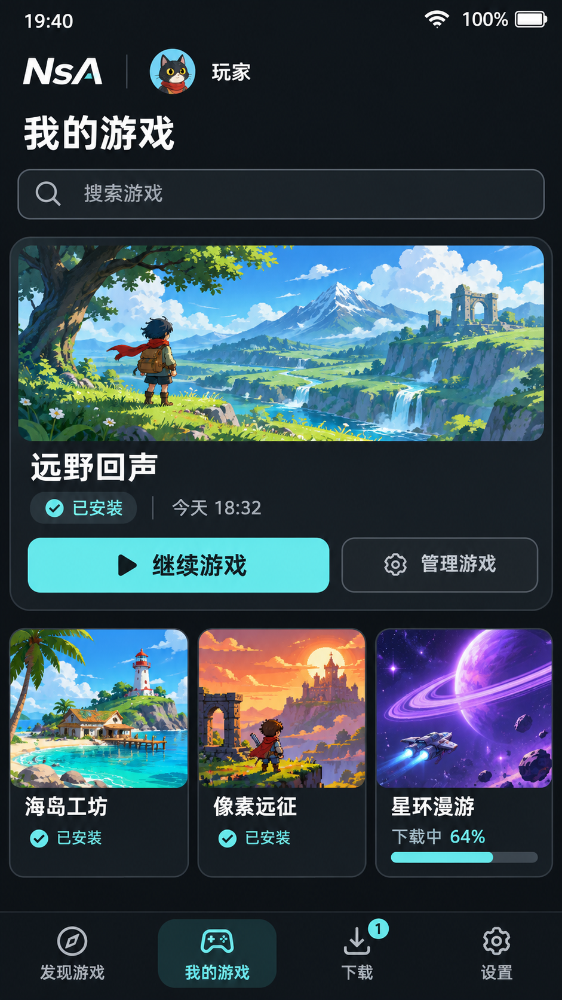
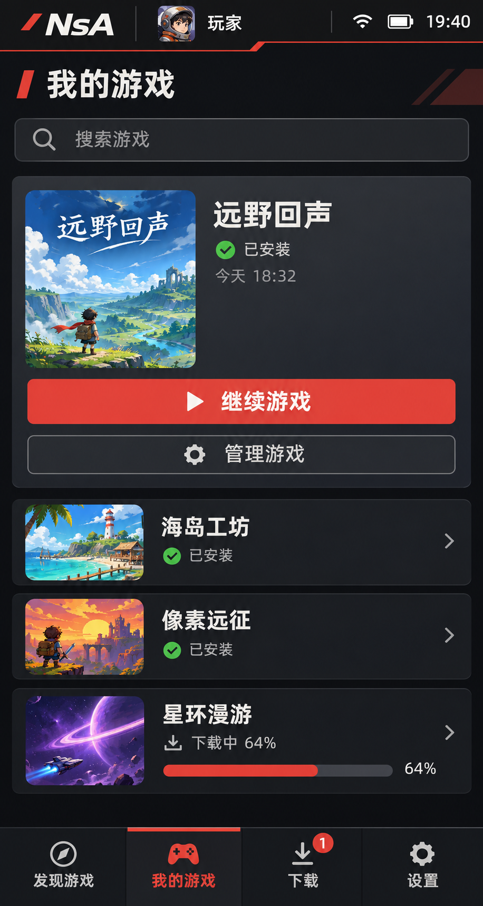
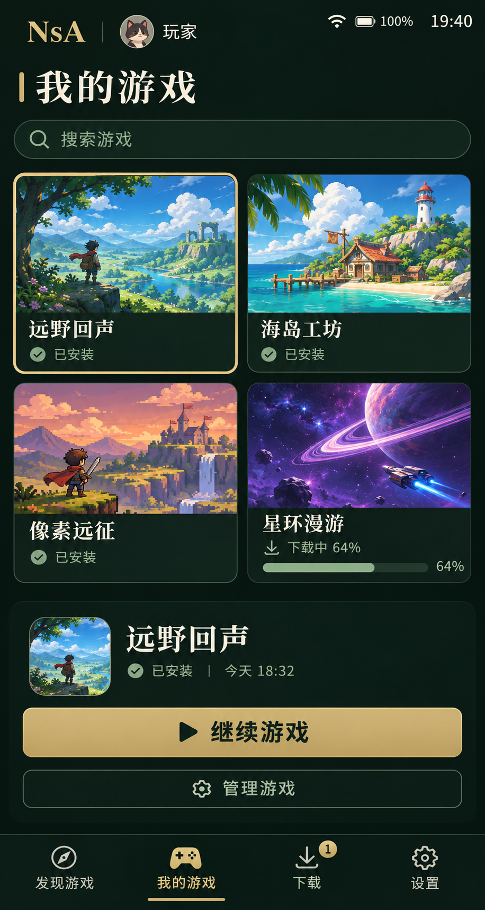
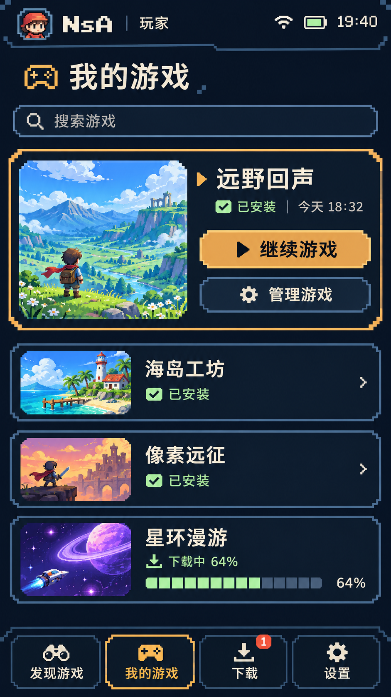
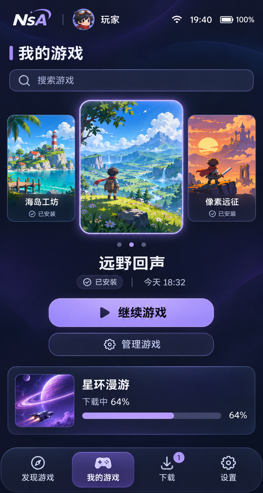

# 第二轮：五种暗色竖屏大厅风格

日期：2026-11-06。状态：视觉选型，尚未实现 Android 界面。按用户最新要求全部采用暗色调、默认竖屏，替代此前本轮的浅色和横屏草案。

已确定的方向规则：大厅、发现、搜索、游戏详情、下载、安装准备、管理、设置和启动失败页均为竖屏；只有用户点击开始/继续游戏并进入游戏运行界面后才切横屏。游戏内暂停菜单跟随横屏；正常退出、启动失败或游戏崩溃回到大厅后恢复竖屏，保留原页面、滚动位置和下载任务。

每种只展示一张完整竖屏大厅首页，编号 D–H。沿用 [第一轮](../README.md) 的功能边界与虚构示例游戏，保留相同的四个主入口与已安装/下载中状态，方便横向比较。参考 NS2 的信息层级和选择焦点，按手机纵向使用重新组织，不直接缩小横屏布局。

| 方案 | 暗色体系与竖屏布局 | 主要特征 | 图片 |
| --- | --- | --- | --- |
| D 曜黑极简 | 曜黑/炭灰/冰青；上方所选主卡，下方三张小封面，底部导航 | 克制、清楚、突出继续游戏 | [查看 D](images/D-obsidian-portrait.png) |
| E 赤影机能 | 碳黑/石墨/朱红；当前游戏展开、其他游戏纵向列表，底部导航 | 利落、列表清楚、便于管理 | [查看 E](images/E-carbon-red-portrait.png) |
| F 墨绿雅集 | 墨绿/深玉/低饱和黄铜；两列封面画廊，下方所选游戏操作区 | 安静、成熟、个人收藏感 | [查看 F](images/F-jade-night-portrait.png) |
| G 午夜像素 | 午夜蓝/蓝黑/琥珀；上方主卡、下方小卡带列表，像素导航 | 复古、有辨识度、中文保持清楚 | [查看 G](images/G-pixel-night-portrait.png) |
| H 深空玻璃 | 深蓝/暗紫/薰衣草强调；居中封面序列、独立下载卡和悬浮导航 | 通透、突出当前选择、层次明显 | [查看 H](images/H-glass-night-portrait.png) |

五套背景、导航和卡片均为暗色，封面保留色彩。底部统一四个主要入口：发现游戏、我的游戏、下载、设置。页面内容可纵向滚动，导航与关键操作按安全区布局，不把桌面侧栏和三列布局硬塞进手机。

本轮比较单页视觉和布局，不增加账号、支付或社交功能。玻璃感实现优先采用静态渐变、边框和轻透明表面，避免持续模糊增加绘制负担。文字对比、焦点、48dp 触控目标、字体放大、读屏与方向切换须在实现阶段验证。概念图不能代替真机运行验收。

使用用户此前明确授权的 gpt-image-2.5-flare，通过原 sub2-image-gen 脚本与同一配置网关重新生成。共同提示词为 prompt-common.txt，各方案差异为 prompt-D.txt 至 prompt-H.txt；本轮竖屏原始输出位于本地 output/imagegen/hall-home-dark-portrait-20261106/。请求尺寸 1080×1920，最终实际尺寸与摘要见 [生成记录](generation-record.json)。

## D 曜黑极简

## E 赤影机能

## F 墨绿雅集

## G 午夜像素

## H 深空玻璃

