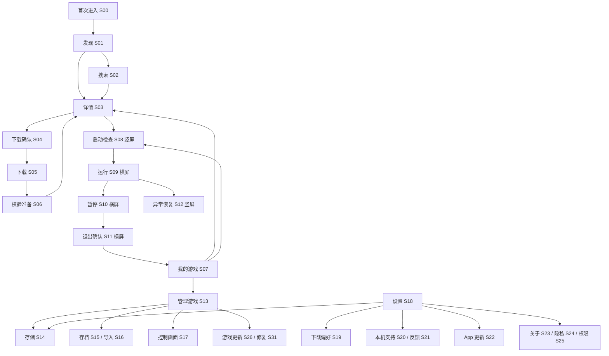
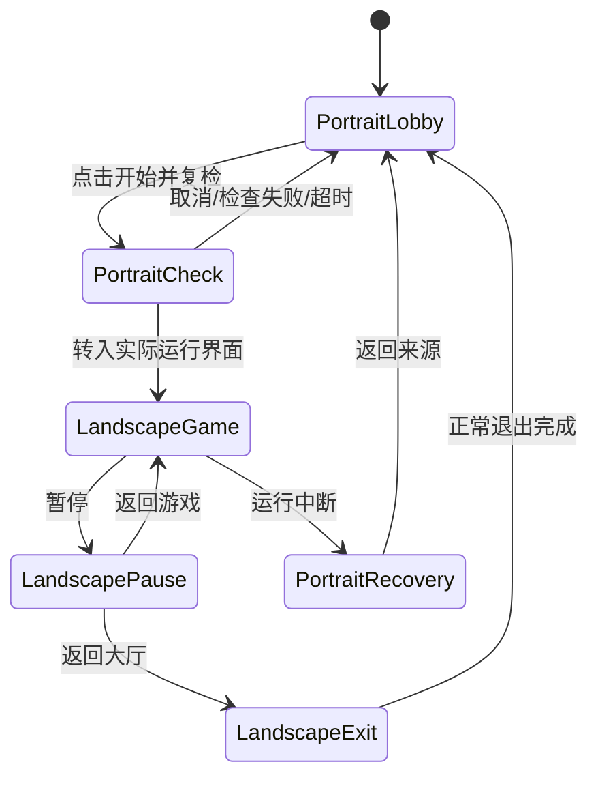

# 01 · 产品结构与导航

## 1. 产品任务与范围

用户安装一个 App，找到本机适用的游戏，下载并完成准备，进入游戏、保存进度，然后返回大厅继续管理或切换另一款。大厅的主要价值是减少准备成本并清楚表达当前能做什么；封面、状态和一个明确的主操作构成每页核心。

本轮设计玩家 App 的全部外围页面和运行边界。内容发布、签名、兼容审核和后台运营按已有需求实施，通过公开目录、状态及反馈与玩家界面连接；这些管理端功能不增加到玩家的主导航。账号、支付、会员、广告、社区、云存档不进入本轮 P0 页面。

## 2. 四个主入口

| 入口 | 主任务 | 核心内容 | 跨标签保留 |
| --- | --- | --- | --- |
| 发现游戏 | 找到目标内容 | 本机可玩优先、搜索、类型、游戏详情 | 筛选、列表位置、缓存时间 |
| 我的游戏 | 快速再次进入 | 当前选择、最近游玩、已安装及资源异常状态 | 所选游戏、滚动位置、上次排序 |
| 下载 | 了解和控制任务 | 实际阶段、下载字节、暂停/继续、失败恢复 | 任务 ID、原因、可信进度、队列 |
| 设置 | 管理偏好与支持 | 控制、下载偏好、存储、权限、帮助、更新、关于 | 已保存偏好与子页来源 |

首次有网络、无本地内容时进入发现；已有可启动内容时默认进入我的游戏。离线时允许进入我的游戏。原型初始显示用户选定的我的游戏样例；右侧“首次下载”情境从发现页开始。

主入口名称、顺序与图标固定。未完成下载角标表示任务数，包含暂停/等待任务；不将传输百分比作为角标。读屏应表达“下载，1 个未完成任务”。

## 3. 导航结构

S04、S11、S30 在视觉上属于确认层；独立编号用于设计、状态和测试追踪，不要求实现为三个独立 Android Activity。

## 4. 点击、返回与层级

| 情境 | 预期行为 |
| --- | --- |
| 点击封面或名称 | 进入对应详情，保持竖屏；不会因选中封面直接下载或启动 |
| 点击开始/继续 | 做安装、依赖、支持和会话检查，再进入启动流程 |
| 二级页面返回 | 回到实际来源列表/详情及原位置，不一律跳首页 |
| 根标签间切换 | 保留各自列表位置、选择与实际任务，不重新创建下载 |
| 弹层返回/取消 | 关闭当前确认层，恢复来源控件焦点，不执行破坏性操作 |
| 搜索时返回 | 先按系统规则关闭键盘，再返回来源；保留已提交查询 |
| 从通知打开任务 | 根据任务 ID 进入下载详情/中心；无效 ID 显示已结束原因 |
| 外部链接打开游戏 | 解析受信任游戏 ID，检查可见资格，展示详情；不直接执行下载或游戏 |
| 游戏内返回 | 先打开暂停或退出确认，由明确操作返回大厅 |
| 游戏失败恢复 | 竖屏恢复来源，展示原因、已提交记录和用户主动重试 |

原型内的返回按钮及 Escape 用于审阅导航；Android 系统返回、预测返回、任务栈、键盘和通知入口需在原生实现阶段按这些规则验证。

## 5. 方向状态机

本机旋转、浏览封面、查看详情、下载到 100%、安装完成、通知点击都不独立触发游戏横屏。方向切换以本次会话为单位，不能重建第二个游戏进程。平板、分屏或系统窗口约束需要自适应；产品默认流程仍是竖屏大厅。

## 6. 四条必走旅程

1. 新安装：首次进入→发现→搜索/详情→确认下载→传输→校验/准备→开始→游戏→保存→返回→再次进入。
2. 再次游玩：我的游戏→继续→启动检查→游戏；返回恢复同一所选游戏与来源位置。
3. 中断恢复：任务等待网络/空间或系统停止→显示实际原因→处理→复用可信分段继续；下载完成仍需准备。
4. 数据管理：管理游戏→存档导出→系统位置确认→删除游戏资源并保留存档→重新取得资源后读取兼容存档。

每条旅程需要分别覆盖无网络、重复点击、进程被回收、取消、失败及再次打开。原型覆盖可审阅的交互规则；真实下载、系统选择器和游戏保存另有原生验收。
