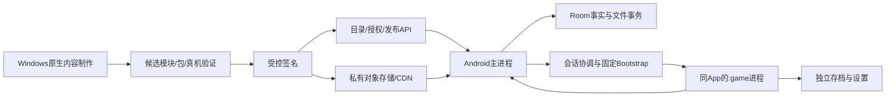

# 01 · 总体架构、选型与工程边界

基线 v2.0 · 2026-11-06。本章固定首版工程形态；任何替换经 ADR 评估并更新关联契约、验收与计划。目录与类名是待实现结构，不表示当前源码已有对应模块。

## 1. 已有源码依据

| 位置 | 当前事实 | 改造约束 |
| --- | --- | --- |
| [build.py](../../nxnative/dm/android/build.py) | 按 --game 生成 game_profile.h / android_profile.h | 每个 runtime_slot 对应可重现的 profile/core 组合 |
| [pipeline.py](../../porter/pipeline.py) | 构建单游戏 libdmhost.so、APK 与数据 | 保留制作入口，新增受控模块/内容导出 |
| [mkapk.py](../../nxnative/dm/android/apk/mkapk.py) | NativeActivity 清单绑定一个原生库 | 统一 Gradle 工程使用固定 bootstrap 与签名保护注册表 |
| [front_android.c](../../nxnative/dm/android/front_android.c) | 原 on_destroy 调 _exit；入口设置单游戏根目录 | 新路径初始化和生命周期必须接入上下文；仅 :game 可结束 |
| [loader.c](../../nxnative/dm/host/loader.c) | 匿名映射改写模块，mprotect 为可执行 | G0 实测目标系统及页大小；哈希不能替代可执行加载验证 |
| [saves_android.c](../../nxnative/dm/android/saves_android.c) | 存档提交与交换可复用 | 扩展按游戏身份隔离，接入提交事件与安全导入 |

阅读基线为本次文档前 HEAD，另有工作区未提交真机适配；本轮不改这些运行文件。实验 BotW 记录不能证明统一大厅已完成，也不继承到 TotK 或其他设备。

## 2. 固定架构

采用统一 Android APK、随 APK 内置受控运行模块、在线版本化内容包、同 UID 的普通独立游戏进程。内容制作在发布前执行。新模块先进入新 App 注册表，再开放相应内容。运行模块及驱动不从目录接口任意下载。



主进程是任务、安装、导航和会话元数据的唯一写入协调者。游戏不直写 Room，不加载任意网络库名。进程隔离用于退出/崩溃及全局状态隔离，同 UID 仍可访问相同权限，不能宣传为安全沙箱。

## 3. 技术选型与版本锁

| 层 | 实施基线 | 锁定与验收 |
| --- | --- | --- |
| 客户端 | Kotlin、Jetpack Compose、Navigation、ViewModel、Coroutines/Flow | Gradle version catalog / dependency verification；UI 不持有任务事实 |
| 数据 | Room + DataStore | 导出数据库 schema；显式迁移，不采用破坏性回退 |
| 网络 | OkHttp 流式引擎 | 接受 identity 编码与 Range；不把大包读入 ByteArray |
| 调度 | API34+ UIDT，API31–33 合法前台传输；轻量工作独立 | 适配系统停止、额度和进程回收；不以常驻服务假设实现可靠性 |
| 原生 | 现有 C/C++、NDK、Vulkan、音频/输入 | slot 独立 SONAME、注册表、ABI v1；保留单游戏工具回归入口 |
| 服务 | Python/FastAPI + PostgreSQL | 显式 DTO、迁移、OpenAPI 契约、版本锁与哈希 |
| 大文件 | S3 兼容私有对象存储 + CDN | 不可变 object_id，Range/ETag、临时授权、上传后复核 |
| 后台任务 | 独立 Python worker + PostgreSQL 作业表/租约 | 至少一次执行，幂等产物与 outbox，不在 HTTP 内编译游戏 |
| 管理入口 | 最小内部管理 Web/操作面板，OIDC 身份 + 服务端 RBAC | 供应商/域名由部署决策配置；管理端不增加到玩家四入口 |
| 本地环境 | Windows 原生 JDK/SDK/NDK/Python/PostgreSQL 或已选托管服务 | 不调用 Docker、WSL、VM、安卓模拟器；USB 真机 |

工程默认 minSdk=31、compileSdk/targetSdk=36、arm64-v8a；这是开发目标，正式系统/GPU支持仍由证据矩阵放行。JDK、Gradle、AGP、Kotlin、Compose BOM、NDK、Python 和服务依赖的精确版本在 G0 首次可重现构建时登记 build-lock，禁止使用 +、latest、未锁定 SNAPSHOT。不能随意捏造未构建验证的版本组合；缺少锁文件不能通过 G0。

## 4. 工程分层与依赖

```text
android/app                    装配、清单、导航入口、签名/渠道配置
android/core/domain            ID、状态、命令、主按钮计算、错误；无Android UI依赖
android/core/data              Room/网络/文件仓储、迁移、投影
android/core/designsystem      定稿颜色、字体、组件、语义与适配
android/core/transfer           HTTP/段校验/任务恢复
android/core/storage            包验证、安装、存档事务、空间/引用
android/core/runtimebridge     会话协调、IPC、bootstrap、注册表
android/feature/*              发现/库/任务/管理/设置的UI与ViewModel
services/catalog               玩家/管理API、领域授权、数据库
services/worker                对象验证/发布投影/清理作业
content_tools                  可提交的包、索引、签名与注册表工具
porter / nxnative              现有制作与运行代码
```

feature 只能调用领域命令和订阅投影；不能直接发原生启动、拼绝对路径或修改 Room 实体。文件和 native bridge 不依赖页面组件。backend 业务层不依赖签名私钥文件或公网任意 URL；签名器为受控独立边界。

## 5. 共用事实与版本

game_id 标识逻辑游戏；release_id 标识不可变内容；runtime_slot_id 标识 APK 内已编译适配；object_id 标识不可变字节；task/install/session/commit 各自有 ID。用户可见名称绝不作为目录或兼容依据。

线上 API v1、manifest_schema=1、runtime_api=1 与本文件基线 v2.0 是不同版本轴。文件内字节变化必须产生新发行/对象，不覆盖旧 ID。后续不能通过修改同名 profile.json 让旧记录指向不同代码。

## 6. G0 必证事项

在同一个候选 APK 内加载两款真实内容，完成 A→大厅→B→大厅→A，保存并读档；确认库名、全局变量、构造器、路径、声音与输入不串用。验证 _exit/fatal 只结束游戏，取消后不会迟到启动。验证可执行映射、W^X、4/16KiB 对齐与目标系统。没有相应真机时将该组合标为未验证，不调用模拟器补名义通过。

G0 同时验证公开内容范围、执行代码交付渠道和 App 兼容窗口。现有 mods 包含改写程序，官网/内部分发路径与应用商店路径需要分别核验。Google Play 对站外执行代码和更新的约束见 [官方政策](https://support.google.com/googleplay/android-developer/answer/16559646?hl=en)；不能仅因宿主随 APK 就声称下载包符合商店要求。
