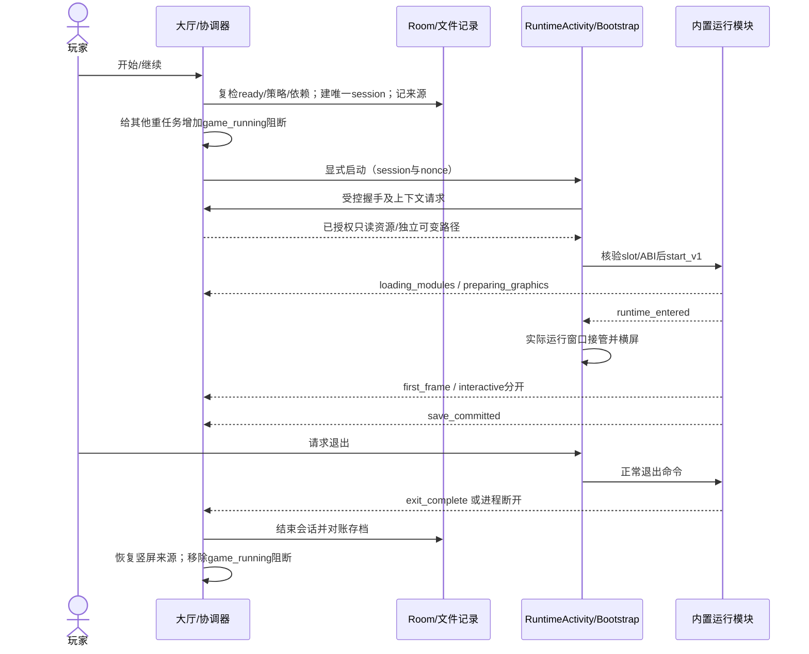

# 03 · 原生模块、进程、IPC 与启动协议

编译及打包约束见 [ADR 0009](decisions/0009-compiled-slot-identity-and-unicode-builds.md)。Clang 依赖按严格 UTF-8 读取，缺失或无效输入不得复用对象；每个大厅运行库以同一生成头、同一编译单元提供 `.nsa_identity` 元数据。收集前和 APK 内均核对实际 ELF、完整身份与 SONAME，不能只对旧库重新计算摘要。手机仍核对实际 ABI/`get_info`，bootstrap ABI v1 不变。

真机运行补充见[声音与返回键修正轮次](../hall/runtime-round-2026-11-07.md)。统一大厅原生输入不得截获系统返回键并绕开 GameActivity 的暂停、退出确认；旧系统应将未处理事件交回 Java，新系统保留平台返回回调。AAudio 断线回调只传递错误，由受控线程关闭、重开音轨；音频流不能在错误回调线程中关闭。适用模块必须用实际路由切换、输入与进程退出验证，非零音频信号与主观听感分别记录。

实施补充见 [ADR 0007](decisions/0007-policy-runtime-save-recovery.md)：游戏进程全生命周期持有内核租约，主进程丢失后按持久 session/generation/nonce 重连；不能只凭数据库行判定运行中或结束。未知归属继续保护资源与存档，确认租约释放后才登记终止。新增私有 IPC 7/8 不改变 bootstrap ABI v1；实际主进程丢失恢复仍须真机验收。

[ADR 0010](decisions/0010-stopped-session-reconciliation.md)补齐初始化与游戏退出之间的竞态：恢复协调器必须重新对账，不得在租约已释放时直接跳过旧会话。操作锁内取得真实内核排他锁，并保持到关闭无主会话和删除对应上下文的短 Room 事务提交；保留原有序列、保存索引和玩家字节，不伪造保存或正常结束事件。拿不到锁沿用认证重连；锁状态不明、上下文损坏或身份不符继续保护，不能启动第二份实例。Android 提交与复用原生库的实际编译提交分别登记；ABI、Room、IPC 与资源身份不变。

## 1. 模块注册

APK 内固定 bootstrap 和 [runtime-registry.schema.json](contracts/runtime-registry.schema.json)。注册表被 APK 签名保护；library_name 只从该表选择，slot、SONAME和摘要唯一，禁止重复默认libdmhost覆盖。模块对应 core commit、profile digest、完整 module Build ID、shader链、驱动与settings schema。

模块装载使用受控 APK 内库与局部符号范围，验证依赖SONAME及构造器行为；构造器不得在上下文授权前执行游戏读取/线程启动。受控环境映射必须在首次读取前设置。只把原 ANativeActivity_onCreate 再调用一次会重写路径，必须抽出公共初始化并接入显式上下文。

首版ABI见 [runtime-api-v1.h](contracts/runtime-api-v1.h)。G0必须证明实现能满足它；需修改 ABI 时先 ADR/版本化，不绕过校验以求启动。

## 2. 进程及 IPC

LauncherActivity 与 SessionCoordinatorService 在主进程；RuntimeActivity在 :game，普通同UID、非isolatedProcess。两个Activity、会话服务和内部接收器不对其他App导出。主进程是Room唯一写者；:game通过受控Binder命令/事件通信，不能直接并发写Room。

主进程创建随机session_id和至少128位nonce，保存启动记录并安全写入受控会话文件。Intent只传ID/nonce，不传任意绝对目录或库名；:game验证一次性握手、记录修订和已激活安装。文件上下文由可信ID派生，路径canonical归属检查。nonce不能写日志，旧session令牌不可复用。

Binder命令含command_id/session_id/expected_revision；事件含session_id/process_generation/event_seq/phase/monotonic时间。重复事件去重，旧generation/较小seq丢弃。主进程不能阻塞UI线程等待 native 初始化或退出。

## 3. 启动时序



S08在检查/初始化/图形准备保持竖屏；runtime_entered定义为本次游戏的窗口与执行循环已接管，不由大厅计时器伪造。first_frame是实际呈现，interactive是可操作信号；暂缺后者只能记录观察证据，不能构造成功事件。Surface方向/尺寸变化走同一进程和会话。

## 4. 路径与读写边界

```text
files/nsa/downloads/<task>/payload.part
files/nsa/staging/<install>/...
files/nsa/packages/<game>/<release>/{mods,RomFS,shaders.dmsv,READY,...}
files/nsa/players/<player>/games/<game>/{save,settings,backups,...}
files/nsa/caches/<game>/<cache-key>/...
files/nsa/sessions/<session>/...
```

大包不放系统可随时回收的cache目录。所有安装提交在同卷完成。package不可变，不写settings/log；DM_ROOT、DM_ROMFS、DM_SAVE、DM_TEMP、DM_VK_SHADERS、日志及设置路径分别从上下文映射。旧env.txt只转换允许的语言/渲染等设置；库路径、存档根、任意probe/远程控制不能由目录下发。

## 5. 生命周期、锁与结束

全局一个会话；每次切换新 :game 进程。资源版本用session pin保持，更新/删除取得同游戏独占修改锁前必须确认无活动使用；保存导入使用独占save锁。

锁顺序为协调租约→游戏操作锁→保存锁→短DB事务；不能持DB事务等待网络、fsync或Binder。持久租约的超时只触发对账，不足以证明native已释放资源；结合进程generation、活连接与文件锁验证。重建主进程发现仍活:game时重新握手或受控恢复，不启动第二份。

Bootstrap拥有唯一Android回调分发器，记录Surface/InputQueue最新状态；模块注册回调后在正确线程重放，防止早期窗口事件丢失。模块不直接抢写activity->callbacks。原有on_destroy/_exit路径改为仅:game受控结束，主进程不链接该退出行为。

后台/失焦暂停音频、渲染和输入；控制器断连释放按键。正常退出等待已提交事务，不强制游戏生成新档。默认10秒后允许用户选择等待或强制结束，强制选择说明未保存风险。取消启动持久标记，迟到ready/first_frame不能重新进入运行。

## 6. 崩溃和超时

不能依赖崩溃回调；Binder死亡/进程断开、最后事件和磁盘记录共同判定。主进程也可能被系统回收，恢复时对账session与真实:game，清理旧记录并重建导航。保存提交标记可晚于最后IPC，读取磁盘事实防止误报丢档或新保存成功。

检查默认15秒；初始化默认120秒，图形准备经profile声明可到600秒；超过60秒无有效心跳进入可恢复超时。用户可取消；上限是工程默认，不代表游戏性能承诺。阶段延长必须有真实进度/QA证据与profile审查，不能无限自动重试。

回大厅只移除game_running阻断，保留手动、系统、网络/空间阻断。游戏失败页只承诺已提交进度保留，提供主动重试、返回和反馈。

## 7. 必须证明的集成结果

双模块加载/符号、构造器和路径初始化；真实4/16KiB页面及W^X；启动取消；旋转不重复start；锁屏/来电；正常/强制/崩溃退出；大厅和游戏分别回收；A/B独立存读档与设置；活动版本不被更新或删除。对应RUN、SAVE与AC-R/AC-S，未有证据不得标已实现。
