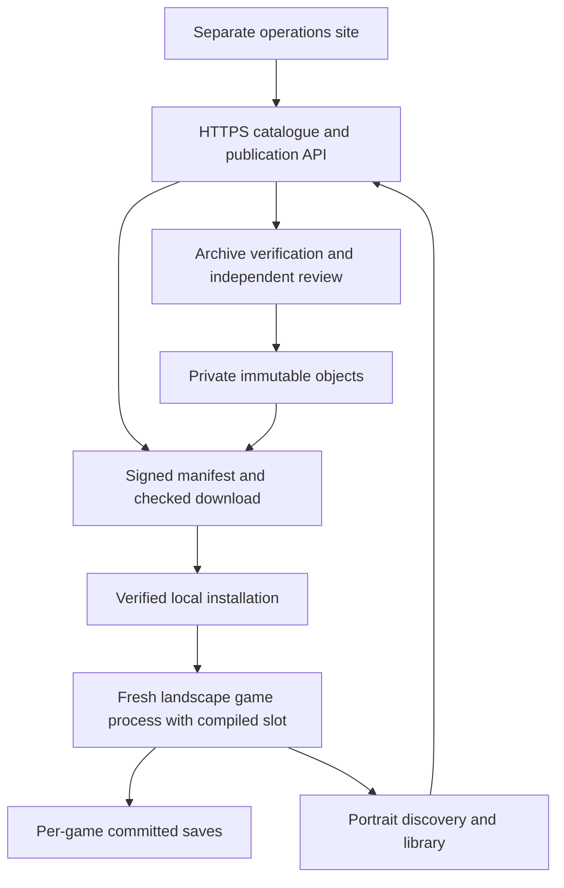

# Unified hall implementation guide

The complete [download/install correction batch](transfer-round-2026-11-07.md) implements the reviewed queue, cancellation, HTTP identity and install-recovery/cleanup boundaries. The user has reauthorized USB testing. Source and necessary test cases are prepared before consolidated execution; new build/device results are recorded separately and do not inherit historical APK passes.

The [new recovery correction round](recovery-round-2026-11-07.md) and [ADR 0007](../engineering/decisions/0007-policy-runtime-save-recovery.md) add the scoped policy sequence, initialization/file reconciliation, kernel runtime ownership, durable picker drafts and recoverable save/index publication. Their validation status is separate from the installed build and existing captures. For save exchange, export now fixes the snapshot before opening the destination picker; import restores its original game/draft and disables cancellation throughout the confirmed operation. Production API rollout requires the database migration described in the ADR.

[中文使用说明](README.zh-CN.md) · [Main README](../../README.md) · [Product baseline](../product/README.md) · [Engineering constraints](../engineering/README.md)

[Actual verification](implementation-status.md) · [Next device run](device-validation.md) · [Execution summary](verification/2026-11-07-main.json) · [Screenshots and recordings](../media/README.md) · [Storage](storage.md)

Read the [historical targeted source review](source-review.md) alongside the [subsequent correction round](recovery-round-2026-11-07.md) before relying on offline readiness, process reconstruction or interrupted save exchange. The phone's retained build has the reviewed gaps. The new candidate implements their source corrections and has its own checks; it has not been installed or accepted on the physical device.

## What runs where

The main-process Application retains one runtime coordinator across Activity recreation. A prepared launch waits for a resumed hall Activity. Session creation, installation and save exchanges share a mutex, and import rechecks the currently active save compatibility group at commit. After verifying an App-update APK, the client backs up existing saves for installed games before handing it to the system installer; backup failure prevents that hand-off. Cancellation drains the pending checkpoint, and delayed process callbacks remain bound to their original session.

The Android application owns the catalogue cache, library, persisted transfer queue, private installation directories, local saves, preferences and session history. Compose renders the finalized D Obsidian portrait design. Four tabs remain portrait; only `GameActivity` uses landscape. The operations website is a separate staff surface.

FastAPI handles installation credentials, scoped catalogue queries, compatibility evaluations, manifests, download grants, feedback, uploads and publication. The worker reads stored objects back, checks the complete archive and its indexes, and records publication verification. An independent reviewer approves records before publication. PostgreSQL and S3 are production providers; native Windows development uses SQLite and a private local directory. Neither mode needs virtualization.

The APK includes a bootstrap and explicitly selected native slots. Game content is downloaded separately. Registry hashes bind the slot, profile, module IDs and shader chain; no catalogue response installs a new runtime `.so`. A fresh `:game` process runs each session. The native bootstrap owns Activity callbacks and replays existing Surface/InputQueue state. Room writes remain in the main process.



The target player flow is install the App → find a supported game → confirm its download → prepare resources → play → save and return. A content operator prepares and publishes each supported release beforehand. Downloading a game cannot add an absent compiled slot; that case requires an App update. The current local setup is an invited development channel, while a public downloadable App/service is a separate deployment step.

## Source and device layout

| Location | Responsibility |
|---|---|
| `android/` | Compose application, persistence, transfer/install/save paths and runtime boundary |
| `android/native-games/2048/` | Original native game, separate from Switch compatibility |
| `nxnative/dm/android/` | Native host, graphics and unified-hall adapter |
| `services/catalog/`, `services/worker/`, `services/admin/` | HTTP service, verification worker and staff website |
| `content_tools/`, `devtools/hall*` | Packaging, publication, Windows tooling and physical-device media |
| `docs/product/`, `docs/engineering/`, `docs/design/` | Normative requirements, machine contracts and approved design |
| `.gamedump/Hall/`, `services/local/`, `tools/hall/` | Ignored private material, credentials, build outputs and tooling |

On Android, resources live under `content/<game>/versions/<release>/`; committed saves live under `players/local/saves/<game>/committed/`. Transfers and per-session temporary files use separate directories. A game cannot inherit another game's saves, settings or runtime process.

## Native Windows setup

Required: Git, Python 3.13, Java 21, Android SDK with API/build-tools 36, NDK r27c and a USB physical Android 12+ arm64 device. Existing tools may be read from their installed paths. All downloaded tooling, caches, credentials and generated game material stay under `游戏移植/`.

```powershell
./devtools/hall_bootstrap.ps1
./devtools/hall.ps1 native
./devtools/hall.ps1 build
```

`hall_setup.py` downloads Gradle 8.13, checks its published SHA-256 and copies only the required existing SDK components into the task directory. Gradle uses AGP 8.13.2, Kotlin 2.2.21 and Compose BOM 2025.11.00. Room 2.8.4 uses KAPT. The minimum API is 31, target/compile API is 36, and the sole ABI is arm64-v8a.

The bootstrap sets project-local temporary and pip-cache directories before creating the Python environment. It installs `services/requirements-dev.txt`, prepares TLS/signing and selects the open-source 2048 demo. No private game inputs are needed for this default. Rebuilding a demo removes unselected generated native libraries. Every selected runtime uses a distinct SONAME.

Setup copies SDK components from `NSA_SDK_SOURCE`, `ANDROID_SDK_ROOT` or the installed Windows SDK; it copies NDK r27c to `tools/player/toolchains/android-ndk-r27c` when missing. Set `NSA_NDK_SOURCE` for another installed NDK location. Licenses must already be accepted in the source SDK. Existing task-local installations are reused. Core checks use the same service environment and the pinned development dependencies; Qt is only needed for the separate upstream desktop GUI.

For the explicitly local two-game profile, run `hall_bootstrap.ps1 -WithBotw`, or `hall.ps1 identities -WithBotw` after setup, **before** native compilation and packaging. This convenience profile reads the existing `.gamedump/BOTW` inputs and writes only `.gamedump/Hall`. Another machine supplies its own inputs/configuration. Never regenerate slot identities for an already published release; changing a runtime requires a new app build and immutable release ID.

Long native Windows jobs can survive a terminal closing and keep their status/log under `output/hall/jobs/<kind>/`:

```powershell
./devtools/hall_jobs.ps1 start Android
./devtools/hall_jobs.ps1 status Android
./devtools/hall_jobs.ps1 start Content
./devtools/hall_jobs.ps1 status Content
```

The launcher rejects a duplicate live job. Check `succeeded`, exit code and artifacts together. A running or successful build job is not a gameplay acceptance result.

Installation verifies the APK's required hall classes, registry bytes and native
library digests. After changing Windows compiler encoding or moving the project,
run `./devtools/hall.ps1 rebuild` to clean old outputs before building again.
`DeviceContractTest` exercises measured capabilities and their JSON wire types on
the physical device, including the Android 12 implementation.

The setup creates a short-lived local TLS CA, a signing key, separate editor/reviewer credentials and one debug-only invitation. These files are ignored. Do not publish them or the resulting internal debug APK. The release build has no local invitation or development CA asset.

Installation credentials are encrypted and committed before renewal. Temporary connection failures preserve the pending request; retry reuses its receipt key. An actual expired credential returns `AUTH_EXPIRED`/401, while a missing content scope remains 403. A fresh local debug invitation can recover enrollment after its one-use receipt has expired, without clearing game resources or saves. See [ADR 0006](../engineering/decisions/0006-durable-credential-renewal.md).

## Start the catalogue and publish local content

Open two native PowerShell terminals in this checkout:

```powershell
./devtools/hall.ps1 serve
./devtools/hall.ps1 worker
```

The first listens on `127.0.0.1:8443` over TLS. The second handles durable verification jobs. The operations UI is `https://localhost:8443/operations/`. The locally generated TLS CA must be trusted explicitly for browser review; the debug Android client trusts this CA only for localhost. Never bypass certificate validation globally.

In a third terminal:

```powershell
./devtools/hall.ps1 content
./devtools/hall.ps1 publish-2048
./devtools/hall.ps1 install
```

Only the explicit local BotW profile also runs `hall.ps1 publish-botw`. It does not grant public distribution rights.

The publication client uploads real bytes, including multipart uploads for large files, completes read-back verification, registers build/rights/release records, waits for the worker, uses a different reviewer, then publishes to the internal catalogue. It does not insert a fabricated verified-playability result. The local development credential file contains the staff credentials; tools never print them.

Publication journals live beside the private package. They retain idempotency keys, completed upload parts and operation IDs so rerunning resumes the same release. Keep these journals private: grants contain scoped URLs. Multipart upload sessions last 24 hours; signed part URLs are refreshed. An expired single-upload grant may need a new upload. Changed inputs require a new immutable release ID (`content_tools.publish --release-id ...`); blocked/unlisted/rejected releases require explicit operator handling. The verification worker renews its ownership lease and cannot overwrite another worker or an administrator's newer release state. Blocking storage/OIDC work runs outside the API event loop.

The install command requires exactly one authorized USB physical device and installs `org.nsa.hall.debug`. It maps the device's localhost TLS port back to the computer with ADB reverse. Existing per-game APKs are retained. Unplugging USB removes the local development service connection; installed content can still use its signed offline policy. Public distribution requires an actual HTTPS origin and production services.

## Player flow

1. Open NsA and continue through the welcome page. Discovery shows content from the connected catalogue, with a cache for temporary outages.
2. Search by name or genre, open details and read size, language, input and compatibility information. Experimental content requires both an internal entitlement and explicit acknowledgement.
3. Confirm download. Mobile data needs separate consent when Wi-Fi-only preference is enabled. One transfer runs at a time; others remain queued.
4. Transfers resume at verified 8 MiB boundaries. Each range, ETag, block hash and final archive hash is checked. A rotated URL is renewed against the same immutable object identity.
5. Installation streams ZIP64 STORE/DEFLATE entries into a staging directory. It rejects traversal, links, special files, unexpected entries, collisions and size/hash mismatches. A persisted journal separates directory publication from database activation and recovers interruptions.
6. Open the installed game. Preflight checks policy, files, compiled slot and free space. The launch uses a single-use nonce/session/generation handshake. The game switches to landscape in its own process.
7. Use the game itself to save. Back opens the pause/exit confirmation. A normal exit returns to the portrait hall. A timeout offers an explicit force-exit choice; force exit does not invent a save.
8. Reopen the game to read its actual committed state. Manage resources, backups and per-game settings from the library.

## States, storage and adding content

| State | Meaning |
|---|---|
| Experimental | Internal entitlement and explicit consent; full gameplay has not been verified |
| Verified | Evidence covers the exact release, device and driver combination and required thresholds |
| App update required | Install an APK containing the required compiled slot first |
| Unsupported | Minimum capabilities are not met |
| Ready | Transfer, indexes, file checks and installation commit completed; launch preflight still applies |
| Paused by user | Verified chunks remain; network recovery cannot replace a deliberate resume |
| Waiting for conditions | Network or mobile-data permission is missing |
| Blocked | No new grant; known policy prevents launch while retaining saves |

Additional free space is `max(archive - downloaded, 0) + max(expanded - installed, 0) + working + max(2 GiB, ceil(expanded × 5%))`. Updates also retain the previous installation and required save backup. Development tools, server object copies and phone installations consume separate storage; the APK size is not the total footprint.

To add a game: implement and compile its native slot; identify modules, profile, shader chain, drivers and save compatibility; register the slot and rebuild the APK; package a separate resource tree with `content_tools.package`; upload and register rights/build/release records; complete independent review and worker verification; publish to the intended scope; collect real-device input, audio, save/reload, exit, sustained gameplay and performance evidence. A remote catalogue entry cannot add an uncompiled runtime. A new game version must be checked against its required module identities, app version and save migration rules.

## Saves, updates and repairs

- Exports use Android's file picker. The ZIP contains a versioned manifest and per-file hashes. Imports check game, local player, compatibility group, paths, counts and sizes, then back up the current state before replacement. A swap journal exists, but interrupted recovery, validation and confirmation handling have [open defects](source-review.md); preserve important backups outside the app. Save content is never sent with ordinary feedback.
- Deleting resources preserves saves by default. Clearing the app or uninstalling it deletes its private files: export important saves first. Backup sharing grants access only to the selected file.
- Game updates retain the previous installation and check save compatibility. Automatic rollback is allowed only to a version recorded as healthy; a first frame alone never marks it healthy.
- Repair checks actual file hashes against the installed index. App updates are separate from game content and must match the installed application's package and signing certificate.
- Feedback requires 10–2000 characters. Diagnostic attachment is explicitly selected per submission, bounded at 10 MiB, and contains filtered state/capability information rather than raw game files, saves or credentials. Uploaded diagnostics expire after 30 days.

The default catalogue filter is **Playable on this device**. It uses evaluations for this exact device and registry, rather than another phone's evidence. Choose **Experimental games** explicitly to see invited test content, or **Installed** to filter the fetched catalogue by local installations. Genre filtering and pagination remain available; an empty filtered page is not evidence that later pages contain no matching items. Invited downloads still require the per-task experimental acknowledgement. Missing compiled slots lead to the App update page before a large download starts.

Cancellation removes incomplete transfer files after confirmation; pause retains progress. Metered Wi-Fi and mobile networks require the default policy's explicit override. Speed and ETA are estimates from observed three-second windows, not catalogue constants. A live game pauses resource preparation at a checkpoint; exit resumes scheduling under the retained user/network policy.

Cache clearing, resetting a game's settings, removing resources and deleting saves/backups are separate actions. The cache binding includes actual native-library and driver identity. Deleting saves requires a separate confirmation and preserves exports already written outside the app. Reduced motion changes the actual Compose animation scale. Loss of audio focus, backgrounding or a noisy-output change pauses the runtime; resume requests audio focus again.

Session logs use a bounded native writer (four 10 MiB files) plus old-log trimming. The total budget is 50 MiB, with at most 10 MiB of previous-session logs retained before a new launch. Startup/completion and a local maintenance job remove expired logs at an Android scheduling opportunity; periodic work is not an exact wall-clock deletion guarantee. See [ADR 0005](../engineering/decisions/0005-client-guardrails-and-cache.md).

## Staff workflow and deployment

The operations site supports game metadata, rights records, builds, artifact uploads, releases, device evidence, feedback and audit. Production login uses OIDC Authorization Code + PKCE. The service validates JWT signature, issuer, audience and expiry and reads authoritative role assignments. Local editor/reviewer tokens are development-only. Never treat an app-supplied `channel` as entitlement.

Small objects use one upload; objects at least 64 MiB use 64 MiB multipart uploads. Completion requires ordered, unique, contiguous part numbers and storage read-back. Aborting removes unfinished local parts or aborts the S3 upload. The proposed release manifest is a `nsa:release-manifest` property in the build's CycloneDX SBOM. The worker verifies it before signing a release envelope.

Production variables: `NSA_MODE=production`, `NSA_DATABASE_URL` (PostgreSQL), `NSA_SERVICE_SECRET` (at least 32 random bytes), `NSA_SIGNING_KEY`, `NSA_KEY_ID`, `NSA_PUBLIC_URL`, `NSA_S3_BUCKET`, optional `NSA_S3_ENDPOINT`, `NSA_OIDC_ISSUER`, `NSA_OIDC_AUDIENCE`, `NSA_OIDC_JWKS_URL`, `NSA_OIDC_CLIENT_ID`, `NSA_OIDC_AUTHORIZATION_ENDPOINT`, `NSA_OIDC_TOKEN_ENDPOINT`. Supply S3 credentials through the provider's standard credential chain. Keep all secrets out of source control. Run `services/migrate.py` explicitly before production service startup, then the API and worker as separate native services. Configure HTTPS, private buckets, S3 multipart/CORS permissions, backups and diagnostic lifecycle retention at deployment.

Set the player's default HTTPS service when building, for example `gradle -p android -Pnsa.catalogUrl=https://catalog.example.org assembleRelease` (replace the example domain). The localhost default is for USB development. Configure release signing separately and provision the intended content-signing trust; a locally generated debug build is not a production release. Rebuild native identities from the clean committed source and create matching immutable content release records before production distribution.

The normative base has 43 API operations; additive v1.1 operations expose app-update downloads/publication and role management. See [ADR 0002](../engineering/decisions/0002-implementation-api-additions.md). Mutations use idempotency keys; revisions prevent stale updates. Audits retain actor, action, target, request ID and reason without recording bearer tokens.

## Integrated verification and media

Per the user's instruction, finish a round's source batch first, then run the combined native/Android/service checks and device scenarios. This changes development order, not acceptance standards.

```powershell
./devtools/hall.ps1 verify
./devtools/hall.ps1 install
services/.venv/Scripts/python.exe devtools/hall_device.py capture --name discovery
services/.venv/Scripts/python.exe devtools/hall_device.py record --name player-flow --seconds 45
services/.venv/Scripts/python.exe devtools/hall_smoke.py all
services/.venv/Scripts/python.exe devtools/hall_media.py --source .gamedump/Hall/device-evidence/discovery.png --name discovery
services/.venv/Scripts/python.exe devtools/hall_media.py --source .gamedump/Hall/device-evidence/hall-walkthrough.mp4 --name hall-walkthrough --start 0 --duration 20
services/.venv/Scripts/python.exe devtools/hall_media.py --source .gamedump/Hall/device-evidence/2048-play.mp4 --name native-2048 --width 720 --duration 10
```

The `all` scenario deliberately removes and downloads **only the 2048 demo's
resources** when already installed. It retains the save by default and checks
that deletion and reinstallation leave its bytes unchanged. Existing commercial
game apps and their data are untouched. The UI harness stops before sending
input if NsA loses foreground focus. Recordings are silent; they do not establish
audible output. The current app interface is Simplified Chinese.

Device media is first written to ignored `.gamedump/Hall/device-evidence`, with provenance. Review it for private game material and identifiers, then copy suitable app UI images and generated GIFs to `docs/media`. Recordings of game content remain private unless separately suitable for publication. Design-prototype screenshots are not runtime evidence. The [implementation status](implementation-status.md) records actual check results and remaining gates; it must be updated from real executions.

The [media index](../media/README.md) links the actual screenshots, GIFs, MP4s and their hashes. The [90-item requirement map](requirement-coverage.md) connects the normative rules to source entry points and outstanding acceptance boundaries. The operations screenshots are explicitly identified as desktop web captures. Source media, personal saves and raw device diagnostics remain outside Git.

The [execution summary](verification/2026-11-07-main.json) separates merged-main checks from the preceding complete hall/2048 run. The current merged APK loads BotW's imported Shrine scene; movement, a new progress save/reload, audio and combined G0 acceptance remain open. Use the [device procedure](device-validation.md) when the phone becomes available. Do not combine results from different APKs into a same-artifact acceptance claim.

Completed code, documentation and reviewed media are committed and pushed to `git@github.com:wikigsroom/NsA-core.git`, branch `main`. Fetch and preserve remote updates before merging; do not force-push. Private debug provisioning/APKs, game files, keys and raw evidence stay ignored. Current historical internal runtime labels are explained in the [implementation record](implementation-status.md); issue new matching identities/releases before production.

## Troubleshooting

| Symptom | Recovery |
|---|---|
| Local USB service is unreachable | Check API/worker, USB authorization, `adb reverse tcp:8443 tcp:8443` and matching development CA |
| Internal invitation was consumed or expired | Prepare a new one-time development invitation and rebuild; never paste it or access tokens into logs |
| Download URL expired | Renew against the same immutable resource; blocked releases require an available replacement |
| Insufficient space | Pause, clear rebuildable temporary files or remove other resources after exporting needed saves |
| Damaged resources | Run repair verification, then redownload the matching release |
| Black screen or crash | Retain exact version/device information and submit explicitly selected filtered diagnostics |
| Runtime will not exit | Confirm force exit; progress not actually saved by the game can be lost |
| Update certificate differs | Use the correct APK signed by the current signer; uninstalling to bypass validation can destroy local progress |

`devtools/hall_smoke.py` drives real USB UI actions, directional game input, process checks, save changes and reload comparisons. Its original reports and recordings remain private until reviewed for publication.

To recover the local debug invitation, run `services/.venv/Scripts/python.exe devtools/hall_local.py init`, then `hall.ps1 build` and `hall.ps1 install`. This renews only local provisioning and installs over the existing debug app. Reuse its runtime identities and published content; regenerating identities would require new immutable releases. The encrypted pending refresh receipt is recoverable for 24 hours; the bootstrap receipt lasts ten minutes. These recovery windows do not extend content access rights.

The original 2048 slot has its own [MIT license](../../android/native-games/2048/LICENSE). Other components retain their respective upstream licenses.
