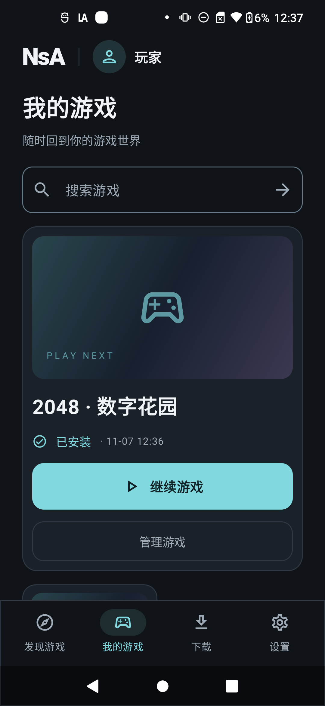
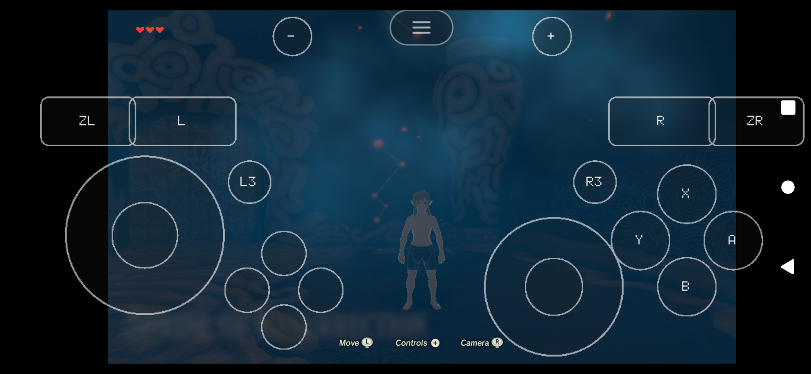
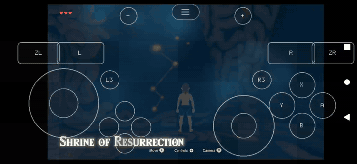

# NsA player and operating guide

[简体中文](README.zh-CN.md) · [Project README](../../README.md) · [All documentation](../README.md) · [Actual media](../media/README.md)

NsA's intended flow is **install → find → download → prepare → play → save → return** in one Android app. This guide describes implemented behavior. A catalogue operator prepares supported content and a matching app beforehand. The public v0.4.0 release supplies source and desktop authoring tools; the local two-game APK and a hosted public catalogue are not included.

## Orientation and navigation

The finalized Obsidian interface is dark and portrait. Discovery, Library, Downloads and Settings are the four root tabs. Game details, management, saves and help are secondary pages with Back navigation. Opening a cover does not start the game. Only the actual game activity enters landscape. Cancellation, failed launch and normal exit return to the source portrait flow, preserving navigation context where available.



The current app UI is Simplified Chinese. Names below include the visible Chinese labels where useful.

## First opening and game discovery

Complete the welcome page. The app records local preferences and creates installation credentials for the configured catalogue. These are installation credentials, not a required player password. Network failures retain the local library and available catalogue cache; cache presence, count and age are shown separately from current server results.

In **发现游戏 / Discovery**, browse recommendations or search by name. Genre and pagination operate on the catalogue. The default compatibility filter is **当前设备可玩 / Playable on this device**. **实验游戏 / Experimental games** is an explicit invited test view; **已安装 / Installed** filters fetched entries by local installation. A title absent from one filtered page is not a universal compatibility decision.

The detail page shows title, description, language, controls, download/expanded size, version, compatibility and the main action. A missing compiled runtime leads to an App update requirement before a large resource download. Experimental access requires server authorization plus explicit consent for that download.

## Download and preparation

1. Tap **下载游戏** and read the confirmation: actual archive size, additional preparation space and compatibility.
2. Confirm experimental access when applicable. Mobile/metered data requires the relevant separate approval under the default Wi-Fi preference.
3. Confirm the task. It remains in Downloads even after changing pages or recreating the Activity.
4. Follow its real state. The client preserves user intent independently from temporary network or runtime conditions.
5. After verification and preparation, the detail/library action becomes Play/Continue. Download completion alone is not installation activation.

| Displayed state | Meaning and available response |
|---|---|
| Queued | Another task or game owns the active operation; retain the task |
| Downloading | Actual bytes arrive; speed and ETA use observed three-second windows |
| Paused by user | Wait for explicit resume, including after network recovery |
| Waiting for conditions | Restore network/consent/space conditions, then follow the offered action |
| Verifying | Check blocks, archive and signed indexes |
| Preparing | Extract and verify into a staging directory, then journal activation |
| Ready | The matching installed release is activated; launch is a separate action |
| Failed | Keep the reported error; fix the condition and explicitly retry |
| Cancelled | Incomplete transfer material is cleaned after cancellation acknowledgement |

The client verifies 8 MiB checkpoints, `Content-Range`, ETag, block hashes and the final archive digest. Expired URLs are renewed for the same immutable object. ZIP64 preparation rejects unsafe paths, links, special files, duplicates/collisions, unexpected entries and size/hash mismatch. The operation lock serializes install/save/session changes. A live game defers resource preparation at a checkpoint.

Pause retains verified progress. Cancel asks for confirmation and removes incomplete transfer data after cleanup; it does not remove an installed game or saved progress. Task history remains visible. A failed grant/policy decision is not bypassed by retrying arbitrary URLs.

## Starting and controlling a game

Tap **继续游戏 / Continue** only after resources are ready. Preflight checks policy, real installed files, matching native slot and remaining space. The main process creates an authenticated session, then a fresh `:game` process loads only the selected native game library. Game code runs locally on the phone.





The current BotW integration exposes an on-screen controller; compatible physical controls depend on the title/profile. Game-specific language and settings are independent. The original 2048 demo also accepts directional inputs. A published catalogue cannot inject an arbitrary new native library: the required slot must already be in the APK.

Backgrounding, audio-focus loss or an output change pauses the runtime. Return to the app and explicitly continue when offered. Activity recreation and a new game session are different operations; recreation must retain ownership and must not start a duplicate game.

## Saving, exiting and reopening

Use the game's save operation. A visible “saving” message or changed frame is not sufficient proof of a completed save. The runtime reports actual committed progress and the app retains the per-game save/index state.

Press Android Back to open the native pause menu, select **返回游戏大厅**, then confirm **退出游戏**. Choose **继续游戏** in the confirmation to cancel and resume the same process. Normal exit ends the game process and restores the portrait detail page. Reopening uses a new game PID and reads committed bytes.

If the process cannot finish, the app can offer an explicit force-exit action with a second confirmation. **结束游戏进程** opens the confirmation; **结束进程** submits it. Forced exit may discard unsaved game progress. It cannot generate a successful save event.

If the hall is reconstructed while a game still owns the save lease, it must protect that data and authenticate reconnect to the existing session/generation/nonce. If the exclusive lease proves the old game is gone, reconciliation closes abandoned rows conservatively and removes their matching contexts. Unknown ownership remains protected. The isolated regression cases pass; controlled physical main-process-loss recovery is still an open acceptance case on the current phone.

## Library, resources and updates

| Action | Effect |
|---|---|
| Continue | Launch the activated release after preflight |
| Check/repair resources | Compare actual files to the signed index; redownload matching resources when required |
| Clear game cache | Remove rebuildable graphics/runtime cache; keep game resources and committed saves |
| Reset game settings | Reset only that game's settings after confirmation |
| Remove resources | Remove that installation; preserve saves by default |
| Delete saves/backups | Separate explicit destructive action; export important progress first |
| Update game content | Prepare a new immutable release, check save compatibility and retain the required previous installation |
| Update App | Verify package, digest, increasing version and installed signing certificate before system confirmation |

A first frame does not mark an installation healthy. Rollback requires a previously healthy, compatible version. App updates back up installed-game saves before handing the APK to the system installer; backup failure prevents the hand-off. Android uninstall/clear-data can delete all private progress, so they are not routine troubleshooting steps.

## Exporting and importing saves

Exports use Android's document picker and a versioned ZIP manifest containing per-file hashes. The app fixes the export snapshot before choosing its destination. Keep external backups in a location under your control.

Imports validate the game, local player, save compatibility group, paths, file counts, size and every digest. A draft stays bound to its original game/operation. Before confirmation it can be cancelled. After confirmation the swap is protected against cancellation, repeated confirmation and outside dismissal; current progress is backed up before replacement. A persisted journal reconciles interrupted exchanges. Import completion does not auto-start a game.

Save paths are separate:

```text
files/content/<game>/versions/<release>/      installed resources
files/players/local/saves/<game>/committed/   actual committed progress
files/players/local/backups/<game>/          in-app backups
files/players/local/settings/<game>/         independent settings
files/transfers/<task>/                      incomplete downloads
files/sessions/<session>/                   bounded runtime diagnostics
```

## Settings, storage and feedback

Settings includes network preference, notifications, player display preferences, reduced motion, device support, storage, help, privacy, update and about pages. Reduced motion changes the actual animation scale. Cache, resources, settings and save deletion have separate controls.

Additional preparation space is the remaining archive plus remaining expanded content, working space and `max(2 GiB, ceil(expanded × 5%))` reserve. Updates also retain the previous version and required save backup. BotW's measured initial additional requirement is approximately 30.592 GiB; this is independent of APK size. See [storage](storage.md).

Feedback accepts 10–2000 characters. Diagnostics are explicitly selected for each submission, filtered and capped at 10 MiB. Normal feedback does not attach personal saves, game content or credentials. Uploaded diagnostics have a 30-day retention policy. Local session logs are bounded; Android scheduling opportunities determine maintenance timing.

## Local connection and common failures

The developer build connects to `https://localhost:8443` over USB reverse. The local CA is debug-only. Keep the API, worker and USB available for catalogue/download operations. A prepared installation may use its signed offline policy, but known blocking policy and save/runtime protection still apply. Production operators supply a real HTTPS origin and signing trust.

| Problem | Response |
|---|---|
| Connection unavailable | Check USB authorization/reverse, matching CA and API/worker; preserve existing installation data |
| Invitation expired/consumed | Developer regenerates only provisioning, rebuilds and overlays without resetting runtime/content identities |
| Missing slot/profile | Install an operator-prepared APK with the matching compiled slot |
| Resource/hash failure | Preserve the reported release/error, check space and repair or redownload |
| Ownership uncertain | Keep data protected; retry or explicitly confirm termination when offered |
| Different update certificate | Obtain the correctly signed app; do not uninstall merely to bypass the check |
| Low speed or black scene | Treat as experimental; report exact build/content/driver/device and selected diagnostics |

[Development](../development.md) · [Deployment](../deployment.md) · [Exact verification status](implementation-status.md) · [Media provenance](../media/README.md)
