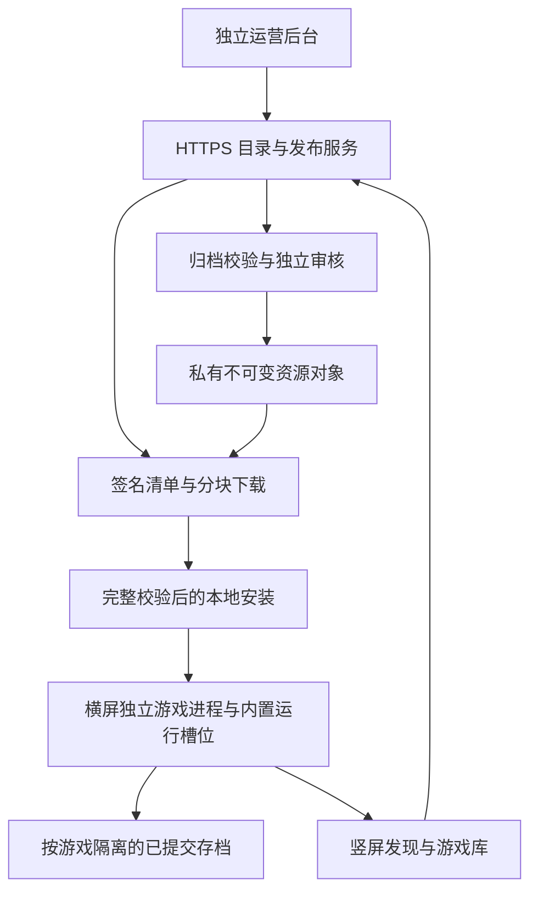

# 统一游戏大厅：方案与使用手册

[English](README.md) · [项目首页](../../README.zh-CN.md) · [完整产品需求](../product/README.md) · [技术开发约束](../engineering/README.md)

[实际验证](implementation-status.md) · [后续真机步骤](device-validation.md) · [机器可读执行记录](verification/2026-11-07-main.json) · [截图与录屏](../media/README.md) · [空间实测](storage.md)

[90 项需求实现对照](requirement-coverage.md)关联原有 360 条细则、代码入口与验收边界；[验证记录](implementation-status.md)只登记真实执行结果。



目标使用流程为：安装 App → 找到支持的游戏 → 确认下载 → 准备资源 → 游玩 → 保存并返回。运营人员须提前完成对应版本的适配、打包、审核和发布；缺少 App 内置运行组件的游戏先更新 App，不能仅靠资源下载获得新运行能力。当前本地方案为受邀开发渠道，公开下载的正式 App 与线上服务仍需单独部署。

安装凭据在续期前加密并同步写入，临时连接失败保留待处理记录；重试复用同一回执。凭据过期返回 `AUTH_EXPIRED`/401，内容权限不足保持 403。内测邀请已消耗且恢复窗口已过时，可执行 `services/.venv/Scripts/python.exe devtools/hall_local.py init`，再执行 `hall.ps1 build` 和 `hall.ps1 install` 获取新的本地调试邀请；保留已有资源与存档，也不重新生成运行身份或已发布内容。续期回执保留 24 小时，首次登记回执为十分钟；这些恢复窗口不延长内容授权。详见 [ADR 0006](../engineering/decisions/0006-durable-credential-renewal.md)。原创 2048 采用独立 [MIT 许可](../../android/native-games/2048/LICENSE)，其他组件保留各自上游许可。

## 目标与界面

用户安装一个 Android App，在发现页找到目标游戏，查看适配与空间要求，确认下载后由 App 完成校验、安装与运行准备，随后在同一 App 内进入横屏游戏。退出后回到竖屏大厅，可继续其他游戏。大厅采用已定稿的 D「曜黑极简」方案：背景 `#101317`、卡片 `#1B2128`、强调色 `#81D8DF`，四个入口是发现游戏、我的游戏、下载、设置。管理后台是独立工作人员页面。

这里的“已安装”“实验适配”“已验证可玩”是不同状态。目录可见、下载成功或出现第一帧，都不能替代真实试玩、声音、操作、保存与重新读取的验证。当前本地《旷野之息》的单游戏旧构建与统一大厅新构建也必须分别记录结果。

## 工程组成

| 部分 | 实现与职责 |
|---|---|
| Android 大厅 | Kotlin、Compose；页面、导航、缓存、搜索、管理与系统文件选择器 |
| 持久化 | Room 保存游戏、任务、安装、会话与策略；DataStore 保存偏好；安装凭据由 Android Keystore 加密 |
| 下载与安装 | 单任务、单连接、8 MiB 分块、范围与摘要检查、安全 ZIP64 解包、安装恢复记录 |
| 游戏进程 | 同一 APK 中的编译槽位，独立 `:game` 进程；每次切换结束前一进程 |
| 原生桥接 | ABI 1，启动身份绑定，Surface/InputQueue 回放，相关联的运行事件；大厅进程负责数据库写入 |
| 目录服务 | FastAPI；匿名安装身份、目录、适配、签名清单、短期下载链接与反馈 |
| 发布工作进程 | 重新读取私有文件，检查清单、全部文件及分块后登记结果 |
| 工作人员后台 | 游戏资料、授权、构建、上传、独立审核、发布、阻断、反馈与审计 |
| 生产存储 | PostgreSQL 与私有 S3；Windows 本地开发使用 SQLite 与私有本地文件目录 |

代码不会从目录下载新的运行 `.so`。槽位、核心、适配配置、模块标识和着色器链必须与 APK 内登记内容一致。游戏程序内容与资源包另行准备；源码仓库不包含游戏本体、密钥、用户存档或私有调试产物。

## 文件组织与约束

```text
android/                         Android App、大厅、运行边界与端侧测试
android/native-games/2048/        独立原生开源游戏
nxnative/dm/android/             原生宿主、图形适配与大厅 ABI 适配器
services/catalog/               目录、身份、下载授权、发布与反馈 API
services/worker/                异步校验、回读与保留期清理
services/admin/                 工作人员内容工作台
content_tools/                  ZIP64 打包、索引、上传与发布客户端
devtools/hall*.py, hall*.ps1     Windows 构建、USB 检查与素材处理
docs/product/, docs/engineering/ 产品与工程约束、机器契约和验收编号
docs/design/obsidian-portrait/   已选定的完整设计规格
docs/media/                     审核后的真实程序展示素材
.gamedump/Hall/                  私有构建、资源包与真机原始证据，不入库
services/local/, tools/hall/     本地凭据、工具与缓存，不入库
```

手机上的资源按 `content/<game>/versions/<release>/` 保存；玩家进度按 `players/local/saves/<game>/committed/` 隔离。下载位于独立任务目录，运行临时文件位于单次会话目录。游戏更新不复用另一款游戏的存档、设置或缓存。

默认目录筛选是“本机可玩”，按当前设备和 APK 的实际组合核对证据；主动选择“实验游戏”后才展示受邀测试内容。“已安装”筛选当前已取得的目录页，类型筛选与加载更多可以同时使用。筛选后为空不等于整个后续目录都没有匹配项。实验下载仍需逐任务确认；缺少内置运行组件时先引导更新 App。

取消任务先说明未完成文件会被移除；需要保留进度应选择暂停。默认网络策略也检查计费 Wi-Fi，速度与剩余时间来自三秒采样窗口并标为估计值。游戏运行期间在检查点暂停资源准备，退出后按原有网络与用户选择恢复调度。

图形缓存、设置与布局重置、游戏资源删除、存档与本地备份删除各有独立动作。缓存绑定实际运行库与驱动标识，清理后重建；删除存档需再次确认，不会删除已导出至 App 外的文件。“减少动态效果”控制实际 Compose 动画；后台、声音焦点丢失或耳机输出变化会暂停运行，继续时重新申请声音焦点。

活动会话日志最多四份、每份 10 MiB；启动新游戏前旧日志压到 10 MiB，整体预算 50 MiB。启动、结束和本地维护任务清理超过七天的日志；后台任务以 Android 的实际调度时机为准。实现约束见 [ADR 0005](../engineering/decisions/0005-client-guardrails-and-cache.md)。

页面重建保留当前运行协调器，并在页面重新可见后接续启动；不会因为 Activity 重建再次初始化并误判正在运行的会话。启动、安装与存档交换互斥，确认导入时会重新核对当前安装版本的兼容组。应用更新包通过摘要、包名、版本及签名校验后，会先为已有进度的已安装游戏创建本地备份，再交给系统安装；备份失败时停止更新交接。取消启动会等待本次检查点清理，旧进程的延迟消息不会结束后来启动的游戏。

## 本地准备与启动

需要 Git、Python 3.13、Java 21、已有 Android SDK 36、NDK r27c 及 USB 连接的 Android 12+ arm64 真机。所有新工具、缓存和构建输出留在 `游戏移植/`。禁止使用 Docker、WSL、虚拟机与 Android 模拟器。

```powershell
./devtools/hall_bootstrap.ps1
./devtools/hall.ps1 native
./devtools/hall.ps1 build
```

固定工具版本为 Gradle 8.13、AGP 8.13.2、Kotlin 2.2.21、Compose BOM 2025.11.00、Room 2.8.4。最低 Android API 31，目标与编译 API 36，仅构建 arm64-v8a。脚本校验 Gradle 下载摘要，并将需要的已安装 SDK 组件复制到本工作区。

正式服务地址在构建时传入，例如 `gradle -p android -Pnsa.catalogUrl=https://catalog.example.org assembleRelease`，需替换示例域名。默认 localhost 用于 USB 本地开发。正式签名、内容签名信任、域名与服务部署需配套配置；公开分发前从干净的已提交源码重新生成运行身份，并登记匹配的不可变内容发布记录。

引导脚本先设置工作区内的临时与 pip 缓存目录，再建立 Python 环境并安装 `services/requirements-dev.txt`。默认只选择原创开源 2048，不读取私有游戏文件；重新构建纯示例时会移除先前未选择的生成运行库。

SDK 从 `NSA_SDK_SOURCE`、`ANDROID_SDK_ROOT` 或 Windows 已安装 SDK 中复制；来源 SDK 需事先接受许可证。NDK r27c 缺失时从 `NSA_NDK_SOURCE` 或已有安装复制到 `tools/player/toolchains/android-ndk-r27c`。已有工作区工具会复用。服务与上游核心检查使用同一个开发环境，Qt 仅用于另外的上游桌面 GUI。`hall_native.py --ndk ... --slots ...` 可显式指定工具链与槽位。

本机双游戏配置需在原生编译和打包前显式执行 `hall_bootstrap.ps1 -WithBotw`，或在准备后运行 `hall.ps1 identities -WithBotw`。该配置只读已有 `.gamedump/BOTW`，新增内容写入 `.gamedump/Hall`；其他电脑提供自己的游戏输入和配置。已发布版本不要直接重新生成身份：运行库变更需要新的 App 构建和不可变发布编号。

长时间构建可以用原生 Windows 后台任务运行，关闭终端后仍能读取状态；重复启动同一活动任务会被拒绝：

```powershell
./devtools/hall_jobs.ps1 start Android
./devtools/hall_jobs.ps1 status Android
./devtools/hall_jobs.ps1 start Content
./devtools/hall_jobs.ps1 status Content
```

任务状态与日志在 `output/hall/jobs/<任务>/`。`running` 只代表进程仍在处理，成功必须以 `succeeded`、退出码和相应产物共同确认。它不代表游戏或产品验收通过。

安装前会检查 APK 内关键类、运行登记表和原生库摘要。更改 Windows 编译编码或移动工程后，执行 `./devtools/hall.ps1 rebuild`，清理旧产物再重新构建。真机契约检查位于 `DeviceContractTest`：它读取实际设备信息并验证发送格式，覆盖 API 31 的平台 JSON 行为。

首次准备会生成本地 TLS 证书、内容签名密钥、编辑与审核两份独立后台凭据，以及仅供内部调试的单次邀请。它们均不入库，工具不会在输出中打印凭据。正式构建不带本地开发证书或邀请文件。

分别在两个原生 PowerShell 终端启动服务与工作进程：

```powershell
./devtools/hall.ps1 serve
./devtools/hall.ps1 worker
```

服务只在本机 `127.0.0.1:8443` 监听 HTTPS，后台入口是 `https://localhost:8443/operations/`。本地凭据位于被忽略的 `services/local/development-credentials.json`。浏览器检查需明确信任本地证书；不要关闭全局证书校验。浏览器使用结束后关闭不再使用的标签页。

第三个终端可准备与发布本地内容，并安装独立调试包：

```powershell
./devtools/hall.ps1 content
./devtools/hall.ps1 publish-2048
./devtools/hall.ps1 install
```

只有显式启用本机双游戏配置时，才另行执行 `hall.ps1 publish-botw`；该步骤不会授予公开分发游戏的权利。

发布客户端执行真实上传、分片完成、服务端回读、构建登记、授权审核、异步文件检查、独立发布审核及内部上架。它不会自动把游戏标为已验证可玩。第一次完整准备《旷野之息》包会额外占用大量空间；原始游戏目录只读，统一大厅的新增包与构建保存在 `.gamedump/Hall`。

发布记录保存在私有包目录，包含幂等键、已上传分片与任务编号；中断后重新执行同一发布即可继续。记录中的授权链接也需保密。分片上传会话有效 24 小时，分片链接可刷新；单文件上传授权过期时可能需要新建上传。输入变更必须使用新发布编号，可通过 `content_tools.publish --release-id ...` 选择已准备的对应包。阻断、下架或拒绝状态需人工处理，自动续传不会重新上架。后台校验会续期任务所有权，并保留其他工作进程或管理员的更新；大文件回读与身份检查不会占住 API 的事件循环。

安装脚本要求恰好一台已授权 USB 真机，安装包名 `org.nsa.hall.debug`，保留现有单游戏 App。通过 ADB reverse 将手机的本机 HTTPS 端口连接到电脑服务。拔掉 USB 后，本地目录服务连接会中断；已安装内容是否能离线运行由已知签名策略决定。面向用户发布时需要真实 HTTPS 域名与生产部署。

## 用户如何使用

1. 首次进入欢迎页，再进入发现游戏。网络暂不可用时保留缓存资料与已安装游戏。
2. 按名称或类型查找，进入详情，核对版本、语言、操作方式、下载大小、展开大小与适配限制。
3. 确认下载。空间估算包括未下载部分、未展开部分、工作空间和安全预留；不重复计算已占用数据。安全预留至少 2 GB 或展开大小的 5%。
4. 下载中心显示排队、下载、暂停、等待条件、校验、安装、失败、完成等实际状态。一次运行一个任务；移动网络按偏好与任务单独授权。用户主动暂停后不会因网络恢复自动继续。
5. 每个分块验证通过后才推进持久化进度；中断后重新检查已有分块，再继续下载。短期链接更新仍绑定同一资源摘要。
6. 资源在暂存目录逐文件展开并验证。路径越界、符号链接、特殊文件、大小异常、未登记内容和校验失败都会阻止安装。目录发布与数据库激活通过恢复记录协调。
7. 从我的游戏启动。启动检查通过后进入同一 App 的横屏游戏进程。返回键显示暂停与退出确认；正常退出回到原来的竖屏入口。
8. 在游戏内真正保存，再退出并重新进入读取。强制结束只结束进程，不会伪造“保存成功”。

原生 2048 是独立编译的开源游戏，用来验证通用下载、进程与存档流程。操作为滑动或方向键移动，右侧 `1` 撤回一步，`0` 开始新的一局；每次有效移动后实际写入存档。它的测试不能替代《旷野之息》或其他 Switch 游戏的适配验证。

## 状态与空间如何判断

| 显示状态 | 可执行操作与含义 |
|---|---|
| 实验适配 | 需要内部访问资格和本次确认；尚未达到完整可玩验收 |
| 已验证适配 | 对应发布版本、设备与驱动组合有通过门槛的真实证据 |
| 需要更新 App | 先安装包含所需运行槽位的新 App；只下载游戏资源不能解决 |
| 设备暂不支持 | 当前能力不满足该游戏声明的最低要求 |
| 已准备好 | 下载、索引、文件校验与安装提交完成；启动前仍需检查策略 |
| 已主动暂停 | 保留完整分块；网络恢复不会代替用户点击继续 |
| 等待恢复条件 | 网络或移动数据许可尚不满足；保留任务状态 |
| 资源版本已阻断 | 不再签发新下载链接，已知策略阻止启动；存档保留 |

新增空间计算为：`max(归档大小 - 已下载, 0) + max(展开大小 - 已展开, 0) + 工作空间 + max(2 GiB, ceil(展开大小 × 5%))`。游戏更新还会保留旧版本与必要的存档备份。完成后会清理可重建的下载临时文件；缓存清理不会删除已安装游戏或存档。构建工具、服务器私有对象副本和手机安装各自占用空间，不应只按 APK 大小估算整个方案。

## 如何增加一款游戏

1. 在原生层完成真实移植并编译独立运行库，确定模块标识、配置摘要、着色器链、存档兼容组和支持的驱动。
2. 在本地槽位配置中登记该库，重建 App 的运行登记表和 APK。仅更新远程目录不能增加一个尚未编译进 App 的核心。
3. 用 `content_tools.package` 为独立资源目录创建归档、文件索引、8 MiB 分块索引与候选清单；输出目录必须在输入树之外。
4. 在工作台登记游戏、分发材料和构建；上传真实文件并完成服务端回读。独立人员进行授权和发布审核。
5. 工作进程检查全部文件、路径、分块与绑定关系，签名后才可发布到对应目录。内部实验包需要内部凭据，不能通过客户端自报渠道获取。
6. 真机完成启动、实际操作、声音、存档重读、退出、连续游玩与性能检查，再附带真实证据登记兼容结论。

模块已存在不代表另一版本可以复用。游戏更新如改变程序模块、运行 API、适配配置或存档格式，必须重新核对槽位、升级 App 或执行明确的迁移流程。

## 数据与恢复规则

**存档：**退出游戏后可通过系统文件选择器导出备份，或者导入与当前游戏、玩家和格式兼容的备份。导入校验路径、文件数量、大小和摘要，并在替换前保留原有存档。取消文件选择不会修改数据。普通反馈不包含存档。

**删除：**默认只删除游戏资源，保留存档和备份；取消保留选项时会再次明确提示。清除 App 数据或卸载会删除私有目录，重要进度应先导出到 App 之外。

**更新：**游戏资源更新与 App 更新是两条不同路径。游戏更新先检查存档兼容并保留旧版本；仅凭第一帧不会把新版本标成健康。App 更新核验包名、版本、摘要与当前安装签名，然后交给系统确认安装。

**修复：**按安装清单读取真实文件并核验摘要，显示缺失或损坏项。修复重新下载资源，不覆盖存档。

**反馈：**问题描述 10–2000 字，可选联系方式。诊断附件由用户本次明确勾选，最大 10 MiB，仅含筛选后的状态与设备能力；不含凭据、密钥、原始游戏内容或存档，服务保留 30 天。

## 后台、部署与开发约束

编辑者上传内容与登记构建，授权审核者检查分发材料，独立审核者审核发布，发布者执行上架、下架与阻断。相同人员不能审核自己创建的记录。变更需要幂等键、预期版本和原因；审计记录包含操作者、动作、对象、请求编号与原因。

生产登录使用 OIDC 与 PKCE，服务端校验 JWT 签名、签发者、受众与过期时间。角色以服务端记录为准；客户端填写 `internal` 不会获得内部权限。服务保留原有 43 个操作，并以 v1.1 增补 App 更新下载/发布与角色管理四个操作。

生产部署配置、私有 S3、PostgreSQL 初始化和 OIDC 环境变量见 [英文手册](README.md#staff-workflow-and-deployment)。生产配置缺少数据库、身份、S3 或足够长度服务密钥时拒绝启动。部署前仍需实际检查备份恢复、访问控制、长文件上传和真机兼容。

每轮先完成整批代码，再集中验证。运行 `./devtools/hall.ps1 verify` 执行服务集成检查、原有核心检查与 Android 检查。所有测试结论以 [实现与验证记录](implementation-status.md) 为准，需求文档完整不代表程序验收完成。

## 常见恢复操作

| 遇到的问题 | 建议操作 |
|---|---|
| USB 本地目录无法连接 | 检查 API 与工作进程、USB 授权和 `adb reverse tcp:8443 tcp:8443`；确认本地证书与 App 构建配套 |
| 内部邀请失效 | 在开发机重新准备单次邀请并重建内部调试包；不要在日志中粘贴邀请或访问凭据 |
| 下载链接过期 | 由任务续签同一资源；若版本被阻断，保留存档并等待可用版本 |
| 空间不足 | 暂停任务，清理可重建缓存或删除其他资源；先导出需要保留的存档 |
| 资源不完整 | 从管理页执行校验，再重新下载对应版本；不能手工补入不匹配的模块 |
| 游戏黑屏或崩溃 | 返回大厅后记录版本和设备状态，按本次授权提交筛选诊断；不将首次出图当作验收成功 |
| 需要强制退出 | 明确确认后结束游戏进程；未真实保存的进度可能丢失 |
| 更新签名不一致 | 停止更新，使用与当前 App 相同签名的正确构建；不要以卸载来绕过检查导致进度丢失 |

测试工具 `devtools/hall_smoke.py` 通过真实 USB 页面点击和方向输入执行流程，检查游戏进程、存档变化和重新读取。原始报告与运行录像保存在私有证据目录，公开 README 只引用审核后的展示素材。

## 截图、录屏与 GIF

`hall_device.py capture` 通过 USB 获取手机真实截图，`record` 获取真实录屏并保存来源记录。原始素材先保存在 `.gamedump/Hall/device-evidence`，审核后将适合公开的大厅页面截图与 GIF 放进 `docs/media`。包含游戏内容与私有信息的素材保持私有；设计原型截图不能当作程序运行证据。

```powershell
services/.venv/Scripts/python.exe devtools/hall_smoke.py all
services/.venv/Scripts/python.exe devtools/hall_media.py --source .gamedump/Hall/device-evidence/discovery.png --name discovery
services/.venv/Scripts/python.exe devtools/hall_media.py --source .gamedump/Hall/device-evidence/hall-walkthrough.mp4 --name hall-walkthrough --start 0 --duration 20
services/.venv/Scripts/python.exe devtools/hall_media.py --source .gamedump/Hall/device-evidence/2048-play.mp4 --name native-2048 --width 720 --duration 10
```

`all` 复测会删除并重新下载已安装的 **2048 示例资源**，默认保留存档，并核对删除、重新安装前后的存档字节一致。测试仅操作独立 NsA 调试 App，不修改原有商业游戏 App。NsA 一旦失去前台，工具会停止发送输入。视频为静音屏幕录制，不能据此认定声音验收通过。

[执行记录](verification/2026-11-07-main.json)分别登记合并后的 main 与前一 APK，不能把不同 APK 的测试拼成同一构建通过。main 已将《旷野之息》原始存档读入神庙场景；移动、新保存重读、声音和完整 G0 尚待验收，待手机可用后按[真机步骤](device-validation.md)继续。

已完成的代码、文档和审核素材统一提交、推送到 `git@github.com:wikigsroom/NsA-core.git` 的 `main`，先获取并保留远端更新，不强制覆盖历史。私有调试配置、APK、游戏文件、密钥、存档和原始证据保持忽略。[验证记录](implementation-status.md)说明本地历史运行身份的保留范围；正式发布前必须重新生成匹配身份和不可变版本，完成签名、线上服务与设备验收。
