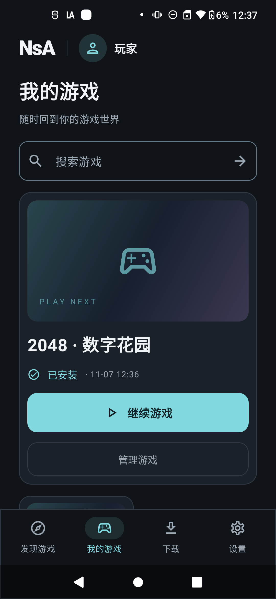
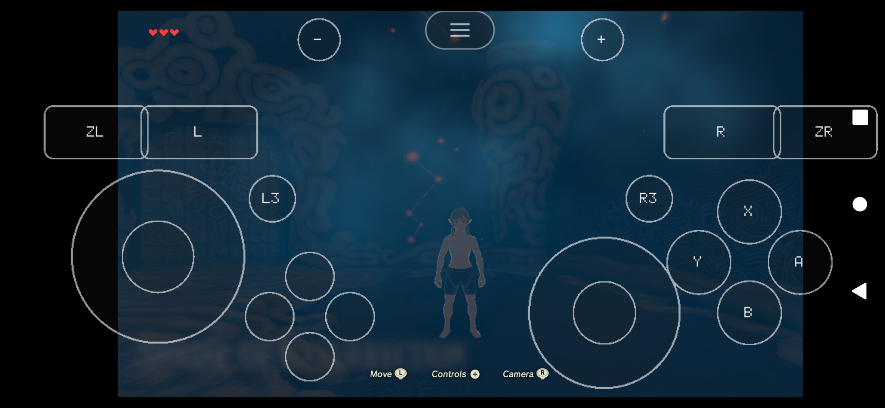
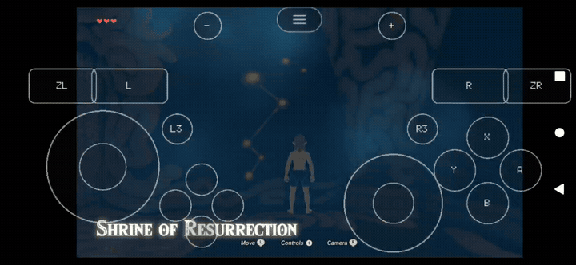

# NsA 玩家与操作手册

[English](README.md) · [项目说明](../../README.zh-CN.md) · [文档总索引](../README.zh-CN.md) · [实机素材](../media/README.md)

目标是在同一 Android App 完成**安装 → 找游戏 → 下载 → 准备 → 游玩 → 保存 → 返回**。本手册描述已有实现；运营方需要先准备支持的内容和匹配 App。公开 v0.4.0 提供源码与桌面制作工具，不附本机双游戏 APK 或已部署的公共游戏目录。

## 方向与导航

曜黑极简界面默认暗色竖屏。发现游戏、我的游戏、下载、设置是四个根页签；详情、管理、存档与帮助为二级页面，使用返回导航。点封面进入详情，不直接开始游戏。实际游戏窗口才横屏；取消、启动失败和正常退出恢复来源竖屏流程，并尽量保留导航上下文。



当前 App 界面使用简体中文。

## 首次进入与查找游戏

完成欢迎页后，App 保存本机偏好，并向配置的目录创建安装凭据，不要求玩家提供账号密码。网络故障时保留本地游戏库和可用目录缓存；缓存有无、数量与更新时间独立于服务器当前结果显示。

在**发现游戏**浏览推荐、按名称搜索，并使用类型筛选和分页。默认**当前设备可玩**按当前手机与内置注册表评估；**实验游戏**需主动选择且具有内测资格；**已安装**按本地安装状态筛选本次取得的目录条目。某一筛选页没有结果，不代表所有分页或全部游戏都不支持。

详情展示标题、简介、语言、操作、下载量、展开空间、版本、适配状态与主要动作。缺少内置运行模块时，先提示更新 App，再决定是否能下载；实验下载同时要求服务授权与本任务的明确确认。

## 下载与准备

1. 点**下载游戏**，阅读实际归档量、新增准备空间及兼容说明。
2. 如属实验内容，确认本次实验说明。默认 Wi-Fi 策略下，移动或计费网络需要额外授权。
3. 确认任务，离开页面或重建 Activity 不会丢失任务。
4. 在下载中心查看实际状态；用户主动暂停与临时网络/运行条件分别保存。
5. 资源经过校验和准备、安装激活后，详情与游戏库才提供继续游戏。网络下载结束不等于安装激活。

| 状态 | 含义与操作 |
|---|---|
| 排队等待 | 其他任务或游戏占用活动操作，保留任务 |
| 正在下载 | 实际传输字节；速度和预计时间来自三秒观测窗口 |
| 已主动暂停 | 网络恢复后仍需主动继续 |
| 等待恢复条件 | 恢复网络、授权或空间条件，并按界面提示操作 |
| 正在校验文件 | 校验分块、完整归档与签名索引 |
| 正在准备游戏 | 流式展开到暂存目录，逐文件核对，再按持久日志激活 |
| 游戏已准备好 | 对应资源已经激活，开始游戏仍是单独动作 |
| 任务失败，可重试 | 保留错误，解决原因后明确重试 |
| 已取消 | 取消确认后等待清理完成，删除未完成传输材料 |

下载校验 8 MiB 检查点、`Content-Range`、ETag、分块摘要与完整归档摘要；链接过期时，只为同一不可变对象续签。ZIP64 准备拒绝危险路径、链接、特殊文件、重复冲突、额外文件及大小/摘要不符。操作锁串行化安装、存档与会话变更；游戏运行时，资源准备在检查点等待。

暂停保留已校验进度。取消需要确认，在清理应答后移除未完成传输材料，不会删除已安装游戏和存档。已完成记录属于任务历史。授权或策略拒绝不能通过任意替换地址绕过。

## 启动与操作游戏

资源就绪后点**继续游戏**。预检查核对策略、真实文件、内置运行身份和空间。主进程建立带身份校验的会话，新的 `:game` 进程只加载所选原生游戏模块，以横屏在手机本机运行。





当前 BotW 接入提供屏幕触控手柄；外接控制器支持依具体游戏与配置。语言、图形与游戏设置按游戏隔离。原创 2048 可接收方向输入。目录不能远程塞入任意原生库，APK 必须预先包含对应运行模块。

切后台、失去音频焦点或输出设备变化时暂停；回到 App 后按提示主动继续。Activity 重建不等于新游戏会话，重建应保留既有归属，不能重复启动游戏。

## 保存、退出与再次启动

通过游戏自身执行保存。出现“正在保存”或画面变化，不能直接认定写档完成；运行层以实际提交事件与已写入的游戏数据为准。

按系统返回打开暂停菜单，选择**返回游戏大厅**，再确认**退出游戏**。在确认中选**继续游戏**会取消退出并恢复同一进程。正常退出应释放游戏进程并恢复竖屏详情；再次启动使用新进程读取已提交字节。

进程迟迟不退出时，可提供明确的强制结束和第二次确认：**结束游戏进程**只是打开确认，**结束进程**才提交。强制退出可能丢失尚未保存的进度，不能产生虚构的保存成功事件。

大厅重建时，如游戏仍占用内核存档锁，继续保护并核对原会话、代次与 nonce 后重连；拿到排他锁确认旧进程已离开后，才保守关闭无主记录并清理对应恢复信息。无法确认归属时继续保护。隔离回归已通过；当前手机的受控大厅进程死亡重连仍属于开放实测项。

## 游戏库、资源与更新

| 操作 | 影响 |
|---|---|
| 继续游戏 | 预检查后运行已激活的版本 |
| 检查/修复资源 | 依据签名索引核对真实文件，必要时重下对应资源 |
| 清理游戏缓存 | 删除可重建图形/运行缓存，保留资源和已提交存档 |
| 重置游戏设置 | 确认后只重置这一款游戏的设置 |
| 删除资源 | 删除此安装，默认保留存档 |
| 删除存档/备份 | 单独确认的破坏性动作，先导出重要进度 |
| 更新游戏内容 | 准备新不可变版本、检查存档兼容并保留所需旧安装 |
| 更新 App | 核对包名、摘要、递增版本号和当前签名，再交系统确认 |

游戏首帧不能直接标记安装健康，回退要求已有健康且兼容的版本。App 更新交给系统安装器前，会备份已安装游戏存档；备份失败则不继续安装。卸载/清除应用数据可能删掉所有私有进度，不属于常规修复方法。

## 导出和导入存档

导出使用 Android 文档选择器，生成带版本和逐文件摘要的 ZIP；打开目标选择器前固定快照。外部备份由玩家自行保管。

导入核对游戏、本地玩家、兼容组、路径、文件数量、大小与全部摘要。草稿固定到原游戏与操作身份；确认前可取消，确认后禁止取消、重复确认和外部点击关闭，展示实际处理中。替换前备份当前存档，通过持久交换日志恢复中断。导入完成不自动启动游戏。

```text
files/content/<game>/versions/<release>/      已安装资源
files/players/local/saves/<game>/committed/   实际已提交进度
files/players/local/backups/<game>/          App 内备份
files/players/local/settings/<game>/         按游戏隔离设置
files/transfers/<task>/                      未完成下载
files/sessions/<session>/                   有大小限制的运行诊断
```

## 设置、空间与反馈

设置包含网络偏好、通知、本地玩家偏好、减少动态效果、设备支持、空间、帮助、隐私、更新和关于页面。减少动态效果会改变实际动画比例；缓存、资源、设置和存档分别管理。

新增准备空间为未下载归档量、未安装展开量、工作空间及 `max(2 GiB, ceil(展开量 × 5%))` 余量；更新还需前版与必要备份。BotW 首次准备实测约需 30.592 GiB 新增可用空间，与 APK 大小分别计算，详见[空间实测](storage.md)。

反馈正文接受 10～2000 字符。诊断需每次明确选择，过滤后上限 10 MiB；普通反馈不附个人存档、游戏内容或凭据。上传诊断保留策略为 30 天。本地会话日志有大小限制，维护时间受 Android 调度机会影响。

## 本地连接与常见故障

开发包通过 USB reverse 连接 `https://localhost:8443`，开发 CA 仅用于 debug。目录和下载需要 API、worker、USB 配套可用。已准备的资源可依据签名离线策略运行；已知阻断策略与存档保护继续适用。生产运营方需提供真实 HTTPS 地址和签名信任。

| 问题 | 处理 |
|---|---|
| 无法连接 | 核对 USB 授权/reverse、配套 CA 和 API/worker，保留原安装数据 |
| 内测邀请过期/已用 | 开发者只更新本机凭据并重新覆盖安装，不重置运行身份与已发布内容 |
| 缺模块/配置 | 安装运营方准备的、含匹配原生模块的 APK |
| 资源或摘要错误 | 保留版本与错误信息，检查空间后修复或重下 |
| 归属未知 | 继续保护数据，按界面重试或明确确认结束进程 |
| 更新签名不符 | 使用正确签名的安装包，不为绕过检查而卸载 |
| 低速或黑屏 | 保持实验状态，报告准确构建/内容/驱动/设备及选择的诊断 |

[开发手册](../development.zh-CN.md) · [部署手册](../deployment.zh-CN.md) · [准确验证状态](implementation-status.md) · [素材来源](../media/README.md)
