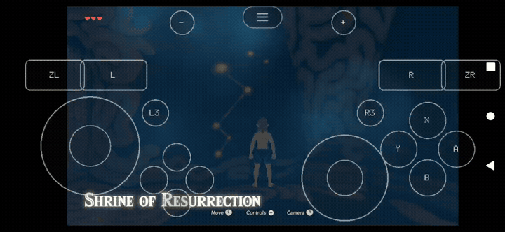
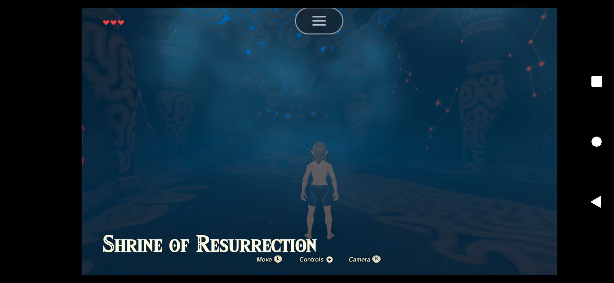
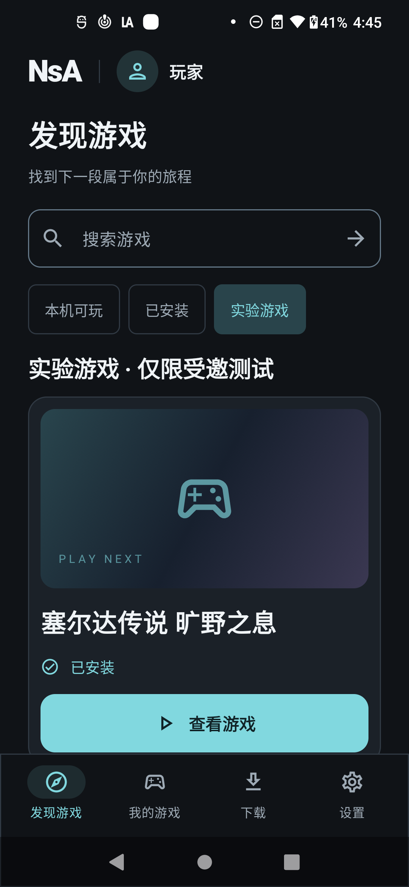
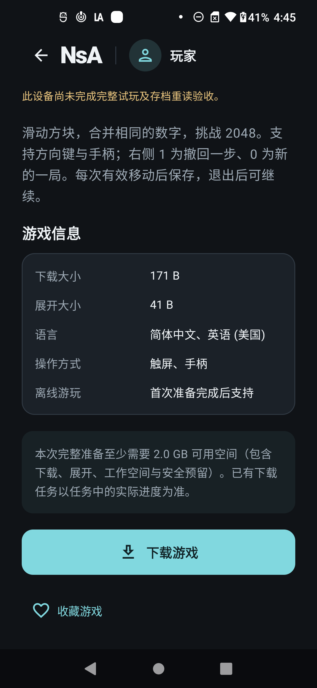
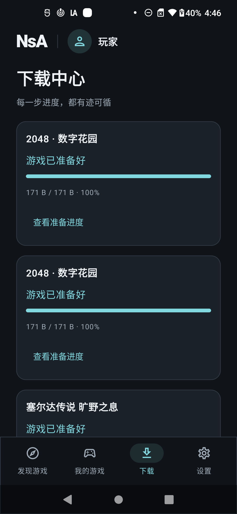

# Actual screenshots, gameplay and recordings / 实机截图与录屏

[Project / 项目](../../README.md) · [中文项目说明](../../README.zh-CN.md) · [Player guide / 玩家手册](../hall/README.md) · [Verification / 验证](../hall/implementation-status.md)

This gallery contains actual USB phone captures and separately identified desktop staff-site captures. It includes **real BotW gameplay and original native 2048 gameplay**. Design images remain in [the design directory](../design/obsidian-portrait/README.md).

这里包含真实 USB 手机截图、游戏游玩片段，以及单独标记的桌面运营后台。设计图不作为程序运行截图。公开版本说明允许展示已检查的游戏画面，商业游戏程序、密钥、内部 APK 与玩家存档继续保留本机。

## Current phone gameplay / 当前实机游戏

Android source `5c1bff0`; native source `d427f08`; installed APK SHA-256 **`3bd6c8a7e5a06bc1679df78792f97827455f8c915e5be4c31728ca15f6a3451d`**. Device: Motorola edge plus, Android 12 / API 31, Snapdragon 865 / Adreno 650, arm64-v8a, 4096-byte pages. Date: 2026-11-07, Asia/Taipei.

| Capture / 实拍内容 | View / 查看 | Provenance / 来源 |
|---|---|---|
| BotW after visible touch movement / 明确触控移动后的游戏 | [PNG](botw-gameplay.png) | [JSON](botw-gameplay.json) |
| BotW actual movement, 9-second excerpt / 9 秒实际移动片段 | [GIF](botw-input.gif) · [MP4](botw-input.mp4) | [JSON](botw-input.json) |
| BotW fresh-process save reload / 新进程读取新手动存档 | [PNG](botw-reloaded.png) | [JSON](botw-reloaded.json) |
| Portrait library / 竖屏游戏库 | [PNG](session-library.png) | [JSON](session-library.json) |
| Original 2048 fresh-process board / 原创 2048 新进程棋盘 | [PNG](session-reloaded.png) | [JSON](session-reloaded.json) |
| 2048 actual input and return, requested 20 seconds / 实际操作与返回 | [GIF](session-play.gif) · [MP4](session-play.mp4) | [JSON](session-play.json) |

The current set adds **4 PNGs, 2 GIFs and 2 MP4s**, with six provenance records. BotW's visible movement was reviewed from the retake's actual frames. The first touch attempt only woke the overlay and is retained privately without a movement pass. During the retake Android reclaimed the hall for low memory; the game exited normally, the reconstructed hall directly opened a fresh game process, and all three manual-slot files matched the new committed save. Exact interruptions and scope are in the [candidate record](../hall/session-recovery-round-2026-11-07.md).

本组新增 8 份素材、6 份来源。首次触控未确认位移，保留原记录；补录已确认角色移动。补录期间大厅被低内存回收，随后正常返回、直接重新打开游戏并读回新存档；这不等于所有重连时序、持续可玩性或完整 G0 已验收。

All public clips are silent. GIF cadence/resize/palette conversion preserves elapsed time; no design or synthetic frames are inserted. JSON records exact encoded durations, dimensions, transformations, installed APK and source hash. New records also include the private source path relative to the repository for local auditing. The private recording itself stays ignored.

BotW remains experimental: low speed and graphics fidelity limitations remain visible in the real capture. The earlier shrine measurement was around 7–13 FPS; these clips are not a representative 30-minute benchmark. A silent clip cannot prove audio quality.

## Hall pages / 大厅页面

The screenshots below are retained from their original capture builds. A per-file JSON identifies each APK; none is relabeled as the current game candidate. / 下方页面保留原采集版本，逐份 JSON 记录真实 APK，不改写成新候选。

<table>
<tr><td></td><td></td><td></td></tr>
<tr><td>发现游戏 / Discovery</td><td>游戏详情 / Details</td><td>下载中心 / Downloads</td></tr>
</table>

| Page / 页面 | Screenshot | Provenance |
|---|---|---|
| Discovery / 发现 | [PNG](discovery.png) | [JSON](discovery.json) |
| Detail / 详情信息区 | [PNG](game-detail.png) | [JSON](game-detail.json) |
| Download confirmation / 下载确认 | [PNG](download-confirmation.png) | [JSON](download-confirmation.json) |
| Downloads/history / 下载与历史 | [PNG](downloads.png) | [JSON](downloads.json) |
| Prepared resources / 资源就绪 | [PNG](installed.png) | [JSON](installed.json) |
| Original library / 原游戏库 | [PNG](library.png) | [JSON](library.json) |
| Settings / 设置 | [PNG](settings.png) | [JSON](settings.json) |
| Device support / 设备支持 | [PNG](device-support.png) | [JSON](device-support.json) |
| Storage / 空间 | [PNG](storage.png) | [JSON](storage.json) |
| Help/feedback / 帮助反馈 | [PNG](feedback.png) | [JSON](feedback.json) |
| Manage game / 管理游戏 | [PNG](manage-game.png) | [JSON](manage-game.json) |
| Saves/backups / 存档备份 | [PNG](saves.png) | [JSON](saves.json) |
| Native pause / 原生暂停菜单 | [PNG](game-pause.png) | [JSON](game-pause.json) |
| Portrait return / 恢复竖屏 | [PNG](returned-portrait.png) | [JSON](returned-portrait.json) |
| Original 2048 input / 原生输入 | [PNG](2048-play.png) | [JSON](2048-play.json) |
| Original reloaded board / 原重读棋盘 | [PNG](2048-reloaded.png) | [JSON](2048-reloaded.json) |

Original hall sequence: [GIF](hall-walkthrough.gif) · [MP4](hall-walkthrough.mp4) · [JSON](hall-walkthrough.json). It shows detail → confirmation → preparation → library → settings, a 38-second excerpt beginning at source second 49. Original input: [GIF](native-2048.gif) · [MP4](native-2048.mp4) · [JSON](native-2048.json), about 7 seconds.

The original demo downloaded 171 bytes and expanded 41 bytes. These recordings demonstrate its real flow, not the duration of a commercial-game transfer. The original set has 16 Android PNGs, 3 desktop PNGs and 2 GIF/MP4 pairs. APK identities are retained in the neighboring JSON; the library came from a separate merged-main capture.

## Desktop operations / 桌面运营后台

| Staff page / 工作人员页面 | Screenshot |
|---|---|
| Game metadata / 游戏元数据 | [PNG](operations-games.png) |
| Publication management / 发布管理 | [PNG](operations-releases.png) |
| Service health / 服务健康 | [PNG](operations-health.png) |

[Desktop provenance](operations.json). These are desktop HTTPS website captures, not Android pages. Credential fields were cleared; the capture browser/context was closed. / 凭据框已清空，采集浏览器已关闭，不能把这些图当成安卓页面。

## Earlier candidate captures / 先前候选实拍

| Candidate / 候选 | Screenshots / 截图 | GIF / MP4 | Provenance |
|---|---|---|---|
| Native build `5808f5…6d06` | [Library](native-library.png) · [v4 prepared](native-installed.png) · [Reload](native-reloaded.png) | [Download GIF](native-hall.gif) · [MP4](native-hall.mp4); [Input GIF](native-play.gif) · [MP4](native-play.mp4) | [Library](native-library.json) · [Prepared](native-installed.json) · [Reload](native-reloaded.json) · [Download](native-hall.json) · [Input](native-play.json) |
| Runtime `d8c51a…79af` | [Library](runtime-library.png) · [v3 prepared](runtime-installed.png) · [Reload](runtime-reloaded.png) | [Download GIF](runtime-hall.gif) · [MP4](runtime-hall.mp4); [Input GIF](runtime-2048.gif) · [MP4](runtime-2048.mp4) | [Library](runtime-library.json) · [Prepared](runtime-installed.json) · [Reload](runtime-reloaded.json) · [Download](runtime-hall.json) · [Input](runtime-2048.json) |
| Transfer `e3b259…42da` | [Discovery](transfer-discovery.png) · [v2 prepared](transfer-installed.png) · [Reload](transfer-reloaded.png) | [Download GIF](transfer-hall.gif) · [MP4](transfer-hall.mp4); [Input GIF](transfer-2048.gif) · [MP4](transfer-2048.mp4) | [Discovery](transfer-discovery.json) · [Prepared](transfer-installed.json) · [Reload](transfer-reloaded.json) · [Download](transfer-hall.json) · [Input](transfer-2048.json) |

Each earlier set has three PNGs and two silent GIF/MP4 pairs. The native download excerpt requests 18 seconds, runtime download 15 seconds, other requested excerpts are recorded in their JSON. Actual encoded times control playback. Failed tests and interrupted scenarios remain in their execution records.

## Capture and review / 采集与检查

1. Use the USB physical device and verify NsA foreground ownership before input.
2. Capture into ignored `.gamedump/Hall/device-evidence/`, recording the exact installed APK.
3. Review scene/input, private information and context. Keep original attempts and sources unchanged.
4. Export with `devtools/hall_media.py`; preserve source hashes and the actual conversion/duration.
5. Decode videos and validate images/links/hashes. Publish only reviewed selected media.

中文：使用 USB 真机采集；先核对前台，再操作；检查真实画面与隐私；保留原始失败；导出后核对来源、摘要、尺寸与实际时长。截图体系包含真实游戏，不把设计原型或其他设备的效果冒充当前手机。
