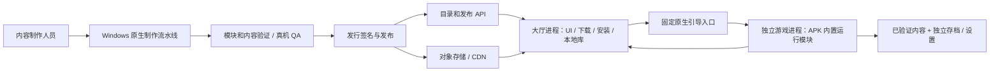
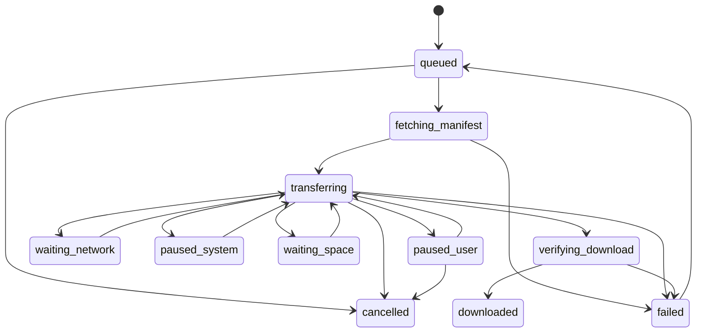

# NsA 游戏大厅技术方案与接口约定

版本：设计草案 v1.0；日期：2026-11-06（UTC+08:00）。

本文件服务于 [需求说明书](游戏大厅二次开发需求说明书.md)。字段、目录、接口和技术选型属于建议实现契约，尚未实现，也不声称现有仓库已经提供这些能力。接口冻结前以 G0 技术验证结果修订。

## 1. 源码依据与改造边界

阅读基线：`a8adac18b947cc8a0969bd15e039f8cde754293a`，另有未作为大厅实现发布的本地真机修复。

| 依据 | 已确认事实 | 必须改造的地方 |
| --- | --- | --- |
| [build.py](../../nxnative/dm/android/build.py) | `--game` 生成该游戏的 `game_profile.h` 和 `android_profile.h` | 生成多个有明确身份的运行模块，不能依赖一个编译配置覆盖全部游戏 |
| [pipeline.py](../../porter/pipeline.py) | 每个游戏分别构建 `libdmhost.so`、独立 APK 和数据目录 | 保留离线制作能力，新增模块导出和在线内容包阶段 |
| [mkapk.py](../../nxnative/dm/android/apk/mkapk.py) | NativeActivity 在清单中指定一个原生库；现有包可带额外 `.so` | 统一 App 使用 Android 工程与固定引导库，再选择已内置模块 |
| [front_android.c](../../nxnative/dm/android/front_android.c) | 根目录取应用数据路径；设置、日志、资源按单游戏组织；`on_destroy` 调用 `_exit(0)` | 启动上下文、资源/用户目录分离，游戏只结束自身进程 |
| [host/main.c](../../nxnative/dm/host/main.c) | 默认模块列表和参数来自编译 profile | 启动必须匹配对应 profile 与模块 Build ID |
| [host/loader.c](../../nxnative/dm/host/loader.c) | 改写模块被加载和映射为可执行代码 | 不能将 mods 描述成纯媒体素材；需验证目标系统的实际加载方式与渠道限制 |
| [datapack.py](../../porter/datapack.py) | 现有 manifest 以游戏/版本、文件数和大小为主，没有在线完整性协议 | 新增受签名的外层发行契约，保留与原制作链的追溯关系 |
| [saves_android.c](../../nxnative/dm/android/saves_android.c) | 已提交存档、临时导出、导入前备份和交换逻辑可复用 | 分游戏存档根目录、前台管理与系统文件选择器导出 |

运行层的通用修复继续放在 core；游戏差异保留在 profile 和 Build ID 对应补丁。大厅代码不按游戏名硬编码启动地址、图形能力或存档布局。现有原生键盘/文字与字体能力也要按游戏验收，不能从 Android 大厅支持中文推导出游戏输入层已经支持中文。

## 2. 首版架构选择

首版采用：**统一 Android App + APK 内预装的少量运行模块 + 可在线下载的版本化内容包 + 独立游戏进程。**

| 方案 | 本方案处理 |
| --- | --- |
| 外部安装并启动每游戏 APK | 只可作为旧测试工具；不能作为本需求端到端完成条件 |
| 一个完全通用的可切换运行库 | 作为后续演进；要先数据化编译 profile、全局状态和版本 ABI，不作为首版既有能力 |
| 按游戏内置运行模块 | 首版选择；运行模块随 App 升级，内容另行下载，目录规模先受控 |
| 从服务器下载任意宿主 `.so` | 不纳入首版；增加代码加载、渠道与版本失配问题，且仍不能解决游戏程序本身的交付约束 |

每个模块是 profile/核心/转换链固定的受控产物。两个游戏版本能否共享模块由构建与运行测试判定，不能只看名称相同。新游戏超出 APK 内置模块注册表时，目录返回 `app_update_required`。



### 2.1 建议技术栈

| 层 | 建议 | 理由与边界 |
| --- | --- | --- |
| Android UI | Kotlin、Jetpack Compose、Navigation | 原生界面接近系统权限、生命周期和 NDK 入口；现有 PySide6 为桌面 UI，不能直接当作 Android 大厅 |
| 本地事实来源 | Room 数据库、DataStore 偏好 | 任务/安装/会话以数据库为事实，简单偏好单独管理；原生进程不直接并发写大厅数据库 |
| 网络传输 | OkHttp 等支持 Range 的流式 HTTP 客户端 | 实现协议校验与可恢复分段，不使用把整个大包放进内存的请求方式 |
| 长传输调度 | API 34+ UIDT；API 31–33 用户主动启动的数据同步前台服务 | 按系统版本选择，均有持久化恢复。短任务才使用相应轻量调度；不承诺常驻后台 |
| 原生游戏 | 现有 C/C++/NDK、Vulkan、音频和输入层 | 加入引导 ABI、启动上下文与会话回调，保留单游戏开发入口便于回归 |
| 服务 API | Python + FastAPI 建议方案 | 复用团队已有 Python 工具经验；与内容构建进程分开，不在玩家 HTTP 请求内执行移植 |
| 元数据 | PostgreSQL 建议方案 | 游戏、发行、设备证据、下载会话、发布审计等关系数据 |
| 大文件 | S3 兼容对象存储 + CDN | 应用 API 只交付元数据和会话，大包走对象服务；不把游戏包放入 Git |
| 构建与开发 | 原生 Windows 工具、本地 Python、JDK/SDK/NDK | 本地不使用 Docker/WSL/虚拟机。服务可用原生进程或经项目方选定的托管服务部署 |

这是实现建议，不是所有依赖版本均已锁定。开工时锁定支持的库版本与更新策略。参考：[Compose](https://developer.android.com/compose)、[Android 存储与 Room](https://developer.android.com/training/data-storage)、[FastAPI](https://fastapi.tiangolo.com/)。

### 2.2 建议目录

```text
android/                 新建统一 Android 工程与大厅
services/catalog/        新建目录、发行、下载会话和管理 API
content_tools/           新增包格式、签名、索引与发布工具（纳入 Git）
porter/                  复用制作链，扩展导出步骤
nxnative/dm/android/     复用并改造运行前端和引导 ABI
docs/product/            需求、接口、任务与验收
.gamedump/<Game>/        已忽略的输入、构建、包、日志和设备证据
tools/                   已忽略的工具链、密钥和本地配置
```

现有根目录 `/tools/` 已被 `.gitignore` 忽略，因此需要提交的制作工具源码放在 `content_tools/`；不要把它们混入工具链缓存目录后遗漏提交。

不为本次文档创建这些代码模块的空壳，以免把建议目录误认成已实现功能。

## 3. 进程、运行模块与启动契约

### 3.1 进程模型

- 主进程负责 UI、Room、目录、任务协调、安装和运行会话记录。
- `:game` 为同一应用的普通独立进程，使用 `GameActivity` 和 NDK 入口，一次加载一个内置运行模块。
- 普通多进程不是虚拟机，也不是独立安全边界：通常仍共用应用 UID 和权限。它主要隔离退出、崩溃与原生全局状态。
- 游戏进程退出不代表大厅一定留在内存；系统也可能回收大厅。因此大厅必须能靠数据库和会话记录重建。
- 原生层不直接把数据库更新作为“保存已完成”；游戏存档仍由已有事务提交机制负责。

### 3.2 模块注册与 ABI v1

APK 内包含一个固定引导库，例如 `libnsa_bootstrap.so`，以及有唯一库名/SONAME 的宿主模块。清单不按网络返回值改库名，`GameActivity` 不对其他 App 导出。

构建时生成受 APK 签名保护的 `runtime-registry.json`，至少包括：

| 字段 | 含义 |
| --- | --- |
| `runtime_slot_id` | 模块的不可变身份，编码 profile/核心组合，而不是简单的游戏名 |
| `runtime_api_version` | 引导 ABI 版本，首版为 1 |
| `library_name` / `library_sha256` | APK 内允许加载的原生库与摘要 |
| `core_revision` / `profile_digest` | 核心提交和 profile 输入摘要 |
| `supported_module_build_ids` | 能接收的游戏模块 Build ID 集合 |
| `shader_bundle_versions` / `shader_chain_id` | 可接受的着色器格式与转换链 |
| `approved_driver_ids` | 随 APK 提供并经过验证的驱动身份 |
| `default_settings_schema` | 设置格式和默认值版本 |

建议导出 `nsa_runtime_get_info_v1`、`nsa_runtime_start_v1` 及受控退出入口。具体 C 结构要有 `struct_size` 与 ABI 版本，不能仅传一个含任意环境变量的 JSON。

引导过程：校验会话 → 生成可信路径/环境 → 从注册表选模块 → 加载内置库 → 比对模块信息 → 传入 Activity 和启动上下文 → 接收阶段事件。需要检查构造器是否在 `dlopen` 时读取路径或环境；相应数据必须在其第一次读取之前准备好。

直接调用原有 `ANativeActivity_onCreate` 会再次把目录写回单游戏默认路径，不能视作路径隔离已经完成。应重构公共初始化，并保留旧入口用于单游戏工具回归。

### 3.3 启动上下文

以下是逻辑字段示例，最终以 ABI 结构与客户端受控会话文件为准：

```json
{
  "launch_schema": 1,
  "session_id": "random-session-id",
  "game_id": "demo.a",
  "release_id": "demo-a-1.0-r1",
  "runtime_slot_id": "demo-a-core1-profile1",
  "manifest_sha256": "sha256-of-verified-release",
  "driver_id": "approved-driver-family",
  "settings_revision": 3,
  "local_player_id": "local-default"
}
```

绝对路径由客户端根据这些身份计算，不从网络 API 或外部 Intent 接受。引导层只接收经过验证的一次性会话标识；对游戏进程校验活动安装、模块、目录和独占锁。

事件至少有 `validating`、`loading_modules`、`preparing_graphics`、`first_frame`、`interactive`、`save_committed`、`exit_requested`、`exit_complete`、`fatal_error`。`first_frame` 和 `interactive` 要分开；暂时无法提供原生交互信号的游戏，在测试和指标中明确使用何种观察证据，不伪造该事件。

回调经受控 IPC/事件协议传回主进程。游戏崩溃用进程/连接断开与会话记录判断，不能依赖崩溃后仍能执行最后一次回调。

### 3.4 路径与可变数据

首版建议全部使用应用内部专用目录并保持同一存储卷，简化原生路径、权限和原子目录切换。大文件不放系统可随时清理的缓存目录。

```text
files/nsa/
  downloads/<task_id>/payload.part + progress.json
  staging/<install_id>/                  安装中的不可运行版本
  packages/<game_id>/<release_id>/       已验证的不可变版本
    mods/ RomFS/ shaders.dmsv profile.json
    verified-manifest.json + READY
  players/local-default/games/<game_id>/
    save/ save_device/                   事务实现可另用 save.work 等
    settings/ backups/
  caches/<game_id>/<cache_key>/
  sessions/<session_id>/                 临时运行文件和会话日志
```

目录名使用受控内部 ID；校验 canonical path、路径分隔符和生命周期。当前前端中日志重定向、`settings_load/save`、`DM_ROOT`、`DM_ROMFS`、`DM_SAVE`、`DM_TEMP`、`DM_VK_SHADERS` 与模块根路径都要改为显式上下文。不能让 `settings.txt` 或 `log.txt` 写入不可变的 package 目录。

旧 `env.txt` 需要转换为经过审核的设置映射：允许语言、已验证的渲染比例等字段；资源和存档路径、库路径、远程控制、probe 等由平台控制。发行构建禁用开发控制入口。每次会话创建全新进程，避免旧环境、缓存指针或控制线程遗留。

已有 BotW 测试包和未来正式大厅包名不同，不能假定共享私有数据。迁移走旧应用导出与新应用导入，迁移前计算同时存在两份资源或存档所需空间。

## 4. 内容制作和发行契约

### 4.1 发布前完成的工作

```text
输入来源/范围登记
  → 版本与 Build ID 检查
  → 现有 porter 提取、改写、着色器转换
  → 受控运行模块编译与 APK 注册表生成
  → 不可变内容目录与逐文件索引
  → ZIP64 包 + 8 MiB 下载分段摘要
  → 候选对象上传与上传后校验
  → 候选清单签名、仅开放相应内测资格
  → 实际客户端下载和真机 QA
  → 审核通过后发布正式目录
```

首版在线格式建议使用 ZIP64，允许大于 4 GiB 的包和文件；逐文件完整性索引独立交付。它是新包装层，原 `nx2a-data.json` 可保留为制作追踪信息，不能独自承担在线信任与依赖校验。

运行模块和图形驱动随 APK 发布；ZIP64 内容包仍包含改写游戏程序，不能对外称作纯素材下载。玩家不下载原始 NSP 再在手机上运行完整制作链。首次运行可能创建本机 Vulkan 管线缓存，需与发布前着色器转换区分。

### 4.2 版本维度

| 维度 | 示例 / 约束 | 变化后怎么处理 |
| --- | --- | --- |
| App `versionCode` | 整数递增、签名一致 | Android 系统更新；不能承诺静默安装 |
| 引导 ABI | `runtime_api_version=1` | 不兼容变更要同时更新 App 和内置模块 |
| 运行模块 | `runtime_slot_id` + 核心提交 + profile 摘要 | 必须存在于 APK；不可下载未注册库替代 |
| 游戏程序版本 | 显示版本 + 精确模块 Build ID | 适配补丁与对应运行模块重新验证 |
| 内容发行 | 不可变 `release_id` | 字节变动创建新 release，不能覆盖旧对象 |
| 着色器 | bundle 格式 + 转换链 ID + 输入摘要 | 不匹配则重制内容或使用匹配模块 |
| 图形驱动 | APK 内 driver ID + 文件摘要 | 更换驱动需重新确认 GPU 和游戏组合 |
| 用户设置 | 每游戏 schema revision | 显式迁移，保留可恢复默认值 |
| 存档 | 存档格式/兼容组与备份策略 | 不兼容回退需要提示与人工选择，不静默覆盖 |

APK 兼容窗口建议至少覆盖当前正式内容和承诺可回退的上一版本模块。移除老模块前，先评估已经安装的内容；新 App 安装后不能令原来可玩的资源毫无提示地失效。不能据“存档目录没变”推断两个游戏版本的存档格式兼容。

### 4.3 签名发行清单示例

以下是协议示意，摘要与内容均为占位，不代表已经制作出这款示例游戏。

```json
{
  "manifest_schema": 1,
  "release_id": "demo-a-1.0-r1",
  "game_id": "demo.a",
  "game_version": "1.0",
  "channel": "internal",
  "required_app_version_code": 100,
  "runtime": {
    "runtime_api_version": 1,
    "runtime_slot_id": "demo-a-core1-profile1",
    "profile_digest": "sha256-of-profile-inputs",
    "module_build_ids": {"main": "exact-main-build-id"},
    "shader_bundle_version": 2,
    "shader_chain_id": "exact-shader-chain-id"
  },
  "artifact": {
    "object_id": "releases/demo-a-1.0-r1/payload.zip",
    "format": "zip64",
    "download_bytes": 134217728,
    "installed_bytes": 268435456,
    "sha256": "sha256-of-complete-artifact",
    "chunk_size_bytes": 8388608,
    "chunks_index": {
      "object_id": "releases/demo-a-1.0-r1/chunks.json",
      "sha256": "sha256-of-chunk-index"
    },
    "files_index": {
      "object_id": "releases/demo-a-1.0-r1/files.json",
      "sha256": "sha256-of-file-index",
      "file_count": 120
    }
  },
  "requirements": {
    "min_android_api": 31,
    "abi": "arm64-v8a",
    "min_physical_ram_bytes": 8589934592,
    "approved_driver_policy_id": "demo-a-drivers-1",
    "required_graphics_features": ["profile-required-features"],
    "first_run_extra_bytes": 67108864
  },
  "save": {
    "compatibility_group": "demo-a-save-v1",
    "compatible_previous_releases": [],
    "backup_before_upgrade": true
  }
}
```

真实生产摘要使用完整 SHA-256 十六进制值，精确 ID 不能保留占位。示例中的 8 GiB 只是示例游戏字段，不是平台已经确定的全部游戏最低内存。

清单签名建议使用 Ed25519，对**发布时保存的原始 UTF-8 字节**签名；客户端在解析和使用字段前验证其原始字节，不自行重排 JSON 后再验签。分离的签名信封含 `key_id`、算法和签名；可信根公钥随 APK 安装，私钥留在受控发布环境。密钥轮换通过旧可信根授权并保留过渡期，不能信任清单自己声明的新根。

临时下载 URL 不写进不可变清单。API 按清单中的 `object_id` 发放 URL；续签只能指向同一个不可变对象。逐文件索引至少有相对路径、长度、摘要、用途；分段索引包含顺序、offset、length 和摘要，最后一段允许不足 8 MiB。

### 4.4 包的接受条件

按顺序校验：可信签名 → schema / 上限 → 身份与版本依赖 → 有效模块 → 文件索引摘要 → 下载分段与完整包摘要 → 解包条目与逐文件摘要 → READY 标记。

清单、索引都设置字节和条目数上限；超过上限属于受控升级协议，不自动接受任意规模输入。解包拒绝路径穿越、绝对路径、越界软/硬链接、设备文件、重复路径和非声明条目。展开总量与单文件大小不得超过已签名声明；对内容大小使用流式计数，不信任 ZIP 头部单独声称的数值。

## 5. 下载、恢复与空间算法

### 5.1 协调层与系统调度层

下载引擎负责 HTTP、分段与持久化；系统适配层负责何时可以运行，两者解耦。API 34+ 在用户可见操作发起时使用 UIDT，并遵守通知与约束；API 31–33 采用用户主动启动的合适前台服务。不要求用户关闭所有系统电池保护才能使用产品。

状态必须在传输过程中持续提交，不能依赖最后一次停止回调。UIDT 被用户从系统任务管理界面停止时，进程可能被立即终止且不调用 `onStopJob`；内存回收也可能没有回调。收到回调时尽快保存；没有回调则在下次允许启动时按已提交分段对账。用户明确停止后不绕过系统反复自启。依据：[UIDT 停止行为](https://developer.android.com/develop/background-work/background-tasks/uidt)。

在 Android 15 及以上且 App targetSdk 为 35 及以上的适用条件下，`dataSync` 前台服务在后台受每 24 小时累计 6 小时额度限制，同类型服务共享额度；用户回到前台会影响计时。需实现 `onTimeout` 并及时停止，不能靠换服务继续常驻。首选 UIDT 的系统不为规避约束而退回无期限服务。依据：[前台服务时限](https://developer.android.com/develop/background-work/services/fgs/timeout)。

首版全局 1 个传输任务，使用 8 MiB 校验段，流式写文件，避免多连接把游戏运行内存挤满。分段完成后的持久化状态以已校验数据为准，不能用网络收到的字节数直接确认断点。

### 5.2 HTTP 恢复规则

1. 从当前可信偏移开始请求 `Range`，有可用强 ETag 时附 `If-Range`。
2. 期望 `206` 且 `Content-Range`、总长度和对象身份吻合。ETag 是对象版本线索，不能当作内容 SHA-256，尤其是多段上传的对象。
3. 返回 `200`、错误区间、长度变动、错误页或对象标识变化时，禁止追加到旧文件；先分类处理和获取同一对象的新地址。
4. `401/403` 区分访问资格失效和 URL 过期；后者只续签固定对象。`404/410` 检查该 release 是否已撤回，不切换成另一个版本继续拼接。
5. `416` 不能直接视为完成：核对已存长度、对象总长和完整性，正确才进入校验；否则恢复可信边界。
6. 中断后验证已完成段，截掉未验证尾部；恢复最多丢弃最后一个未提交段，不必重传全部已确认字节。
7. 429/短暂 5xx 按 `Retry-After` 或有限退避重试，建议最多 5 次自动尝试；耗尽后保留任务等用户决定。校验签名错误不做无限网络重试。

### 5.3 首版下载状态



示意图展示主要转移；状态表中所有未结束的等待/失败状态也要允许用户取消。已完成下载后的解包安装属于独立安装任务，而不是伪造仍有网络速度。取消、暂停和重试都必须以任务 ID 幂等处理。

### 5.4 空间计算

定义：`A_remaining` 为本次还需分配的下载包字节，`B_remaining` 为本次还需写入的展开内容，`C_remaining` 为预留启动/工作数据，`S` 为系统与操作余量。旧版已经占用空间，不能既从实际 free 中扣过又在公式中重复扣除。

```text
S = max(2 GiB, 新版展开大小的 5%)          建议默认，发布前按参考机确认
additional_required = A_remaining + B_remaining + C_remaining + S
allow = 当前同卷可用字节数 >= additional_required
```

第一次开始前通常是完整 A+B+C+S；下载/解包恢复时仅计算尚未分配部分。不能把稀疏文件的逻辑预分配视为已经真正占用的全部物理空间；首版可采用不预分配或记录实际分配量的可验证策略。

更新时保留旧有效版本，直到新版本验证和恢复条件满足。只把经确认、属于本任务且无引用的临时文件计入可清理空间。不要用存档、当前运行版本或仅有一份的恢复包作为自动清理候选。

## 6. 安装、提交和崩溃恢复

安装状态：`not_installed → staging → verifying_files → prepared → ready`。运行状态另有 `starting/running/exiting`，更新使用 `pending_release_id` 而不覆盖当前 `active_release_id`。

建议提交日志阶段：

| 阶段 | 文件状态 | 进程中断后的恢复 |
| --- | --- | --- |
| `CREATED` | 下载已验证，建立 install ID | 继续解包或安全清理本安装临时目录 |
| `EXTRACTED` | 所有文件位于 staging | 继续逐文件验证，不能启动 |
| `VERIFIED` | 摘要与依赖通过，写 READY/清单摘要并同步落盘 | 可以发布目录，还不能先改 UI 为可玩 |
| `DIRECTORY_PUBLISHED` | 同卷 rename 到不可变 package 目录 | 扫描标记，与安装日志对账，完成或回退数据库登记 |
| `DB_ACTIVATED` | Room 事务切换有效版本，保留旧版引用 | 启动新版本；清理待后续健康条件满足 |
| `CLEANED` | 下载临时文件与可释放 staging 已清理 | 幂等结束 |

文件系统 rename 与 Room 事务不是一个跨系统原子事务。必须通过安装日志、不可变目录、READY 标记和启动时对账补齐，不能只写一句“原子安装”就认为不会中断。

进入最后提交步骤后，不在中间任意打断；取消动作等待最短提交步骤完成，再选择回退或清理。清理扫描只操作产品拥有的目录，检查活跃会话和引用；出现目录/数据库不一致时优先保留仍有效的旧版与用户存档。

每次启动做清单、READY、依赖与关键程序文件检查。完整资源哈希在安装时完成；按需修复执行完整核对，避免每次启动都扫描十几 GB。对启动关键程序/配置的完整性不能只信任文件时间戳。

## 7. 更新、存档和缓存

### 7.1 更新锁和回退

同一游戏安装/切换有效版、导入存档与运行会话互斥。下载新版可排队，进入游戏时暂停重 I/O。运行会话固定 `release_id + runtime_slot_id + manifest_sha256 + driver_id`，结束前不能切换其中任一项。

内容回退需同时具备旧 package、APK 内匹配模块和兼容存档/备份。新 App 的正式发布必须验证其对受支持旧内容的兼容窗口。App 自身需要回退时按 Android 签名和版本机制交付更高 versionCode 的修复版本，不把普通用户静默安装低版本作为恢复策略。

### 7.2 存档一致性

复用已有已提交存档与事务机制，路径按 `local_player_id/game_id` 生成。导出必须选择已提交目录而不是 `save.work`；提交期间发生变化时重试一致快照。导入在游戏未运行时执行，先备份再验证、交换，失败恢复旧档。

外部备份通过系统文件选择器保存，并有包含游戏 ID、存档格式、来源版本、长度与摘要的说明。通用进程退出不能强迫游戏引擎产生新存档，只保证已提交结果；游戏内手动保存和读档验收不可省略。

### 7.3 缓存键

建议至少包含：游戏 release、着色器 bundle/输入摘要、核心模块摘要、驱动摘要、GPU 标识和系统构建。缓存无效时只重建缓存；清缓存不改内容包和存档。设置从默认值与用户覆盖合并，用户配置升级有 schema 迁移，不能更新包时直接覆盖控制布局。

## 8. 数据模型

| 实体 | 关键字段 | 约束 |
| --- | --- | --- |
| `Game` | game_id、名称/别名、类型、语言、素材、介绍 | 逻辑游戏稳定身份，不直接使用显示名称做目录名 |
| `Release` | release_id、game_id、游戏版本、manifest 摘要、对象、发布状态 | 不可变发行身份；下架不修改旧对象字节 |
| `ContentScope` | 来源、允许范围、地区、凭据引用、审核状态 | 独立后台资料，玩家接口只返回使用条件 |
| `RuntimeSlot` | slot_id、ABI、核心/profile/库摘要、支持 Build ID | APK 注册表为客户端真实能力，服务端声明不能凭空新增库 |
| `CompatibilityEvidence` | release、App/模块/驱动、设备系统、结果、指标、测试范围 | 精确组合，未验证和实验状态不可当作正式可玩 |
| `LocalGameInstallation` | game_id、active/pending release、存储位置、READY 摘要、健康状态 | 当前有效版本唯一；旧版和新安装可同时存在 |
| `DownloadTask` | task_id、release、对象身份、字节、分段、状态、暂停原因、URL 到期 | 游戏/目标 release 活跃任务唯一，URL 不是资源身份 |
| `InstallTransaction` | install_id、任务、staging、目标目录、阶段、旧有效版本 | 文件和数据库对账依据，恢复操作幂等 |
| `GameSession` | session_id、game/release/slot/driver、开始结束、阶段与退出原因 | 全局至多一个活动会话，进程 PID 不能作为跨重启唯一身份 |
| `SaveRecord` | game/player、格式/兼容组、提交计数、备份/导出信息 | 实际已提交数据是依据，不以 UI 显示时间代替落盘 |
| `ClientPolicy` | revision、最低 App、阻断规则、有效范围、签名 | 受信任且防止用旧 revision 覆盖已知新规则 |
| `PublishAudit` | 操作者、动作、对象、前后状态、时间、关联构建/证据 | 发布和应急操作可追踪 |

SQLite/Room 的任务、安装和会话只由主进程协调写入。必要 IPC 请求由主进程串行处理，避免原生进程自行切换有效版本或清理文件。

## 9. 服务端 API 初稿

统一 `/v1`，时间采用带时区的 ISO 8601，大小/偏移为 64 位整数字节。错误包含稳定业务码和可展示消息，不把服务端堆栈返回给客户端。分页使用稳定 cursor，目录支持 ETag/条件请求。

| 方法 / 路径 | 使用者 | 目的与关键返回 |
| --- | --- | --- |
| `GET /v1/catalog/games` | 游客/玩家 | query、类型、渠道、cursor；返回游戏卡片和下一页，不夹带全部逐文件清单 |
| `GET /v1/catalog/games/{game_id}` | 游客/玩家 | 详情、可见版本、操作语言、已知限制和来源条件摘要 |
| `POST /v1/compatibility/check` | 玩家 | 用 App 能力/设备特征检查指定 release；返回 verdict、原因、证据引用和推荐设置 |
| `GET /v1/releases/{release_id}/manifest` | 有相应访问资格的玩家 | 返回原始字节编码的清单及签名信封；客户端独立验签 |
| `POST /v1/download-sessions` | 玩家 | 携带 release、允许的内容访问凭据和幂等键，返回固定对象的下载会话与临时 URL |
| `POST /v1/download-sessions/{id}/renew` | 同一会话使用者 | 为同一个 release/object 续签 URL，不替换文件身份 |
| `GET /v1/client-policy` | App | 受签名的策略 revision、更新提示与版本阻断范围，支持缓存 |
| `GET /v1/app-releases/latest` | App | 按渠道返回 App 版本、说明、下载对象与签名信息；安装交给系统 |
| `POST /v1/diagnostics` | 主动提交的玩家 | 接收有大小上限的脱敏诊断，返回工单/关联 ID；不接收原始游戏或密钥 |
| `POST /admin/v1/games` | 内容运营 | 创建/编辑草稿信息 |
| `POST /admin/v1/releases` | 制作角色 | 登记发行候选、构建、清单与对象摘要 |
| `POST /admin/v1/compatibility-evidence` | 测试角色 | 登记精确组合与证据，不能直接执行公开发布 |
| `POST /admin/v1/releases/{id}/publish` | 发布角色 | 校验审核、模块、来源范围与对象后更新目录可见状态 |
| `POST /admin/v1/releases/{id}/withdraw` | 发布角色 | 停止新下载；和严重故障阻断分开记录 |
| `POST /admin/v1/client-policies` | 管理角色 | 发布有明确版本范围的应急策略并审计 |

玩家普通目录可以无账号；访问受限内容时使用明确的账号/内测访问凭据。内容访问资格与硬件兼容是两个判断，不能因客户端报告“兼容”就自动获得内容权限。后台始终要求登录和角色权限，不复用游客令牌。

### 9.1 创建下载会话示例

```http
POST /v1/download-sessions
Idempotency-Key: local-task-unique-id
Content-Type: application/json

{"release_id":"demo-a-1.0-r1","app_version_code":100}
```

```json
{
  "download_session_id": "session-example",
  "release_id": "demo-a-1.0-r1",
  "manifest_sha256": "sha256-of-verified-release",
  "objects": [
    {
      "object_id": "releases/demo-a-1.0-r1/payload.zip",
      "url": "https://downloads.example.invalid/temporary-object-url",
      "expires_at": "2026-11-06T19:00:00+08:00",
      "supports_range": true
    }
  ]
}
```

URL 只是格式示例。API 响应中的临时地址不能覆盖已经验签的长度和摘要；续签返回同一对象。预计会跨多次 URL 有效期的大包，使用同一任务续签与 Range，不能把一次 URL 有效期误当作全包必须下载完成的时间。

清单信封建议字段为 `key_id`、`algorithm=Ed25519`、`payload_base64`、`signature_base64`；签名对象是 base64 解码后的清单原始字节。算法与 key_id 只能在已安装的受信任集合中选择。生产示例需补齐实际长度、摘要和签名后才可作联调样本。

### 9.2 兼容结果

```json
{
  "game_id": "demo.a",
  "release_id": "demo-a-1.0-r1",
  "verdict": "app_update_required",
  "reason_code": "RUNTIME_SLOT_MISSING",
  "required_app_version_code": 101,
  "message": "更新 App 后可下载这款游戏"
}
```

`verdict` 使用 `verified_playable / experimental / unverified / unsupported / app_update_required`。客户端还要检查当前实际 GPU 能力、模块与本地状态；服务端正面建议不能越过本地硬性失败。能力资料不包括手机序列号、IMEI、游戏密钥或其他 App 列表。

### 9.3 错误码初稿

| 业务码 | 默认恢复 | 玩家文案方向 |
| --- | --- | --- |
| `NETWORK_UNAVAILABLE` | 等待网络 | 网络不可用，连接后继续 |
| `METERED_NETWORK_BLOCKED` | 等待用户或 Wi-Fi | 当前网络可能计费 |
| `INSUFFICIENT_SPACE` | 保留进度并停止写入 | 还需释放指定空间 |
| `ACCESS_REQUIRED` | 登录或确认对应访问资格 | 当前内容需要相应访问资格 |
| `DOWNLOAD_URL_EXPIRED` | 同对象续签 | 正在恢复连接 |
| `OBJECT_CHANGED` | 不追加旧文件，重新确认发行 | 下载内容已发生变化 |
| `MANIFEST_SIGNATURE_INVALID` | 阻止使用，不无限重试 | 内容验证失败 |
| `ARTIFACT_HASH_MISMATCH` | 重取失败段/包，次数有上限 | 文件校验失败 |
| `PACKAGE_DEPENDENCY_MISMATCH` | 更新 App 或选择正确发行 | 当前版本无法加载此内容 |
| `RUNTIME_SLOT_MISSING` | 更新 App 后重试 | 需要更新 App |
| `DEVICE_UNSUPPORTED` | 正式下载前拦截 | 此游戏暂不支持本机 |
| `INSTALL_INTERRUPTED` | 重建安装阶段 | 正在恢复安装 |
| `RELEASE_WITHDRAWN` | 停止新下载，保留存档 | 此版本暂不提供下载 |
| `SESSION_ALREADY_RUNNING` | 回到当前会话 | 已有游戏正在运行 |
| `GAME_START_TIMEOUT` | 返回大厅、导出诊断 | 游戏启动未完成 |
| `GAME_PROCESS_EXITED` | 结束记录，用户主动重试 | 游戏已退出或发生异常 |
| `SAVE_INCOMPATIBLE` | 保留原档与备份，阻止覆盖 | 此存档需要其他游戏版本 |

## 10. 兼容判定与图形策略

判断顺序：渠道/访问范围 → App/ABI → 运行模块 → 游戏 Build ID/着色器 → 图形功能路径 → 已批准驱动 → 内存/空间 → 对应组合的测试证据。

Vulkan 版本号不是充分条件。根据实际运行路径验证 BC 纹理支持、dynamic rendering 或所需备用 render pass 能力、相关特性和可用格式。需要应用内驱动时必须实际加载该内置版本并查询能力；不能用系统驱动查询结果替代它，也不能仅凭 GPU 品牌保证所有驱动可用。

设备状态分硬性不满足与暂时不足。系统 API/必要图形能力缺失为不支持；当前空闲内存、存储或热状态不合适则给恢复建议。物理 RAM、可用 RAM 与虚拟地址保留量不同，不能把 host 预留数百 GB 虚拟地址误当作手机需要对应物理内存。

现有本机 BotW 的 SYSMEM 驱动是避免特定 GPU 退出的实验解法，不代表所有游戏默认切换到它都更快。驱动推荐随游戏/设备测试记录管理。App 内驱动不修改系统驱动，不需要 Root；更换组合必须重新验证实际玩法与持续性能。

## 11. 测量口径与运行故障

- 启动指标：点击开始、上下文通过、模块载入、首帧、进入可操作场景分别计时；冷启动、缓存启动和首次管线准备分开。
- 平均 FPS：规定游玩区间内有效呈现帧数 / 该区间实际墙钟秒数。不能把 `1000 / p50 帧时间` 标成平均 FPS。
- p95 帧时间：该区间全部纳入统计的帧间隔分位数；1% low 建议定义为最慢 1% 帧间隔的均值取倒数，再换算为 FPS。固定区间与加载边界，不事后只挑高帧率片段。
- 游戏速度：有帧步测量的游戏检查模拟推进与预期推进的比例；同时用实际操作段落核对，避免“画面在动但游戏逻辑明显慢放”。
- 退出与崩溃：区分正常退出、系统回收、启动超时、native 信号、主动 fatal 退出、GPU device lost。`EXIT_SELF` 不能无证据写成系统 native 崩溃。
- 热与功耗：按当前系统信号和机型测试记录，至少比较前后段性能与电池/外壳等可用传感数据；不统一写死某个温度即代表全部手机安全或不安全。

主进程接收到退出后核对游戏进程、锁和有效版本引用，再恢复队列。直接杀进程只能保留已经提交存档，不能替代正常保存协议。大厅本身被回收后，需要根据会话标识和当前进程状态对账，不能依赖旧 PID 一直有效。

## 12. 发行、完整性与隐私约束

| 环节 | 实现要求 |
| --- | --- |
| 官网 APK | 固定身份、持续签名、递增版本，更新走 Android 安装器确认 |
| Play 渠道 | 单独解决其执行代码交付规则；站外 ZIP 中的改写模块仍然是代码，不因改扩展名而改变其性质 |
| 运行代码 | 验证原始字节、模块身份和受信任来源；按目标 Android 实测所用映射方式，不把 DEX 的某条规则不加区分地套成所有原生模块结论 |
| 下载地址 | HTTPS、受控对象服务，重定向目标受约束；不让临时 URL/token 进入普通日志 |
| 安装解包 | 路径、链接、大小、条目与摘要验证；不执行包中脚本/命令，不接收任意运行参数 |
| 后台 | 角色权限、签名与发布分离、审计；上传完成并不自动上架 |
| 玩家数据 | 默认本机存档；可选诊断主动提交且脱敏，原始内容与存档不作为普通埋点上传 |
| 数据删除 | 有引用和锁检查；清理范围限定在本产品拥有且可释放的目录 |
| 依赖许可 | 原项目及第三方组件来源、许可证与必要源码/声明资料随发行维护 |

Android 官方建议对动态加载内容使用可信来源和完整性保护；Google Play 对站外执行代码的政策是另一个约束，技术上能映射运行不表示渠道已经接受。依据：[动态代码加载说明](https://developer.android.com/privacy-and-security/risks/dynamic-code-loading)、[Play 代码下载规则](https://support.google.com/googleplay/android-developer/answer/16559646?hl=en)。

目标设备还需验证不同页大小和 native 产物兼容。对 16 KB 页设备，检查 ELF 段对齐、APK 包装和实际原生加载；只把 ZIP 里的 `.so` 对齐到 16 KB 不足以证明全部 native 链路正确。相关物理机未测试时，应记录为覆盖缺口，不能用被禁止的本地虚拟化环境补作已完成证据。依据：[Android 16 KB page sizes](https://developer.android.com/guide/practices/page-sizes)。

## 13. 服务运行与发布工程

内容制作进程与在线 API 隔离：制作任务由受控原生 Windows worker 处理，调用现有 Python/.NET/NDK；API 请求只登记或查询作业，不同步执行数小时的解包与转换。输入、密钥和大中间文件保留在 `.gamedump/<Game>` 及受控配置中。

发布顺序：上传不可变对象 → 校验上传后的真实字节 → 写入发行候选并核对 APK 模块注册表 → 签名候选清单，仅开放对应内测资格 → 用真实客户端完成下载与真机验证 → 登记精确结果并审核正式范围 → 发布正式目录。目录、对象或 APK 任一前置项失败，不提前开放正式下载。

草稿/内测/正式是服务端发布与访问状态；签名清单里的渠道描述不是可随意改写的状态字段。候选晋级可保留相同不可变字节；若需改变包、依赖或清单内容，生成新身份并重新执行相应验证，不在旧 release 下覆盖。

API、数据库、对象存储、日志和备份具备独立健康检查。正式部署需确定区域、容量、费用、管理员恢复入口和数据库备份恢复演练。当前本地开发不创建 Docker/WSL 服务；云端托管选型和费用由项目方确认后实施。

应急规则至少区分“停止新下载”“提示更新”“下一次同步后阻止某个严重故障版本启动”。完全离线的设备无法立即收到新规则；不通过删除玩家存档实现应急处置。

## 14. G0 必须验证的假设

| 假设 | 验证方法 | 失败时的处理 |
| --- | --- | --- |
| 两个编译 profile 可装入同一个 APK | 为两款真实内容构建唯一库名，bootstrap 从注册表选择，真机各启动 | 修订引导 ABI/符号/构建，不把目录切换当作已支持 |
| 进程退出能返回大厅 | 正常退出、主动结束、native 崩溃、后台回收后重建 | 修复导航和进程协调，保持独立游戏进程原则 |
| 路径没有单游戏遗漏 | 对 settings、save/device save、cache、log、temp、mods、RomFS 逐项隔离测试 | 查找所有默认路径和全局读点，不靠覆盖一个环境变量结束工作 |
| 目标 Android 能加载已验证模块 | 在参考机实际走签名校验、加载与可操作场景；覆盖声明系统/页大小 | 对未通过组合限制支持范围，继续研究实现；不降低校验换取启动 |
| 有真实可分发测试内容 | 登记内容范围、输入版本，实际通过制作与游戏操作 | 下载演示包只用于传输测试，真实闭环仍未完成 |
| 性能开销可接受 | 比较独立游戏 App 与统一 App 同一游戏/配置的帧时间、内存和启动 | 查大厅驻留、图像缓存、额外 I/O 和进程开销，区分原游戏低帧率问题 |
| 新格式能交付真实规模 | 制作超 10 GiB、超 4 GiB 单文件和大量小文件包，恢复测试 | 修订包/索引/IO 实现，不只用几 MB 测试包宣布支持 |

完成以上验证后再锁定模块 ABI、内容包 schema、参考设备和首发版本范围。未来将 profile 数据化或支持更多运行层，必须增加新的接口版本与迁移，不能在已发布字段含义不变的名义下破坏旧包。
