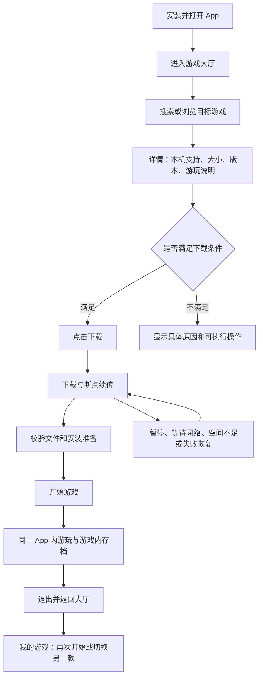

# NsA 游戏大厅二次开发需求说明书

版本：需求基线草案 v1.1。编写日期：2026-11-06（UTC+08:00）。

状态：供产品与研发评审的完整方案。文中的“必须”表示建议纳入相应版本的验收约束；新增商业选择和数值目标尚未获得用户逐项确认，不应写成已交付事实。

配套文档：[技术方案与接口约定](技术方案与接口约定.md)、[开发计划与验收矩阵](开发计划与验收矩阵.md)。

## 1. 产品目标与成功定义

产品交付一个 Android 游戏大厅 App。用户从发布入口安装 App，浏览适合本机的游戏，完成下载与自动准备，再在同一 App 中游玩、存档并返回大厅。面向普通用户的主流程无需电脑、USB 调试、命令行、编译工具、手工复制目录或每款游戏再安装一个 APK。

界面方向已由用户确定：大厅、发现、搜索、游戏详情、下载、安装准备、设置和管理默认竖屏；仅启动具体游戏并进入运行界面后切换横屏。退出游戏或启动失败回到大厅时恢复竖屏与原页面状态。

“下载后可以玩”包含四个不同的完成条件：文件下载完成、完整性与版本校验通过、安装准备完成、本机运行条件通过。只有这些条件都满足，按钮才显示“开始游戏”。

| 用户原始要求 | 产品必须交付的结果 | 本文对应范围 |
| --- | --- | --- |
| 用户下载该 App | 有固定应用身份、持续签名的可安装 APK 和版本更新入口 | APP、UPD |
| 在 App 游戏列表找到目标 | 有真实在线目录、搜索、详情、本机支持状态与我的游戏 | CAT |
| 点击下载 | 有游戏下载、进度、断点续传、校验、准备、失败恢复 | DL、PKG |
| 在 App 内加载并游玩 | 启动匹配运行模块、显示画面与声音、支持输入、存档、退出和再次进入 | RUN、SAVE |

端到端验收至少覆盖：全新手机安装 → 找到游戏 A → 下载 → 准备 → 实际游玩 → 游戏内存档 → 退出回大厅 → 杀掉并重开 App → 再次进入并读取已保存进度 → 下载并进入游戏 B → 返回游戏 A，确认资源和存档没有串用。

正式闭环必须使用两款能执行游戏逻辑、渲染场景并产生独立存档的真实测试内容。静态截图、播放视频、占位下载包、跳转到另一个已安装游戏 App，均不能替代这个验收。

## 2. 已知现状与新增建设范围

| 项目 | 现有情况 | 对本产品的影响 |
| --- | --- | --- |
| 制作工具 | `porter/` 已有提取、改写、着色器、宿主、APK、数据包和 USB 安装流程 | 复用为发布前制作工具，不作为普通玩家手机端的操作流程 |
| Android 运行层 | 有 Vulkan、音频、触屏手柄、设置、生命周期和存档处理 | 继续复用；需要接入统一大厅的启动、路径、进程和错误反馈 |
| 游戏配置 | `game_profile.h`、`android_profile.h` 在构建时按游戏生成 | 首版不能假定把目录中的游戏 ID 换掉就能支持另一款游戏 |
| 应用形态 | 当前每款游戏制作自己的 APK；`NativeActivity` 库名在清单中指定 | 需要新建统一 Android 工程和受控的多运行模块入口 |
| 进程 | 当前 Android 前端销毁时调用 `_exit(0)`，按一款游戏一个进程组织 | 大厅不能直接和游戏共用同一个长驻进程 |
| 内容包 | 已有 `mods/`、`RomFS/`、`shaders.dmsv` 等 | 可作为新包制作输入，但现有清单缺少在线发布、签名、下载与多版本管理信息 |
| 在线服务 | 未实现面向玩家的目录、下载、内容发布和兼容服务 | 需要新增后端、对象存储/CDN、运营管理和发布流程 |
| 当前真机 | 《旷野之息》1.9.0 在 Adreno 650 已进入场景，约 7–13 FPS | 属于实验运行；尚不满足正式推荐下载和流畅游玩的条件 |

源码依据：[现有架构](../ARCHITECTURE.md)、[按游戏构建](../../nxnative/dm/android/build.py)、[Android 前端](../../nxnative/dm/android/front_android.c)、[数据包](../../porter/datapack.py)、[APK 生成](../../nxnative/dm/android/apk/mkapk.py)。本次基线打包器的 `minSdkVersion=29`、`targetSdkVersion=36` 只是现有配置，不代表所有 Android 10 及以上手机已经通过游戏兼容测试。

## 3. 角色、使用场景与版本范围

| 角色 | 需要完成的事情 | 主要限制 |
| --- | --- | --- |
| 普通玩家 | 找游戏、下载、开始、继续、管理空间和存档 | 默认游客可浏览和使用开放内容；不要求了解底层实现 |
| 内测玩家 | 测试实验内容、查看限制、提交问题 | 实验区与正式推荐区分开；需要明确加入内测 |
| 内容运营 | 编辑介绍、封面、来源和上架范围 | 只能发布已经过审核的版本和素材 |
| 内容制作人员 | 准备输入、运行制作链、生成受控内容包 | 游戏原始输入与密钥留在受控制作环境 |
| 兼容测试人员 | 对指定手机、运行模块、驱动和游戏版本完成验证 | 测试结果绑定精确组合，不能只填“安卓可玩” |
| 平台管理员 | 管理发布权限、下架、应急阻断与审计 | 后台身份与普通玩家身份分离 |

优先级含义：P0 是最小可用版本不可缺少的能力；P1 是体验完善和扩展；P2 是更后续的能力。正式公开上线仍须满足其发布门槛，不能把实验版标签当成免验收。

| 首版 P0 | P1 | P2 / 本阶段不承诺 |
| --- | --- | --- |
| 单一 App、游客流程、游戏目录与搜索、详情、下载任务、断点续传、完整性校验、安装、双游戏切换、独立存档、离线启动、本机兼容判断、最小运营发布后台 | 收藏、更多排序、自动开始选项、账号、云存档、下载限速、更多设备、多语言、分区灰度与更精细修复 | 支付会员、广告体系、社交社区、任意游戏自动适配、云游戏、多人联机服务、任意模组执行、通用即时存档与跨设备无损快照 |

首版候选为少量通过验证的内容；目录条目可以增加，但每个可下载版本均须满足所需运行模块已包含在玩家 App 中。新游戏需要新模块时，先更新 App，再开放下载。移植新游戏和提高某款游戏帧率属于独立工作量。

## 4. 产品默认方案与待确认边界

| 决策 | 已确定 / 建议默认 | 需要项目方确认的内容 |
| --- | --- | --- |
| 代码归属 | 已确定：`wikigsroom/NsA-core` | 后续代码、配置、测试和必要文档进入该仓库 |
| 用户体验 | 已确定：同一 App 找游戏、下载并游玩 | 是否要把“下载完成后自动开始”作为默认；本文默认由用户再点“开始游戏” |
| 首发渠道 | 建议：官网 APK，持续使用同一签名 | 官网域名、发行区域、是否另做应用商店版本 |
| 用户身份 | 建议：游客优先，开放内容无需注册 | 是否有必须依账号判断的授权内容 |
| 内容来源 | 必须登记每款内容的可分发范围 | 首发真实游戏清单、授权材料、自有内容或开放许可内容 |
| 收费方式 | 建议首版不加入交易流程 | 免费、购买、订阅及其服务端权限模型 |
| Android 范围 | 建议首轮正式测试从 Android 12 / API 31、ARM64 开始 | 最低系统、支持设备、内存门槛；安装可用和每款游戏可玩分别确定 |
| 界面 | 已确定非游戏页面默认竖屏、游戏运行时横屏、大厅暗色调；建议简体中文优先，适配手机/平板 | 五套暗色竖屏风格待选；品牌名、图标、正式包名与其他语言 |
| 离线使用 | 建议已安装的开放内容可离线玩 | 特定授权内容是否另有有效期或联网限制，应单独说明 |
| 本机《旷野之息》 | 作为内部实验样本 | 是否投入专项性能修复，以及达到什么设备覆盖目标 |

公开游戏列表需要同时满足“有权提供该版本”“包可下载”“App 有匹配模块”“本机满足运行要求”。本地测试时能取得文件，只证明有测试输入，不自动代表可以向所有玩家提供下载。未确认可分发范围的内容保留在内部测试环境。

通过 Google Play 发布的版本不能直接照搬官网方案：当前内容包中的 `mods/` 是改写后的程序，包含执行代码；预装宿主 `.so` 并不会让整个下载包变成纯素材。Google Play 对从站外下载执行代码有明确限制，因此该渠道需要单独设计和核验交付路径，不能预先承诺上架。依据：[Google Play Device and Network Abuse](https://support.google.com/googleplay/android-developer/answer/16559646?hl=en)。

## 5. 用户旅程与页面结构

大厅建议使用“发现游戏 / 我的游戏 / 下载 / 设置”四个主入口。搜索是发现页的主要操作；详情可从发现页、搜索结果、我的游戏和下载任务进入。

| 页面 | 必须显示 | 主要动作 | 空状态 / 失败状态 |
| --- | --- | --- | --- |
| 首次打开 | 品牌、必要说明、联网与存储用途 | 进入大厅；后续按动作申请权限 | 离线仍允许进入空的本地库，不循环卡在启动页 |
| 发现游戏 | 封面、名称、类型、本机状态、下载大小 | 搜索、筛选、打开详情 | 有缓存则展示更新时间；无缓存则重试和进入我的游戏 |
| 搜索结果 | 关键词、结果数、支持状态 | 中文名、英文名和别名检索 | “未找到”附清空筛选或反馈入口，不推荐不存在的结果 |
| 游戏详情 | 简介、截图、版本、下载与安装大小、本机兼容、操作方式、已知限制 | 下载、继续下载、开始、更新、管理 | 唯一主按钮由实际状态决定，原因在按钮附近可见 |
| 下载中心 | 任务顺序、阶段、字节进度、速度、剩余时间估计 | 暂停、继续、取消、重试、调整队列 | 显示等待网络、系统暂停、空间不足或链接更新等原因 |
| 我的游戏 | 已安装游戏、最近游玩、更新与异常状态 | 开始、打开详情、删除资源、存档管理 | 没有游戏时引导发现页，不展示虚假的“最近游玩” |
| 启动准备 | 正在检查、正在准备画面等真实阶段 | 取消启动、查看失败解决方法 | 不以一个无限转圈替代错误；超时后可返回大厅 |
| 游戏画面 / 暂停菜单 | 场景、输入、暂停与退出 | 触屏/手柄操作、画面设置、返回大厅 | 崩溃由大厅提供重新打开和问题反馈 |
| 存储和存档管理 | 游戏资源、缓存、临时文件、存档分别占用 | 清缓存、卸载游戏资源、导入导出存档 | 删除行为分别说明影响，不把清缓存做成清存档 |
| 设置和帮助 | 网络偏好、设备支持、App 版本、隐私、许可、问题反馈 | 更新 App、导出诊断、恢复默认设置 | 不把解密密钥、ADB、编译器作为普通用户必填项 |

游戏详情主按钮规则和下载、安装、可玩性状态见下文；这些状态是所有页面的共同事实，不能由每个页面独立推测。

## 6. 首次使用、应用身份与基础功能

| 编号 | 优先级 | 需求与验收约束 |
| --- | --- | --- |
| APP-01 | P0 | 一个固定包名、一个桌面入口；大厅和游戏属于同一安装包。首次测试旧单游戏 App 的包名不直接作为正式产品身份；正式包名与签名在发布前确定。 |
| APP-02 | P0 | 全新安装后可直接进入游客大厅；开放内容下载和游玩不被强制注册阻断。若某内容需要账号授权，只在该内容入口说明并验证。 |
| APP-03 | P0 | 首次启动执行轻量能力采集并保留结果；昂贵图形探测以受控任务执行。主界面可先显示，不因探测长时间白屏。 |
| APP-04 | P0 | 权限按用户动作申请；下载、通知、存档导出分别处理。拒绝通知后仍能在 App 内看到任务状态，并按系统允许的机制工作。默认应用目录不要求全部文件访问权限。 |
| APP-05 | P0 | 无网络时可打开大厅和我的游戏；已安装且允许离线的内容仍可启动。首次没有目录缓存时明确解释，不伪造在线列表。 |
| APP-06 | P0 | 简体中文、清晰文字和适配手机/平板；所有非游戏页面默认竖屏，包括游戏详情、下载和启动准备，手机四入口导航置底；关键触控目标建议不少于 48dp；下载进度与错误不能只靠颜色表达，基础流程可被读屏识别。 |
| APP-07 | P0 | 面向玩家的按钮使用“下载、准备中、开始游戏、返回大厅”等可理解语言。构建 ID、图形环境变量和目录细节放在高级诊断中。 |
| APP-08 | P0 | 前后台切换、来电和系统重建后恢复最近页面与实际任务状态；不因重开页面重复创建下载或错误宣称游戏仍在运行。 |

## 7. 游戏目录、搜索与兼容展示

| 编号 | 优先级 | 需求与验收约束 |
| --- | --- | --- |
| CAT-01 | P0 | 服务端维护有发布状态的游戏目录；用户只获得其发行区域、内容范围和测试资格允许看到的条目。原始 profile 目录不能直接等同公开目录。 |
| CAT-02 | P0 | 支持名称、英文名、中文别名的搜索，大小写和首尾空格不影响结果；结果分页且可以重试，不重复或漏掉同一页内容。 |
| CAT-03 | P0 | 首版提供“本机可玩、已安装、类型”等必要筛选及清除筛选；按最新上架排序。收藏和复杂推荐算法列为 P1。 |
| CAT-04 | P0 | 每款游戏有独立详情，显示游戏版本、语言、操作支持、下载大小、安装后大小、安装期间所需空间和已知限制。帧率证据附机型与测试范围，不写无条件“全机型 60 帧”。 |
| CAT-05 | P0 | 本机状态至少区分“已验证可玩、实验运行、未验证、不支持、需要更新 App”；必须绑定内容版本、运行模块、驱动与设备条件，而非只按手机品牌判断。 |
| CAT-06 | P0 | 只有可公开分发、内容包完整且存在匹配运行模块的版本可供正式下载。缺少对应模块时显示“更新 App 后可下载”，不先下载十几 GB 再告知无法启动。 |
| CAT-07 | P0 | 同一游戏条目关联同一个下载与安装记录；从列表、搜索和详情重复点击不会创建第二份资源副本。 |
| CAT-08 | P0 | 目录、封面与最近一次兼容结果可缓存。离线或目录更新失败时展示缓存时间；旧缓存不能覆盖本地已知的包撤回或严重故障限制。 |
| CAT-09 | P0 | 正式区默认优先展示本机已验证内容；实验游戏仅在用户主动进入实验区后允许尝试，并显示实际限制。本机《旷野之息》目前只能进入该层级。 |
| CAT-10 | P1 | 支持收藏、更多排序、最近搜索和后续个性化入口；不采集与这些功能无关的设备或其他 App 使用信息。 |

## 8. 下载任务与网络行为

| 编号 | 优先级 | 需求与验收约束 |
| --- | --- | --- |
| DL-01 | P0 | 点击下载先检查内容访问资格、本机支持、App/模块版本和可用空间；通过后建立唯一持久化任务。失败给出可执行原因，不创建注定不能启动的正式任务。 |
| DL-02 | P0 | 下载前显示下载量、安装后大小、当前还需可用空间；默认仅 Wi-Fi / 非计费网络。首次使用移动网络或计费网络需要用户明确选择，重试不重复询问同一任务已确认的选择。 |
| DL-03 | P0 | 展示已下载字节、总字节、百分比、速度和剩余时间估计；未知总量时显示已下载量与当前阶段。速度和 ETA 不稳定时不展示伪精确值。 |
| DL-04 | P0 | 支持暂停和继续；已验证完成的分段保留。停止按钮和通知操作对应同一个任务，重复操作保持幂等。 |
| DL-05 | P0 | 进程被回收或设备重启后，任务记录和已验证分段可恢复。系统不允许后台立即继续时显示等待用户继续；不承诺所有厂商手机都能永久后台下载。 |
| DL-06 | P0 | 采用 HTTP Range 与稳定对象标识恢复；ETag、长度或版本改变时不得拼接两份内容。链接过期可续签同一不可变对象，已校验分段继续复用。 |
| DL-07 | P0 | 一款游戏只存在一个活动下载任务；首版同时下载 1 款，其余排队。多次点击下载、任务恢复和列表刷新不增加重复连接或副本。 |
| DL-08 | P0 | 取消任务需说明将删除未完成文件；仅清理该任务拥有且未被其他任务引用的临时数据，不影响已安装版本或存档。 |
| DL-09 | P0 | 断网、超时、429 和服务端短暂失败可以有限退避重试；鉴权失效、空间不足、签名错误等分别处理。达到重试上限后等待用户，不无限消耗流量。 |
| DL-10 | P0 | 下载大包按适用 Android 版本接入系统允许的用户主动传输机制与可见状态；系统暂停、用户停止、通知受限都能恢复为一致任务状态。 |
| DL-11 | P0 | Wi-Fi 转到移动网络、网络失去互联网或计费属性改变时重新检查已授权网络策略；默认暂停，不悄悄继续消耗移动数据。 |
| DL-12 | P0 | 下载过程中持续检查剩余空间和写入错误；空间不足时保存可恢复进度，并给出清理入口，不把半包标成已完成。 |
| DL-13 | P0 | 校验、解包、安装准备与联网下载显示为不同阶段。文件到 100% 时只表示下载阶段结束；准备结束前不能变成“开始游戏”。 |
| DL-14 | P0 | 用户进入游戏时默认暂停其他资源下载与安装重任务，避免争夺 I/O、内存和温度预算；退出后按网络和用户偏好恢复，不覆盖游戏正在使用的文件。 |
| DL-15 | P1 | 支持限速、调整任务顺序和“完成后开始”；自动开始仅在 App 前台、用户主动选择且没有其他游戏运行时执行，后台完成以通知提示。 |

Android 14 起的 UIDT 用于用户主动发起的长传输，仍可能被系统条件限制；Android 15 及以上目标版本的 `dataSync` 前台服务存在运行时限。下载管理必须持久化和可恢复，不能依赖一个永久后台服务。依据：[UIDT](https://developer.android.com/develop/background-work/background-tasks/uidt)、[前台服务时限](https://developer.android.com/develop/background-work/services/fgs/timeout)。

## 9. 内容校验与安装准备

| 编号 | 优先级 | 需求与验收约束 |
| --- | --- | --- |
| PKG-01 | P0 | 游戏包由发布前制作链生成，包含匹配的改写模块、资源、着色器和声明信息。普通玩家下载后不承担原始 NSP/XCI 解包、密钥配置、完整着色器转换或宿主编译。 |
| PKG-02 | P0 | 客户端先验证发行清单签名，再校验对象、分段和解包文件；未经验证的文件不能交给运行入口。只有哈希而没有可信清单来源，不足以证明包可信。 |
| PKG-03 | P0 | 内容包必须声明游戏 ID、游戏版本、模块 Build ID、运行模块 ID、内容包格式、着色器格式/转换链和最低 App 要求；任一不匹配都阻止正式安装。 |
| PKG-04 | P0 | 解包采用受控临时目录，限制路径、文件数量、展开大小和链接类型；拒绝越界路径、重复冲突、非法链接和超过声明范围的内容。失败时不污染已有安装。 |
| PKG-05 | P0 | 下载、解包和旧版并存的峰值按当前真实字节数计算；再次执行空间检查。手机 `/data` 与 `/sdcard` 可能是同一卷的视图，不能相加当作两份容量。 |
| PKG-06 | P0 | 安装使用不可变版本目录和提交记录。文件完整落盘并完成标记后，才能切换有效版本；任意阶段断电或进程退出，都能恢复为旧版可用或新版本待恢复。 |
| PKG-07 | P0 | 每个游戏的资源、改写模块、存档、设置、缓存、日志和临时文件分别命名空间隔离；目录路径由受信任的客户端规则生成，不能直接接受服务端任意绝对路径。 |
| PKG-08 | P0 | 首次创建本机图形缓存可显示独立准备状态，后续复用缓存；缓存键包含对应运行模块、图形驱动、着色器与系统条件。损坏缓存可重建，不能要求用户重下完整游戏才能清缓存。 |
| PKG-09 | P0 | 安装完成写入可核对的本地记录。启动时做关键文件和元数据快速检查，完整校验提供按需修复入口；文件缺失或损坏显示“需要修复”，不保留可启动的假状态。 |

## 10. 游戏启动、输入与返回大厅

| 编号 | 优先级 | 需求与验收约束 |
| --- | --- | --- |
| RUN-01 | P0 | 开始前再次检查游戏、包版本、模块、设备、有效安装和当前会话；以一次性会话描述启动本次游戏，不依赖上一次遗留的全局路径。 |
| RUN-02 | P0 | 游戏在同一 App 的运行界面中呈现，使用独立普通 Android 进程；一次只允许一个游戏会话。主进程负责大厅和任务，不被原生游戏退出一并结束。 |
| RUN-03 | P0 | 启动阶段区分检查资源、加载游戏、准备画面和进入游戏；原生层返回明确事件。大厅检查与准备页保持竖屏，仅进入游戏运行界面时切横屏；退出、取消或启动失败返回大厅恢复竖屏和原页面。超时可返回、查看帮助或重试；首帧出来不自动等于用户已能操作。 |
| RUN-04 | P0 | 复用并适配触屏手柄，支持位置、尺寸、透明度与每游戏保存的布局；多点触控可同时移动和按键，安全区域不被系统导航遮挡。 |
| RUN-05 | P0 | 标注并验证游戏所需的输入方式；对已声明支持的物理手柄，连接、断开和切到触屏时释放旧按键，不出现持续移动。蓝牙或 USB 手柄不成为触屏可玩的前置要求。 |
| RUN-06 | P0 | 暂停菜单可返回游戏、调整已验证的画质/帧率目标、控制布局、音量和返回大厅。画质目标只表示上限或设置，不承诺所有设备达到该帧率。 |
| RUN-07 | P0 | 返回大厅前提示未由游戏保存的进度可能丢失；运行器只保证已经提交的存档落盘，不承诺任意时刻强制自动存档。正常退出有完成通知和超时恢复。 |
| RUN-08 | P0 | A→大厅→B→大厅→A 在新游戏进程中完成，清理旧会话的窗口、音频、输入和进程资源；禁止直接复用已初始化的原生全局状态。 |
| RUN-09 | P0 | 切后台时暂停或按已验证策略挂起画面、声音和输入。进程尚存时可恢复；被系统回收后重新启动游戏并读取最近已提交存档，不伪装成支持即时快照。 |
| RUN-10 | P0 | 游戏进程崩溃或退出后，大厅能恢复或重新构建，显示该会话失败原因与反馈入口；重试最多由用户主动触发，不无限循环拉起。 |
| RUN-11 | P0 | 来电、耳机变化、锁屏、亮暗模式按应用/游戏支持范围处理；手机旋转不能让非游戏页面提前进入横屏，方向切换不能重复创建会话；暂停时不持续后台播放。大厅配置变更不能误触发正在运行游戏的全进程退出。 |
| RUN-12 | P1 | 陀螺仪、振动、外接屏、触控直传等按游戏能力声明逐步支持；游戏详情不能把未验证功能显示为已支持。 |

进入第一张场景、能移动一次或菜单显示高帧率，只能作为部分证据。正式“可玩”还要检查存档与读档、典型游玩段落、持续性能、音画与输入，见第 17 节和验收矩阵。

## 11. 存档、设置与数据删除

| 编号 | 优先级 | 需求与验收约束 |
| --- | --- | --- |
| SAVE-01 | P0 | 存档按游戏 ID、玩家本地档案和存档格式隔离；只有同一逻辑游戏可在兼容版本间共享。游戏 B 不能读取游戏 A 的存档目录。 |
| SAVE-02 | P0 | 游戏内保存后，等待已提交事务完成；正常退出、重开 App 与重新进入游戏后验证读档。本机现有《旷野之息》只验证到写入，读档仍需补测。 |
| SAVE-03 | P0 | 删除已安装游戏资源默认保留存档、控制布局和必要设置；重新下载后可继续使用。单独“删除存档”需展示游戏名和影响，并再次确认。 |
| SAVE-04 | P0 | 提供导出已提交存档至系统选择的持久位置，以及导入相应游戏存档。导入前验证格式、大小与游戏标识，并备份旧档；不在游戏运行中直接替换存档。 |
| SAVE-05 | P0 | 内容或 App 更新前保留可恢复的存档版本；回退内容版本前检查存档兼容。新版存档不能被未声明兼容的旧版直接覆盖或静默降级。 |
| SAVE-06 | P0 | 清图形缓存、清下载临时文件、卸载游戏资源、重置设置、删除存档分成不同动作，并分别显示可释放空间和影响范围。不能以“修复游戏”为由清掉存档。 |
| SAVE-07 | P1 | 账号和云存档后续加入；同步需有游戏/版本/内容哈希、修改时间与冲突副本。离线可保存，联网冲突由用户选择，不默认用最后上传者覆盖本地。 |
| SAVE-08 | P0 | 说明卸载整个 App 会删除应用私有数据；App 内部导出的文件不是卸载保护备份。旧单游戏测试 App 的存档通过其导出入口迁移，统一 App 不假定能跨包名读取其私有目录。 |

## 12. 游戏更新、App 更新与回退

| 编号 | 优先级 | 需求与验收约束 |
| --- | --- | --- |
| UPD-01 | P0 | 发现更新时分别说明“App 更新”和“游戏内容更新”。运行模块或驱动随首版 APK 更新；新内容必须和该 App 实际包含的模块匹配。 |
| UPD-02 | P0 | 正在运行的内容版本保持固定；下载/准备新版可以排队，但不得覆盖旧版正在使用的文件。有效版本切换在会话结束后进行。 |
| UPD-03 | P0 | 新版准备失败仍可使用未撤回的旧版；安装和首启健康检查结束前保留已承诺的恢复条件，不因空间紧张偷偷删除唯一可运行版本。 |
| UPD-04 | P0 | 自动回退只适用于已声明内容与存档兼容的情况；不兼容时保留备份并提供说明，不把“回退引擎”当作任意存档格式都可读取。 |
| UPD-05 | P0 | 官网渠道提供签名一致、versionCode 递增的 App 更新；显示版本说明和大小，由系统完成安装确认，不承诺普通 App 可静默安装或无感降级 APK。 |
| UPD-06 | P0 | 下架和紧急阻断分开：普通下架停止新下载；确认严重故障的特定版本可在下一次同步后阻止再次启动并给恢复入口。不远程删除玩家存档；离线设备不能保证即时收到服务端撤回。 |
| UPD-07 | P0 | 更新目录或配置失败不会影响已经安装、允许离线且没有本地阻断记录的游戏启动。要求联网的特殊内容在详情中明确说明有效条件。 |
| UPD-08 | P1 | 支持按设备组、App 版本与测试资格灰度发布，以及后续按文件/分段增量修复；首版使用完整包更新，不假装已具备节省流量的二进制差分。 |

## 13. 内容制作、发布后台与运营

| 编号 | 优先级 | 需求与验收约束 |
| --- | --- | --- |
| OPS-01 | P0 | 后台编辑游戏 ID、名称与别名、类型、介绍、封面截图、语言、控制方式及已知限制；玩家目录和这些信息由同一份发布数据生成。 |
| OPS-02 | P0 | 每个可下载版本登记内容来源、可分发范围、发行区域和必要凭据引用；未确认范围的版本不能进入公开发布状态。材料不作为玩家公开接口返回。 |
| OPS-03 | P0 | 发布制作保留输入版本、模块 Build ID、核心提交、profile、补丁、着色器转换链和构建参数；复用现有 porter，但新增可追溯的统一内容包步骤。 |
| OPS-04 | P0 | 上传对象存储后完成真实下载、摘要和解包验证，生成签名发行清单。对象采用不可变版本地址，禁止原地替换一个已发布 release 的字节内容。 |
| OPS-05 | P0 | 一条正式可玩记录必须附设备、系统、GPU、驱动摘要、App/模块/包版本、测试时长、操作/存档结果和帧时间证据；实验和未验证结果不能提升为正式可玩。 |
| OPS-06 | P0 | 流程至少有草稿、制作中、待验证、内测、正式发布、下架；只有所需审核与依赖全部通过后才上架。核心候选模块未进入 APK 时不得对旧 App 开放。 |
| OPS-07 | P0 | 支持内容范围、渠道与测试资格控制，以及单版本撤回和新下载阻断；管理员和运营权限分离，普通玩家接口不能执行发布或签名。 |
| OPS-08 | P0 | 可查看目录、下载会话、失败原因、内容 CDN 可用性和发布状态；区分玩家取消、网络失败、安装失败和运行失败，避免把它们计为同一种故障。 |
| OPS-09 | P0 | 有内容反馈和问题工单入口；诊断由用户主动附加，包含脱敏的版本与错误码，不上传密钥、原始游戏程序、完整存档或其他应用数据。 |
| OPS-10 | P0 | 发布、下架、权限修改和紧急阻断留审计记录；签名密钥与私有内容输入不进入 Git。原项目许可与第三方组件许可资料随发行维护。 |

## 14. 客户端状态与按钮规则

游戏的“目录状态”“本机兼容状态”“安装状态”“下载状态”“运行状态”分别存储，组合决定界面。它们不能合并为一个会相互覆盖的 `status` 字符串。

| 当前情形 | 主按钮 / 显示文字 | 允许操作 | 必须保留的事实 |
| --- | --- | --- | --- |
| 未安装、条件满足 | 下载 | 下载、看详情 | 选定 release 和实际所需空间 |
| 缺少运行模块 | 更新 App 后可下载 | 更新 App | 不新建游戏大包任务 |
| 本机明确不支持 | 当前设备不支持 | 查看原因 | 缺少的必要特性或已验证故障 |
| 未验证 / 实验 | 正式区不提供普通开始入口 | 查看限制、加入允许的内测 | 不混成正式可玩 |
| 排队 | 等待下载 | 调整/取消 | 队列顺序与所属任务 |
| 下载中 | 下载进度、暂停 | 暂停、取消 | 已验证字节数和不可变内容身份 |
| 暂停 / 等待网络 | 继续下载 / 等待 Wi-Fi | 继续、取消、更改网络偏好 | 暂停原因不能丢失 |
| 文件下载完成 | 正在校验 / 准备 | 取消准备、看阶段 | 还没有成为可运行安装 |
| 安装完成 | 开始游戏 | 启动、管理 | 有效版本和完整标记 |
| 启动 / 运行中 | 正在启动 / 返回游戏 | 返回当前会话 | 不再建立第二个游戏进程 |
| 有内容更新 | 开始游戏，附更新入口 | 玩旧版或按条件更新 | 新旧版本及存档兼容信息 |
| 安装损坏 | 修复 | 修复、反馈 | 保留存档和旧版恢复信息 |
| 普通下架后已安装 | 按仍有效的使用条件显示 | 已安装内容按许可与本地规则使用 | 停止新下载不等于强制删除存档 |
| 严重故障已在本地生效 | 此版本暂不能启动 | 修复、回退或更新 | 阻断范围及可执行恢复办法 |

“继续游戏”表示再次启动并使用最近已提交存档；若游戏需要在自身菜单选择继续，应保留它的正常流程。首版不承诺任意暂停时刻的内存快照恢复。

## 15. 关键异常处理

| 触发 | 用户看到的原因 | 系统动作 | 用户下一步 |
| --- | --- | --- | --- |
| 无网络 / 服务器暂不可用 | 网络连接不可用 / 目录暂不可用 | 展示缓存，保留任务 | 重试或玩已安装游戏 |
| 下载地址过期 | 正在恢复连接 | 为同一 release/对象续签 | 通常无需操作，失败后重试 |
| HTTP 返回的不是下载内容 | 下载服务响应异常 | 拒绝 HTML 错误页/错误范围，保留可信进度 | 重试或反馈 |
| 包签名或内容摘要不匹配 | 文件校验失败 | 不运行；仅按策略重取失败部分或重下 | 重试或联系客服 |
| 空间不足 | 还需多少空间 | 暂停，保留可恢复数据 | 管理资源或取消 |
| App 模块太旧 | 需要更新 App | 在大包下载前拦截 | 更新 App 后继续 |
| 硬件或驱动缺必要特性 | 这款游戏暂不支持本机 | 不提供正式开始入口 | 查看本机可玩内容 |
| 系统停止后台任务 | 下载已暂停 | 记录停止原因和分段 | 打开 App 继续 |
| 安装或切换有效版时中断 | 正在恢复安装 | 根据提交记录修复数据库与文件状态 | 等待或重试，不清存档 |
| 游戏崩溃 | 本次游戏运行异常 | 结束会话、释放资源、保留已提交存档 | 返回大厅、重试、反馈 |
| 温度或内存压力过高 | 设备当前负载过高 | 按实际系统信号降低负载、提示暂停或退出 | 降温/释放资源后重试 |
| 旧版与新存档不兼容 | 此存档需要更新的游戏版本 | 阻止静默回退或覆盖 | 更新游戏或手动选择兼容备份 |

错误提示必须指向一个真实的可执行动作。技术栈异常、服务器堆栈、密钥路径和开发环境变量不直接显示给普通玩家。

## 16. 非功能需求与建议质量目标

以下数值是建议验收目标，需在技术验证后按参考设备确认；它们不是当前项目已经达到的数据。

| 编号 | 优先级 | 要求与测量口径 |
| --- | --- | --- |
| NFR-01 | P0 | 大厅在参考机有缓存时冷启动到可交互的 p95 目标不超过 3 秒；网络请求不能阻塞主线程。正式目录第一页正常网络下可见内容的 p95 目标不超过 2 秒，服务端响应与网络时间分别记录。 |
| NFR-02 | P0 | 大包下载和解包流式处理，内存不随包体大小线性增长；文件长度、进度和空间计算使用 64 位。必须覆盖超过 4 GiB、超过 10 GiB 和约四万个文件的真实规模。 |
| NFR-03 | P0 | 目录核心 API 月可用率建议目标 99.5%，不含已公告维护；没有监控周期前不声称已达标。服务故障时已安装的离线内容仍可使用。 |
| NFR-04 | P0 | 大厅稳定性和原生游戏稳定性分别计量；正式候选至少完成规定故障恢复用例和参考机 30 分钟游玩测试，不以一次首帧或测试脚本通过替代。 |
| NFR-05 | P0 | 每个正式可玩设备组合有帧率、帧时间、游戏速度和温度证据；测量方法与建议门槛见第 17 节。未通过性能门槛不能标成该机型“已验证可玩”。 |
| NFR-06 | P0 | 采用 HTTPS、发行清单验签、完整性校验和后台身份验证。发布私钥、prod.keys、APK 签名材料不下发到玩家端；用户提交的诊断先脱敏，上传由用户主动选择。 |
| NFR-07 | P0 | 用户界面、下载、安装、版本与会话数据有统一事实来源和可恢复事务记录；进程退出、设备重启与存储中断不会把半成品标成可玩。 |
| NFR-08 | P0 | 兼容矩阵覆盖目标 Android 版本、GPU/驱动、内存条件、触屏/手柄、横竖屏与网络异常；基于实际能力和证据放行。现有打包器支持安装的系统版本不能直接作为覆盖承诺。 |
| NFR-09 | P0 | 工程沿用 NsA-core、明确上游来源和组件许可；所有本地新增文件位于指定路径，不用本地虚拟化。产品、原生适配和服务端变更分别有可追踪版本，测试记录不泄露私人设备标识。 |
| NFR-10 | P0 | 有下载、准备、启动、运行和返回大厅各阶段的日志与指标；记录错误码和精确版本组合。设备本地日志建议滚动上限 50 MB / 7 天，诊断服务建议 30 天保留期，作为待确认运营默认值。 |

首版客户端建议采用 Android 原生界面。当前 Android/Play 目标 API 要求应按发布时官方政策复核；本次核对官方页面说明自 2026-08-31 起新应用和更新要求 API 36 或以上，现有打包器也设为 36。符合目标 API 只是条件之一，不代表本产品的代码下载模式已获渠道认可。依据：[目标 API 要求](https://support.google.com/googleplay/android-developer/answer/11926878?hl=en)。

## 17. “可玩”的分级和发布门槛

兼容性判断以 `(游戏 release, App 构建, 运行模块, 驱动, 设备/GPU, 系统版本)` 为最小证据组合。泛称“骁龙支持”“Vulkan 1.3 支持”不能代替它。

| 分级 | 允许的证据和展示 | 能否进入正式推荐 |
| --- | --- | --- |
| 未验证 | 有目录或构建产物，没有本机操作证据 | 否 |
| 可以启动 | 初始化、开场或首帧成功 | 否 |
| 实验运行 | 已进入可操作场景，存在明显卡顿、缺画面、告警或未完成稳定性检查 | 否，内部或明确选择的实验区可提供 |
| 已验证可玩 | 通过规定场景、输入、音画、保存与读档、返回大厅、性能及持续测试 | 是，仅对其证据范围有效 |
| 已知不支持 | 必要图形能力不满足或有可复现严重失败 | 否，显示原因 |

建议正式可玩测试集：

1. 首次下载、首次启动和再次启动都通过；首次管线准备时间单独记录。
2. 连续操作至少 30 分钟，覆盖启动后的可操作场景、一个典型负载场景和一次场景切换；加载区间提前标记，不临时剔除不利帧。
3. 触屏移动、镜头、动作与多点输入正常；有音频输出且无持续严重破音/错位。
4. 游戏内存档、正常退出、重启整个 App 后读档通过；两款游戏切换后存档和设置仍独立。
5. 无崩溃、ANR、存档损坏、阻断操作的画面缺失和未解决的严重运行错误。新出现的 `[RED]` 或验证错误需要说明和处置，不能直接忽略。
6. 对原目标 30 FPS 的游戏，建议典型游玩段平均至少 27 FPS、p95 帧时间不高于 50 ms、1% low 至少 20 FPS；60 FPS 游戏相应建议为 54 FPS、25 ms、40 FPS。每款游戏可提出有证据的其他标准，但必须在上架前明示，不能把达不到的目标写成实测。
7. 游戏逻辑推进速度需正常；有可测时间步的游戏建议为预期速度的 0.95–1.05。世界内昼夜时钟不是现实计时的替代品。
8. 根据系统热状态和该机型实测限制处理温度；分别记录前后段性能，不能只发布冷机开场峰值。出现持续过热提示或明显降频影响可玩性时保留实验标签。

当前《旷野之息》真机结果：约 7–13 FPS、约 14 分钟同一进程证据、成功写档但未验证读档，仍有缓冲区范围告警，测试后电池实测 49.5℃并结束试跑。它不满足上面的正式可玩标准；49.5℃是这次观察值，不是所有机型通用的温控阈值。《王国之泪》需要独立的版本与设备验证，不能继承该结论。

## 18. 内容生命周期、离线与用户数据规则

发布链：内容范围登记 → 输入版本确认 → 制作 → 完整性验证 → 设备验证 → 内测 → 正式发布 → 监控 → 更新/下架。

开放内容首次下载需要网络；完成安装与必要本机准备后可离线运行。离线时采用最近一次验证通过的清单和已知阻断记录，不要求仅为了展示目录而强制联网。若未来加入按账号授权的内容，其离线有效期要成为单独、可展示的产品规则。

平台停止提供新下载，与已安装内容是否还能运行，是两个操作。服务器状态不会在完全离线的设备上即时生效。应急策略按准确版本范围执行，避免一款游戏故障导致所有游戏停用。

| 数据 | 用户删除游戏资源时 | 更新 App/游戏时 | 卸载整个 App 时 |
| --- | --- | --- | --- |
| 已安装资源 | 删除 | 按新旧版本与回退规则管理 | 应用专用目录由系统删除 |
| 游戏存档 | 默认保留 | 保留并按兼容要求备份 | 私有目录随 App 删除，提醒先导出 |
| 图形缓存 | 可清理 | 不兼容时重建 | 删除 |
| 已完成/未完成下载临时文件 | 按引用和任务状态清理 | 不将旧任务误作新版 | 删除 |
| 用户导出到系统选定位置的备份 | 保留 | 保留 | 不随应用专用目录清理；仍需用户管理其保存位置 |
| 诊断日志 | 按容量和时间滚动 | 保留必要排错记录 | 本地私有副本删除；已同意上传的副本按服务端保留策略处理 |

应用专用目录的数据通常会随卸载删除；要在卸载后保留的备份应通过系统文件选择器导出到用户选定位置。依据：[Android 存储说明](https://developer.android.com/training/data-storage)。

## 19. 空间、下载成本与容量规划

空间预算必须按发布包实测，不统一写死“有 15 GB 就能下载”。定义：A 为尚需保留的压缩下载包，B 为新安装展开内容，C 为启动缓存/额外工作空间，S 为保留余量。第一次安装前的基本预算为 `A + B + C + S`；如果部分下载已占用空间，按尚未分配的剩余量计算，不能重复计数。

现有《旷野之息》散文件数据约 15.35 GB；37 MB 是单游戏实验 APK，不能当作未来统一大厅 APK 的大小。当前已测在线压缩包大小尚不存在。举例若 A=10 GB、B=15.35 GB、C=1 GB、S=2 GB，则至少需要约 28.35 GB，这是公式演算而不是发布包实测；生产策略的余量由技术方案另定。

旧版保留占用的是已经使用的空间；计算“还需多少可用空间”时不能再次把它与当前空闲容量混算。更新需要新包与旧版并存，在新版本健康检查前不以删除旧版来虚增可用空间。以前 USB 分批传输采用的 35 GB 预算，不能直接当作未来所有在线包的统一上限。

平台费用至少由存储、CDN 出网、请求次数、API/数据库、构建、测试设备和人工构成。月下载流量约为 `各版本实际下载次数 × 对应传输字节数 + 更新/重试流量`。同一个 10 GB 包完成 1,000 次下载就是约 10 TB 传输，下载成本应按实际服务商和地区单价测算；本文不虚构报价或免费额度。

## 20. 建议实施顺序和范围退出条件

| 阶段 | 主要结果 | 进入下一阶段的条件 |
| --- | --- | --- |
| G0 技术与内容可行性 | 同 APK 双模块、游戏进程退出恢复、目录隔离、真实可分发测试内容、目标系统代码加载验证 | 两款真实内容完成切换与独立存档；代码交付渠道和内容范围没有未解决阻断 |
| G1 纵向闭环 | 小型真实目录 → 下载 → 校验 → 准备 → 游戏 → 存档 → 回大厅 | 全新安装设备走通完整链路，不能依赖已存在的 USB 安装 |
| G2 可恢复安装与运营 | 大包、断点、空间、更新、发布后台、诊断 | 异常和重启用例通过，状态一致，失败可恢复 |
| G3 发布候选 | 正式可玩设备矩阵、持续测试、用户资料与安装说明 | 产品、内容、设备兼容、服务端和发行门槛全部满足 |
| G4 扩展 | 更多游戏、设备、账号和云存档 | 每项新增能力有对应验收，不降低既有存档与安装一致性要求 |

G0 失败应保留调查结果并修订方案，不以“从大厅跳到外部单游戏 APK”作为同一目标的完成证明；如产品方主动接受这种形态，应另立范围变更记录。

本轮文档的交付物是可开发的需求基线、技术约定、任务依赖和验收矩阵。它不表示完成统一大厅代码、部署目录/下载服务、获得首发内容分发范围或解决当前手机上的低帧率问题。

## 21. 待决策清单与变更规则

| 决策编号 | 需要确定的内容 | 建议默认 | 最迟影响点 |
| --- | --- | --- | --- |
| DEC-01 | 产品名、正式应用包名与签名保管 | NsA 为工作名，包名发布前固定 | 首个可对外安装版本前 |
| DEC-02 | 官网首发还是应用商店同步首发 | 官网 APK；Play 交付模式独立评估 | G0 结束前 |
| DEC-03 | 第一批真实可分发游戏与版本 | 两款已获分发范围且已适配内容 | G0 / G1 真游戏验收前 |
| DEC-04 | 首批正式参考机、系统、RAM/存储要求 | Android 12+ ARM64，按 GPU 实测收敛；现有 Adreno 650 先为实验机 | G0 设备计划前 |
| DEC-05 | 游客、账号、授权访问和收费 | 游客 + 开放内容；无交易 | 后端接口与 UI 范围冻结前 |
| DEC-06 | 地区、语言、内容素材与公开测试范围 | 简体中文，明确内测名单/范围 | 首次内容发布前 |
| DEC-07 | 下载自动开始、移动网络、并发和余量策略 | 手动开始；默认非计费网络；单下载 | 下载模块开发前 |
| DEC-08 | 是否专项提升《旷野之息》/《王国之泪》的本机表现 | 单独立项，不作为大厅壳层能自动解决的问题 | 首发游戏确认前 |
| DEC-09 | 云服务预算、日志保留、数据地区和服务目标 | 按第 16、19 节建议值测算后定 | 服务部署前 |

需求修改需记录受影响的功能编号、内容包/接口版本、兼容设备与验收用例。评审通过后冻结一个可交付范围；后续新增支付、社交、任意游戏或强制云存档，不能在不改排期和验收的情况下默认为首版工作。
